# ESQueryStudio · Elasticsearch 查询工作台

> **为 Spring Boot 而生的 Elasticsearch 查询工作台，控制台覆盖 Elasticsearch 6.7 → 9.x。**
> 六种查询模式共用同一个现场：DSL 构建器与原始编辑器双向同步、mapping / analyzer / 版本感知的补全与 lint、
> 打分树与 Profile 火焰图。嵌进宿主后共享登录态、路由和权限，53 个页面收敛成 11 个功能包。

[](https://dengmeiluan.github.io/esquerystudio/)
[](https://github.com/dengmeiluan/esquerystudio/releases)
[](https://github.com/dengmeiluan/esquerystudio/actions/workflows/ci.yml)
[](https://openjdk.java.net)
[](https://spring.io/projects/spring-boot)
[](https://www.elastic.co)
[](extensions/chrome/README.md)
[](LICENSE)
[](#贡献)
[](https://linux.do)
[](https://github.com/dengmeiluan/esquerystudio/actions/workflows/codeql.yml)
[](https://securityscorecards.dev/viewer/?uri=github.com/dengmeiluan/esquerystudio)

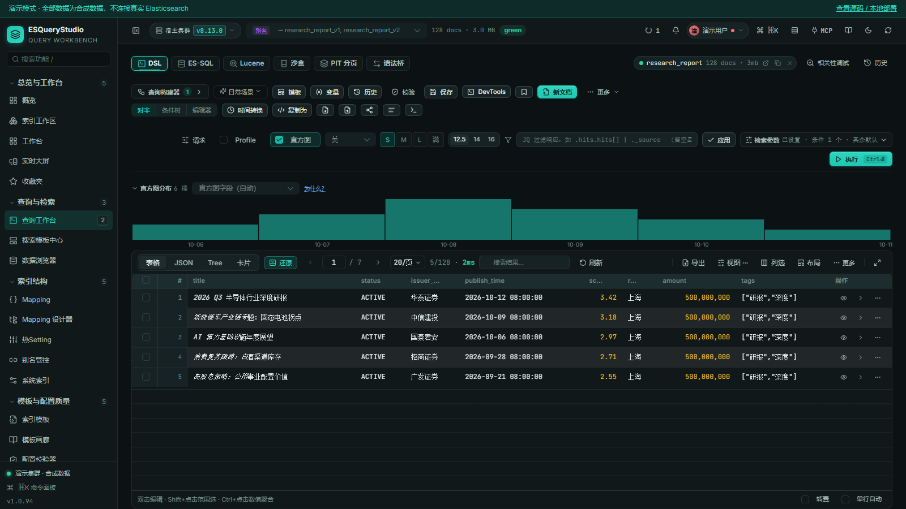

**一句话**：别人给你一个查询框，ESQueryStudio 给你一条从「写查询 → 看结果 → 解释分数 → 定位慢点 → 零停机重建」的完整动线。

**直达链接**：[🎪 在线演示（合成数据，点开即玩）](https://dengmeiluan.github.io/esquerystudio/) · [GitHub](https://github.com/dengmeiluan/esquerystudio) · [发行包（含 Chrome 扩展 zip）](https://github.com/dengmeiluan/esquerystudio/releases) · [文档索引](docs/README.md) · [LINUX DO 社区](https://linux.do)

**[5 分钟接入](#-5-分钟接入)** · [MCP 接入](docs/mcp.md#快速开始) · [English README](README_EN.md) · [查询工作台](docs/query-workbench.md) · [Chrome 扩展](#-chrome-扩展原生-vue-控制台双模式同源) · [功能包](#-功能包11-个模块按需上甲板) · [宿主集成](docs/integration/README.md) · [架构](docs/architecture.md)

---

## 🧭 Elasticsearch 6.7 → 9.x，控制台一套版本感知层

不是「只支持 7.x，8/9 勉强能连」。查询工作台、独立 jar 与 Chrome 扩展浏览器模式从 6.7 跑到 9.x：请求形态、SQL 端点、模板、mapping type 由集群 `version.number` 驱动；版本未知时也不猜 major，直接走 6.x 与 7.x+ 都合法的双兼容形态。

| 版本 | 控制台里发生什么 |
|---|---|
| **6.7–6.8** | typed mapping、`_xpack/sql`、legacy `_template` 回退；低版本能力在入口按 `minVer` 标注 |
| **7.x** | typeless mapping、`_sql`、7.8+ composable template、7.9+ data streams |
| **8.x** | typeless REST、kNN / `dense_vector`、8.x 查询与聚合目录 |
| **9.x** | typeless REST 透传、9.x 新增查询类型（如 `bitmap_terms`） |
| **版本未知** | 不猜：改用 6.x 与 7.x+ 都合法的请求形态，探活后自动精确 |

> **三条边界，分开说清楚**：
> - **控制台 / 浏览器模式**：上述 6.7–9.x 由完整控制台处理；Chrome 扩展直连 ES REST，独立 jar 的控制台也走同一套 REST 契约。
> - **宿主形态（`boot-support` 自动装配）**：同一套 [`es-rest`](modules/es-rest/) + [`boot-support`](modules/boot-support/) 核心。**Boot 2.3 宿主直接引依赖即可嵌入**（同一配置类同时登记在 `spring.factories`，Java 8 / Spring 5.2 实测通过），Boot 2.7 / 3.5 / 4.2 另提供三个薄适配器 app；ES 6.7–9.x 走同一条现代请求路径 + 通用回退（如 `_sql` → `_xpack/sql`），不再维护 6.x/7.x 代码分支。不存在 2.3 专属分叉：完整控制台按 Spring 5.3 编译，独立 jar 与 Boot 2.7 宿主共用同一份字节码；Boot 3.5 / 4.2 由同一个 `boot-support` 自动装配承载。同一个 [`mcp-server`](modules/mcp-server/) 核心把 **17 组 MCP 端点**也带给宿主形态（服务 token 认证；adhoc/迁移等 console-only 动作返回明确的不可用错误）。
> - **已验证**：Boot 2.7 / 3.5 / 4.2 三宿主测试全绿（JDK 17 / 17 / 21），Boot 2.3 嵌入 6/6（Java 8 + Spring 5.2，`spring.factories` 自动装配）；四条车道的宿主 MCP 端点各 4/4（401、discovery 17 组、tools/list、真实 `es_search`、console-only 动作如实报错）；6.7 stub 上 typed 建索引/加字段自动重试与数字 `hits.total` 透传均实测；9.1 形状 stub 上搜索 / SQL / mapping / 查询全程走 `_sql` 与 typeless 路由，`_xpack/sql` 与 `_doc/_mapping` 零调用；真实浏览器打开现有 Vue 控制台，42 条页面路由 **0 个 404**，单页最多 17 个 API 全 200。

> **`boot-support` 宿主形态还在迁移的部分**（不影响完整控制台）：sdes 映射自动登记、托管重建、宿主侧 MCP API key 治理（端点已用服务 token 可用）、Spring Security 具体适配。完整控制台（独立 jar）的 MCP 与运维深面已可用；详见 [Boot 2/3/4 迁移计划](docs/boot3-migration.md)。

### 30 秒版

- **不用再部署一套 Kibana**：控制台随 Spring Boot 应用发布，登录态、路由、权限、菜单留在宿主。
- **查询不是孤岛**：DSL / SQL / Lucene / 沙盒 / PIT / 语法桥共用一个现场，结果、直方图、历史、草稿不丢。
- **Agent 接入是一等公民**：17 个 action 组 / 171 个 action，连接级 read/write、配额与真取消。

## 🎪 在线演示

[**点开即玩 →**](https://dengmeiluan.github.io/esquerystudio/demo/) 静态演示由同一套 Vue 源码构建，数据全部为合成数据、不连接真实 Elasticsearch，也不需要任何配置。可直接体验查询工作台、SQL 结果、打分解剖、Mapping 与集群概览。

## ✨ 特色一页看懂

| 特色 | 具体落地 | 为什么少见 |
|---|---|---|
| **六模式共用一个现场** | DSL 构建器 / 原始编辑器、ES-SQL、Lucene、沙盒、PIT、语法桥在同一页切换；条件树、JSON、结果、直方图、历史与草稿不丢 | 常见控制台把不同查询方式拆成互不相通的工具页 |
| **真正懂 ES 的语义层** | mapping、analysis、版本、字段角色、可排序性一起参与补全、lint、值枚举与执行前检查；树 ⇄ 文本双向同步，未知子句退回原文 | 不是「补几个关键字」，而是降低「语法对、语义错」 |
| **相关性实验室** | 打分解剖、排名侦探、查询 X 光、子句命中矩阵、Boost 调参、Profile 火焰图共享查询现场 | 大多数 ES 管理台不把「为什么命中/为什么慢」做成一等公民 |
| **一套源码，多端同源** | 同一个 Vue 53 页控制台：Spring Boot 服务端模式 + Chrome 扩展浏览器模式；浏览器模式保留本机连接、监控、审计、作业与护栏执行 | 不需要维护「服务端 UI + 插件 UI」两套代码 |
| **MCP 原生、实时密钥治理** | 服务端 `/esmcp`、浏览器 `window.ESQueryStudioMCP`、本地 Node stdio 三接入面共用 17 个 action 型工具（覆盖 171 个细粒度操作）、14 个只读资源 + 1 个 MCP App 与 7 个引导提示词（含一键搭建/接入）；任意登录人可为自己签发其授权范围内的 key，连接级 read/write（QA/UAT 写、生产只读）、rpm / 日 / 月配额（多实例共享原子计数）、实时编辑/轮换/撤销 | 不是把 MCP 当附录，而是把 Agent 接入与最小权限当成一等公民 |
| **长调用可取消、不堵生产** | 每个 MCP 调用 3 分钟硬预算；`tasks/cancel` 与 `notifications/cancelled` 真中断（断线程 / REST 透传与 SQL 走 `Cancellable` 线级 abort / 对 ES `node:num` 下发 `_tasks/_cancel`）；声明 Tasks 的客户端先拿 `working` 再续传，任务台账跨重启与多实例可读（控制集群索引或宿主 JDBC 表）；页面「调用任务」条直接取消 Agent 发起的调用；本地 stdio 可打成免装 Node 的单文件 exe | 常见 MCP 桥只能等，取消只改状态词；长任务会把生产集群连接一直占着 |
| **宿主优先、可裁剪** | 页面契约 + 11 个功能包 + `ConsoleHostIntegration` / 认证 / 连接目录 / 审计 SPI；深链停用页有可解释落地 | 不是只换 logo 的伪嵌入，也不是把业务语义硬编码进平台 |
| **开源交付可验证** | 前后端全量测试、真实浏览器探针、权限矩阵、可复现 release、SBOM、CodeQL / Scorecard / Dependabot | 不只给演示截图，也给可重复运行的证据 |

## 🎯 核心：一块真正懂 Elasticsearch 的查询工作台

ESQueryStudio 的主角不是又一个索引管理表格，而是**查询工作台**。它把 Elasticsearch 查询从「记住 DSL 语法、复制 JSON、再回浏览器看结果」变成一块连续的编辑面：左边是条件树，右边是原始请求体，下面是结果、直方图和耗时；切到 SQL、Lucene 或 PIT，现场不丢。

### 六个模式，一个现场

| 模式 | 你得到什么 |
|---|---|
| **DSL 构建器** | 条件树 + 原始编辑器双向同步；40+ 子句按字段类型出现，稀有子句有专门入口，不认识的子句也能退回原文编辑 |
| **ES-SQL** | `_sql` 查询、`cursor` 深分页、字段体检、结果表/JSON/Tree/卡片视图，SQL 与 DSL 一键互转 |
| **Lucene** | Lucene 语法直查，保留原始高亮与命中行，可带去构建器继续精修 |
| **查询沙盒** | 自由写 DSL、看原始响应、对比 `_source` 与高亮，适合验证一个假设 |
| **PIT 深分页** | 基于 Point-in-Time 的稳定翻页，游标断了能解释、能续拉，不在 10k 窗口前停住 |
| **语法桥** | SQL 与 DSL 互相翻译时保留语义差异提示，不把「翻译成功」当成「语义等价」 |

### 不是「补全几个关键字」，而是理解你的索引

- **mapping 感知**：字段类型、`text` / `keyword` 子字段、嵌套对象、日期格式都来自当前索引的实时 mapping；补全和 lint 不会给你一个 ES 不接受的建议。
- **analysis 感知**：分词器、normalizer、同义词与 `analysis` 设置参与候选；字段值枚举直接来自索引，不再靠猜。
- **版本感知**：按当前集群版本标注 `minVer`；6.x typed / 7.x typeless / 7.9+ data streams / 8.x kNN / 9.x typeless REST 的差异在入口处就说清楚，不让用户把版本不兼容当成查询写错。
- **双向同步**：条件树改完，JSON 立即更新；JSON 改完，条件树按语义重建。只改一边、另一边静默过期的情况不会发生。
- **lint 是语义检查**：字段不存在、类型不可排序、`text` 未走 `.keyword`、日期格式不匹配、聚合/排序冲突，都在执行前给出可操作的修复建议。
- **现场可回放**：跨模式查询历史、收藏、草稿、分享深链共用一套现场；切模式、翻页、刷新不会把写到一半的查询清空。

### 从「为什么这条命中」到「为什么慢」

查询工作台不是一个孤立的输入框。它和相关性实验室共用同一个查询现场：

- **打分解剖**：把每个命中文档的 BM25 因子树展开到 `tf` / `idf` / `boost` / `norm`，看清是哪一项在推高分数。
- **排名侦探**：对单文档追问「为什么是它」，对比不同查询下同一文档的得分路径。
- **查询 X 光**：逐子句查看词项、命中数和被分析器改写后的实际查询。
- **子句命中矩阵**：哪条子句命中了哪些文档，一屏对齐，专门抓「写了但没起作用」的条件。
- **Profile 火焰图**：把 `profile=true` 的查询/采集器耗时展开成火焰图，定位慢在 rewrite、build_scorer 还是 next_doc。

> 这些页面共享 `?idx=` 与查询现场，不是六个互不相干的工具页。所有截图都由当前源码在真实 Chromium 中渲染（Mock ES 数据），不使用设计稿、合成图或旧版界面。在线演示同样由当前源码构建，并在页面顶部明确标注「合成数据、不连接真实 Elasticsearch」。

---

## 🛳️ 它是什么

ESQueryStudio 是一个**可嵌入的 Elasticsearch 查询与运维平台**，不是一个只解决「索引重建」的单点工具：

- **查询工作台**：DSL / ES-SQL / Lucene / 沙盒 / PIT / 语法桥六模式，mapping 感知补全、lint、树⇄文本双向同步、历史与收藏。
- **索引生命周期**：别名写索引翻转 + 服务端 `_reindex`，零停机重建；跨集群迁移、Reindex 预估、快照 / SLM / ILM 与删除复活补偿。
- **观测与治理**：节点 KPI、告警、慢请求、Top 索引、任务树、拓扑、体检报告、配置漂移与权限面。
- **宿主集成**：认证委托、连接目录、页面契约菜单、品牌与功能包裁剪；通过 `ConsoleHostIntegration` SPI 适配任意 Spring Boot 宿主，不绑定具体业务系统。

### 适合谁

| 你在做什么 | ESQueryStudio 给你的 |
|---|---|
| Java / Spring Boot 团队把 ES 作为主搜索或日志存储 | 不用再部署一套 Kibana；控制台随应用发布，登录态、路由、权限和菜单都留在宿主 |
| 搜索质量 / 相关性团队 | 构建器、打分树、排名侦探、X 光、命中矩阵、Profile 火焰图在同一现场 |
| 平台团队要交付「可查、可改、可治理」的 ES 能力 | 页面级权限、功能包裁剪、连接目录、审计贡献、独立 jar 或宿主适配器两种形态 |
| 正在做索引重建 / 迁移 / 容量治理 | 托管重建、跨集群迁移、Reindex 预估、快照与生命周期成套出现 |

### 它不是什么

| 是 | 不是 |
|---|---|
| Elasticsearch 6.7–9.x 的查询 / 运维 / 治理工作台 | 通用 BI 或拖拽式大屏搭建器 |
| 可独立部署，也可作为 Spring Boot starter 嵌入宿主 | 必须依赖某一家的云服务或 SaaS |
| 宿主可以裁剪产品面、接管认证与连接目录 | 自带业务语义的行情 / 报价系统 |
| 页面级授权的控制台（连接 × 页面 × 读/写） | 用隐藏菜单代替服务端校验的「假权限」 |
| ES 客户端栈由宿主提供的 `provided` 契约 | 把一整套 ES 客户端版本强塞进宿主 classpath |

---

## 🧩 为什么是 ESQueryStudio

1. **查询工作台优先**：先把「写查询、看结果、解释分数、定位慢点」做成一条连续动线，再向外长成索引与运维能力；不是把一堆管理页拼在一起。
2. **真正懂 ES 的语义层**：mapping、analysis、版本、字段角色、可排序性都进入补全、lint、值枚举与执行前检查，减少「语法对但语义错」。
3. **一个平台，两种形态**：Kibana 式 `java -jar` 独立部署，或嵌进宿主 Spring Boot 应用共享认证与路由。
4. **产品面可裁剪**：11 个功能包 + 单页排除，宿主只暴露自己需要的模块；深链访问未启用模块会落到可解释的「模块未启用」页，而不是空白或 404。
5. **宿主优先的 SPI**：`ConsoleAuthDelegate`、`ConnStore`、`ConsoleAuditContributor` 与 `ConsoleHostIntegration` 分工明确；页面契约是前端导航、后端页面门、宿主菜单注册器三端唯一事实源。

### 和常见做法比

| 你现在的做法 | 常见缺口 | ESQueryStudio 的做法 |
|---|---|---|
| Kibana Dev Tools | 只有原始请求框；不嵌入宿主；不解释分数；MCP 要另接一层 | 六模式共用现场 + 语义 lint + 相关性实验室 + 三接入面 MCP |
| 通用 REST 客户端（Head 等） | 能发请求，但不懂 mapping / analyzer / 版本 | 补全、lint、值枚举、执行前检查都读当前索引 |
| 自研管理页 | 查询、重建、迁移、权限各做一套，版本一升就散 | 页面契约 + 11 功能包 + 宿主 SPI，一套源码多形态 |
| 只做索引重建的 starter | 重建完就没有然后了 | 重建 / 迁移与查询 / 观测 / 治理同栈 |

---

## 📦 功能包：11 个模块，按需上甲板

默认全开。宿主在 `esquerystudio.console.features.packs` 里列出需要的包即可收敛；
`exclude-pages` 可在包之上再隐藏单页。功能包是**部署选择**，不是权限——权限仍由
`grantedPages` 的页面级读/写键决定。

| Pack | 页面数 | 你在里面能做什么 |
|---|---:|---|
| `platform` | 5 | 概览、索引工作区、工作台、实时大屏、收藏夹 |
| `search` | 3 | 查询工作台（DSL/SQL/Lucene/沙盒/PIT/语法桥）、搜索模板、数据浏览器 |
| `index` | 5 | Mapping 与设计器、热 Setting、别名管控、系统索引 |
| `quality` | 5 | 索引模板、模板画廊、配置校验、配置漂移、优化向导 |
| `data` | 3 | Bulk 编辑、Update By Query、文档 Diff |
| `text` | 4 | 分词验证、分词实验室、同义词字典、Analysis 全景 |
| `relevance` | 6 | 打分解剖、排名侦探、Boost 调参、命中矩阵、查询 X 光、Profile 火焰图 |
| `lifecycle` | 8 | 托管重建、跨集群迁移、Reindex 高级/预估、快照、SLM、ILM、生命周期 |
| `observe` | 9 | 诊断、一键体检、拓扑、Watcher、任务/任务树、集群设置、插件、远程集群 |
| `security` | 1 | 安全中心：账号、权限面、操作审计 |
| `devtools` | 4 | REST 直连、Dev Tools 多标签、MCP 接入、Painless 沙盒 |

> 页面契约 `META-INF/esquerystudio-pages.json` 是唯一事实源：前端导航、后端页面级拦截、
> 宿主菜单注册器都从这里派生。功能包只改变「暴露面」，不改变 page key。

**页面地图**（13 个分组 / 53 页，宿主可按分组或单页裁剪）：

| 分组 | 页面 | 代表能力 |
|---|---:|---|
| `core` | 5 | 集群总览、索引工作区、Dev 工作台、实时大屏、收藏夹 |
| `search` | 3 | 六模式查询工作台、搜索模板、数据浏览器 |
| `index` | 5 | Mapping 与设计器、热 Setting、别名管控、系统索引 |
| `quality` | 5 | 索引模板、模板画廊、配置校验、配置漂移、优化向导 |
| `data` | 3 | Bulk 编辑、Update By Query、文档 Diff |
| `text` | 4 | 分词验证、分词实验室、同义词字典、Analysis 全景 |
| `rank` | 6 | 打分解剖、排名侦探、Boost 调参、命中矩阵、查询 X 光、Profile 火焰图 |
| `rebuild` | 4 | 托管重建、跨集群迁移、Reindex 高级与预估 |
| `protect` | 4 | 快照、SLM、ILM、生命周期 |
| `health` | 4 | 诊断、一键体检、拓扑、Watcher |
| `cluster` | 5 | 任务/任务树、集群设置、插件、远程集群 |
| `security` | 1 | 安全中心：账号、权限面、操作审计 |
| `devx` | 4 | REST 直连、Dev Tools 多标签、MCP 接入、Painless 沙盒 |

> `rebuild` 分组四页能力重叠？按[重建与迁移选型指南](docs/rebuild-guide.md)的决策表选页。

---

## 🖥️ 控制台一览

**查询工作台** —— 条件树、原始 DSL、直方图与结果表在同一屏；mapping 感知补全和 lint 随输入更新：

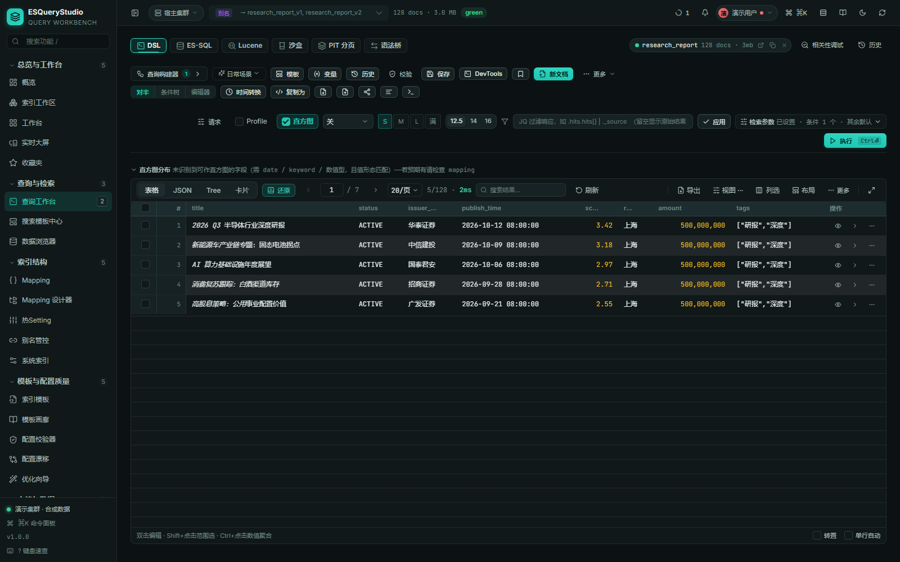

**打分解剖** —— 每个命中文档的 BM25 因子树，`tf` / `idf` / `boost` / `norm` 逐层展开：

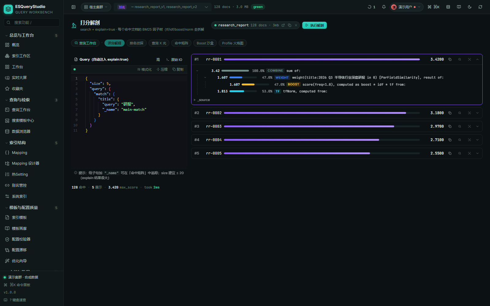

**SQL 控制台** —— `_sql` 查询、游标深分页、字段体检、结果多视图与 DSL 互转：

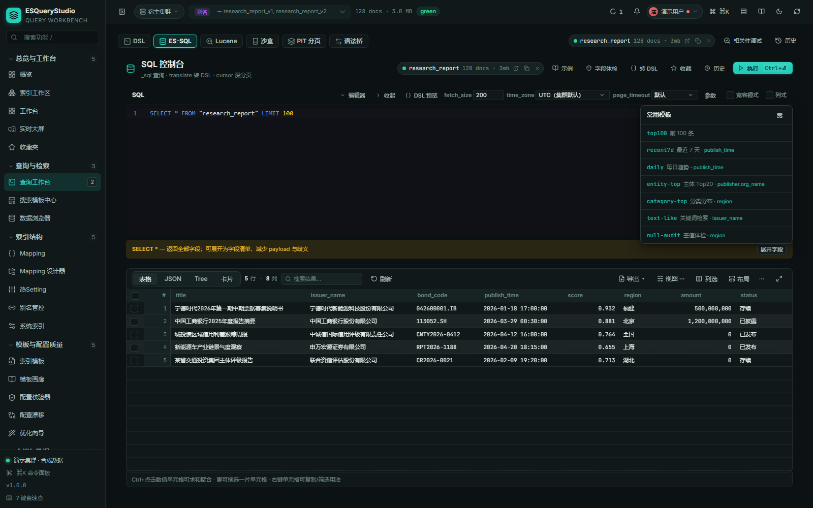

**集群概览** —— 健康、存储、文档分布与集群监控历史：

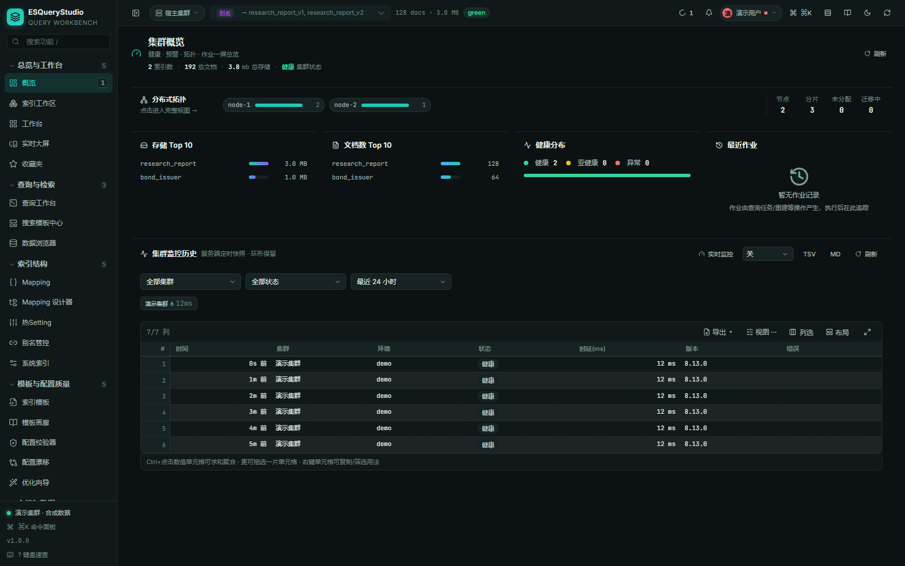

### 运维控制台能力

- **托管重建** —— 向导式零停机重建：选索引 → 审值 settings/mapping → 追平策略 → 确认预览 → 执行监控。
- **索引工作区** —— 索引列表 + 内嵌文档网格：筛选 / 列统计 / 快照 / 导出 / 直改。
- **查询工作台** —— DSL / ES-SQL / Lucene / 沙盒 / PIT / 语法桥六模式，智能补全与高亮。
- **数据浏览器** —— 文档 CRUD、列统计、CSV / Markdown / XLSX 多格式导出。
- **集群治理** —— 索引 / 别名 / mapping / ILM / 快照 / 任务树 / 设置漂移 / 健康报告。
- **权限审计** —— 页面级授权（连接 × 页面 × 读/写）+ 宿主审计贡献。
- **实时监控** —— 节点 KPI / 告警 / 慢请求 / Top 索引，多集群视角。

---

## 🚀 三种交付形态

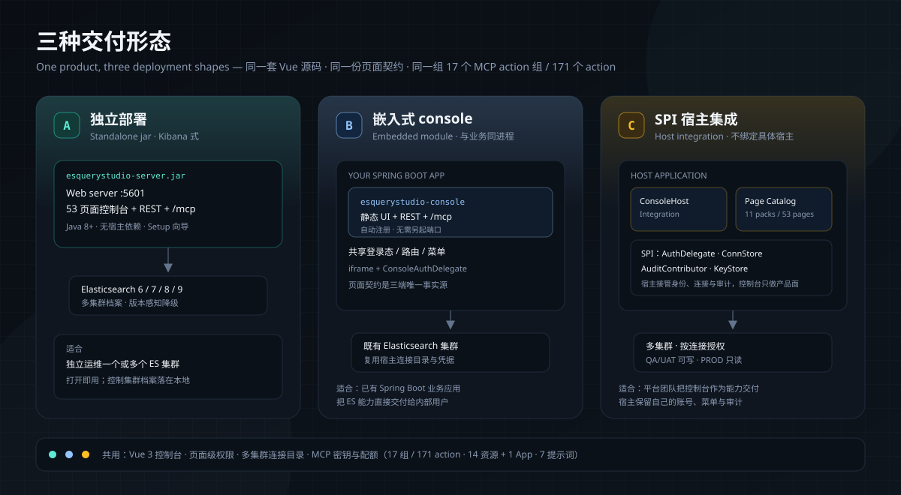

### A. 独立部署（Kibana 式）

```bash
java -jar esquerystudio-server.jar
```

内置 Web 服务器（默认端口 `5601`）与 ES 客户端栈，不依赖宿主应用。打开
`http://localhost:5601/esquerystudio.html`，按 Setup 向导完成控制集群首连。

首连档案持久在 `~/.esquerystudio/`，重启即达。详见 [apps/server/README.md](apps/server/README.md)。

### B. 嵌入式 console 模块

把 `esquerystudio-console` 加进宿主 Spring Boot 应用，控制台静态资源与 HTTP 端点自动注册；
认证可委托宿主（iframe 共享登录态）。适合与业务系统一体化交付。

### C. 宿主集成（SPI 驱动，不绑定具体宿主）

ESQueryStudio 不要求宿主改造成某一种业务形态。实现 `ConsoleHostIntegration` 声明品牌与
默认功能包，再按需接入认证委托、连接目录与审计贡献即可：

```java
@Bean
public ConsoleHostIntegration esQueryStudioHostIntegration() {
    return new ConsoleHostIntegration() {
        public String id() { return "acme"; }
        public String displayName() { return "Acme Search"; }
        public List<String> preferredPacks() {
            return Arrays.asList("platform", "search", "index", "data",
                    "lifecycle", "observe", "security", "devtools");
        }
    };
}
```

宿主自定义面全部是接口：`ConsoleAuthDelegate`（认证）、`ConnStore`（连接目录）、
`ConsoleAuditContributor`（审计）、`ConsolePageCatalog`（菜单）。完整接入面与验收清单：
[docs/integration/README.md](docs/integration/README.md)。

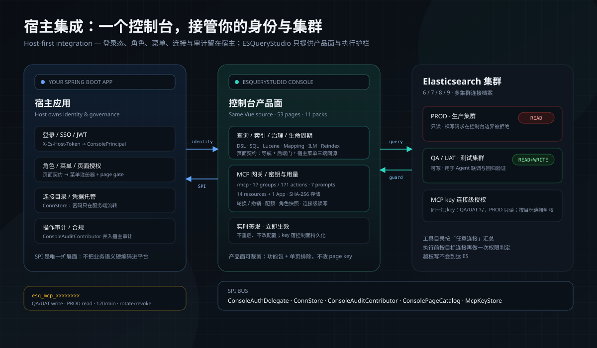

**按场景选择**：

| 你的场景 | 选用 | 额外工作 |
|---|---|---|
| 独立运维一个或多个 ES 集群 | `esquerystudio-server` 独立 jar | 无，打开 Setup 向导即可 |
| 已有 Spring Boot 业务应用 | `esquerystudio-console` 嵌入式 | 声明 `@Document` 实体；可选认证委托 |
| 与宿主账号、菜单、审计一体化 | `esquerystudio-console` + 宿主 SPI | 实现 `ConsoleHostIntegration` 与 `ConsoleAuthDelegate` |
| 只要重建 / 迁移引擎 | `esquerystudio-console`，`mode=rebuild-only` | 不暴露控制台页面与静态资源 |

---

## 🤖 MCP 接入

同一组工具契约（默认只读，ADMIN 可签发写权限 key），三种接入面：

> **端点默认 `/esmcp`**（项目标志位，避免与宿主或其它集成的裸 `/mcp` 冲突）；需要保留旧地址的宿主设
> `esquerystudio.mcp.path=/mcp`，非法路径启动即失败。控制台从 `setup/status.mcpPath` 自动跟随。
>
> **MCP 服务端由完整控制台与所有宿主形态共同提供**：独立 jar、Boot 2.7 控制台嵌入、以及 `boot-support` 的 Boot 2.3–4.2 宿主都挂载同一个 17 组 `/esmcp` 核心。宿主形态用服务 token 认证（`esquerystudio.mcp.enabled=true` + `esquerystudio.mcp.token`）；按用户签发的 API key 与需要 console 存储的动作（adhoc 重建 / 跨集群迁移 / 配置实验室等）仍由完整控制台提供，宿主形态对这些动作返回明确的不可用错误。浏览器桥与本地 Node 两种接入面不受影响。

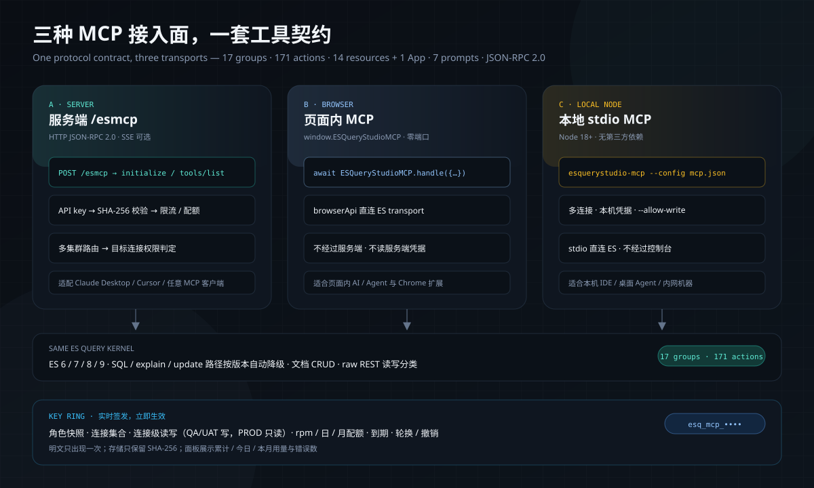

- **服务端模式**：`POST /esmcp` JSON-RPC 2.0，支持 **MCP 2026-07-28**（`server/discover`、缓存提示、无状态请求）并兼容 2025-11-25 / 2025-06-18 / 2025-03-26 / 2024-11-05 `initialize`；支持服务级 Bearer token 与按登录人/角色签发的 MCP API key（连接集合、连接级 read/write、工具白名单、独立频率、日/月配额（多实例共享原子计数）与有效期；一把 key 可 QA/UAT 可写、生产只读），附 `mcp/esquerystudio-mcp-stdio.mjs` stdio 桥；17 个 action 型工具（覆盖 171 个细粒度操作：索引生命周期（建/删索引、mapping、settings、别名、rollover、merge、模板、数据流、克隆/收缩/拆分、Transform 生命周期）、批量 update/delete/reindex、分词配置/同义词/查询校验/词频取证、集群设置/reroute、分片诊断、节点/热点线程/插件/Watcher、快照/ILM/SLM、脚本、ingest pipeline 生命周期、托管重建/跨集群迁移作业治理与事件时间线、settings/aliases/templates/nodes/tasks/stats 与原始 REST 透传）；另有 14 个只读资源（连接/集群/索引/别名/数据流/组件模板/mapping/迁移作业/任务）、1 个 MCP App 资源（`ui://esquerystudio/tool-console`，17 个 action 工具通过 `_meta.ui.resourceUri` 绑定）与 7 个引导提示词（慢查询、mapping 设计、迁移、容量、失败搜索、跨云结构同步、一键搭建/接入）；Tasks（`io.modelcontextprotocol/tasks`）与 MCP Apps（`io.modelcontextprotocol/ui`）扩展已声明，MRTR 高危写 elicitation 二次确认已支持，key 可持久化到控制集群 ES 或宿主 JDBC。
- **纯前端模式**：browser 构建内安装 `window.ESQueryStudioMCP`，页面内 AI / Agent 可直接 `handle` / `callTool`；浏览器标签页不监听 TCP，外部进程客户端请使用服务端模式或本地 Node 模式。
- **本地 Node 模式**：`node mcp/esquerystudio-local-mcp.mjs --config ~/.esquerystudio/mcp.json`（也可 `cd mcp && npm install -g .` 后使用 `esquerystudio-mcp`），Node 18+ 无第三方依赖，直连一个或多个 ES 连接；浏览器模式配好连接后可在 MCP 面板导出 Node MCP 配置，Claude Desktop / Cursor 无需启动 Spring Boot 或浏览器。
- **本地单文件可执行（Windows）**：`node scripts/build-local-mcp-exe.mjs` 产出 `dist/mcp/esquerystudio-mcp.exe`（内含 Node 运行时，目标机零依赖，`--version` 可自证）；客户端配置只写一个可执行路径，对标 DBX 的 `dbx-mcp.exe`，凭据仍留在本机 `mcp.json`。
- **管理面**：服务端 **Dev Tools → MCP → 密钥与用量** 可签发/撤销 key 并查看请求数与配额；纯前端/演示站如实展示不支持 HTTP key 的边界。
- **客户端接入向导**：面板「客户端接入」标签页与 `esquerystudio-mcp-cli`（`list` / `detect --json` / `config` / `install`）覆盖 Claude Code、Claude Desktop、Cursor、CodeBuddy Code CLI、ZCode、TRAE、VS Code、Windsurf、Codex、DeepSeek Harness、OpenCode、Pi、Cherry Studio、Qoder、WorkBuddy、Antigravity、Cline、Roo Code、Kilo Code、Gemini CLI、GitHub Copilot CLI、Zed、Continue、Amp、Crush、JetBrains AI Assistant；Cursor / VS Code / Windsurf / OpenCode / Qoder / TRAE / CodeBuddy / ZCode / WorkBuddy / Pi / Antigravity / Cline / Roo Code / Kilo Code 安全合并写入，其余输出可粘贴配置或可执行命令（Crush 给 `~/.config/charm/crush/config.toml` 的 TOML 段，JetBrains 给项目级 `.idea/mcp.xml` 的 stdio 桥 XML，2025.2+ 原生支持）。系统管理工具仅 ADMIN 角色的 key 可签发与调用；`detect --json` 回报 `commandFound` / `configFound` / `installed` 三态，`--local` 可把任一客户端直接指到本机 Node stdio 桥（不经过 Spring Boot）。

> **让 AI 一键搭建 / 接入**：把 [AGENT_SETUP.md](AGENT_SETUP.md) 的提示词整段粘贴给任意 Agent；或打开控制台「MCP 接入 → 接入总览 → AI 一键搭建 / 接入」，选形态 / 客户端 / 端点后实时生成、复制或下载。MCP 客户端也可直接 `prompts/get`（`deploy_and_connect`）。

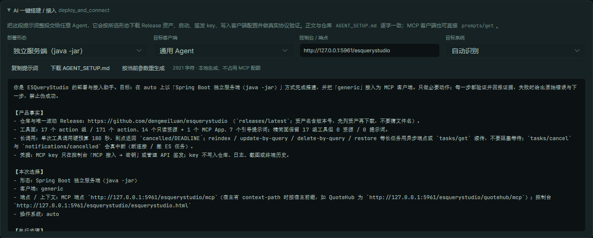

最短接入、Claude/Cursor 配置、连接级授权与 30 秒验收见 [docs/mcp.md](docs/mcp.md#快速开始)；完整配置、工具表和边界在同一文档。服务端 UI 的 Dev Tools → MCP 面板可查看三种接入面的端点和工具目录。


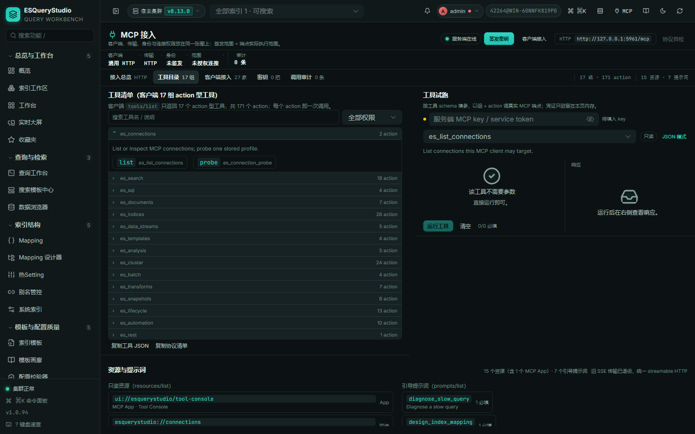


### 控制台端点速查（完整控制台）

| 端点 | 用途 |
|---|---|
| `/internal/es/index/rebuild` | 受管重建 / reindex（完整控制台） |
| `/internal/es/index/keys` | MCP 密钥与用量 |
| `/internal/es/index/desired-state.html` | 期望状态（mapping auto-register）回显 |

> 这些端点属于完整控制台（独立 jar）；`boot-support` 宿主形态当前只覆盖只读概览、查询工作台与文档 / 索引写面，边界见上文「三条边界」。

## 🧩 Chrome 扩展：原生 Vue 控制台，双模式同源

同一套 Vue 控制台源码，服务端模式（Spring Boot 提供 `/internal/es/index`）与浏览器模式（插件内直连 ES）只切换 transport，不再维护第二套 UI。插件主界面就是完整 53 页 Vue 控制台（browser 构建），首次打开填写 ES 地址后，页面/路由/组件/样式与服务端模式完全同源。

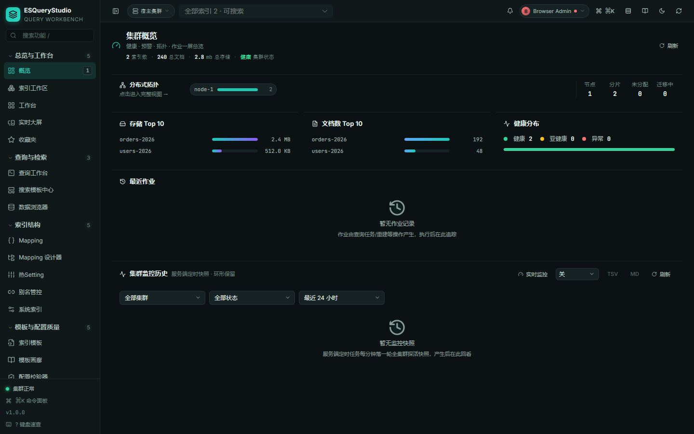

- **服务端模式**：同一套 Vue 源码由 Spring Boot server 提供，经 `/internal/es/index` 后端适配；原有 53 页、11 功能包、宿主 SPI 全部保留。
- **浏览器模式**：插件内运行同一套 Vue 源码的 `browser` 构建，`api.ts` 底层 transport 切换为浏览器直连 ES；首次连接在原生连接层填写地址，支持保存多个本机连接档案并在顶栏切换目标，凭据只存本机。
- **覆盖**：索引/Mapping/Setting/别名/模板、快照/ILM/SLM/Watcher、任务/节点/REST/SQL/PIT/Reindex/Bulk/托管重建、跨集群迁移（客户端 scroll+bulk）、配置校验（L1+L2 dry-run）、配置漂移（本机基线）、系统索引（本机作业锁）均可用；任务进度、索引设置影响预估与护栏执行（本机 ES 7.10 分类 + confirmToken）、监控历史/告警、操作审计、重建/迁移作业也走同一套 API 契约，数据落在本机 IndexedDB/localStorage。
- **边界**：浏览器模式没有跨实例分布式锁和代码 provider，系统索引页展示本机作业锁、配置漂移以本机首次基线为准；本机监控每分钟采样（打开的控制台页采样当前目标，service worker 为每条本机连接写集群 / 每节点 / Top 索引行；受限账号缺 `_nodes` / `_cat` / `_stats` 权限时只保留真实集群健康行），只保存在本机，不伪造离线历史；账号由 Elasticsearch 自身认证。
- **安装**：打开 `chrome://extensions` → 开启开发者模式 → **加载已解压的扩展程序** → 选择包含 `manifest.json` 的文件夹（源码为 `extensions/chrome`；Release zip 请先解压，不要直接选 zip）。

浏览器模式的能力矩阵与本机边界见 [docs/browser-mode.md](docs/browser-mode.md)，安装与安全说明见 [extensions/chrome/README.md](extensions/chrome/README.md)。

---

## ⚡ 5 分钟接入

> **两种交付形态（诚实边界）**：完整控制台（53 页 + MCP + 运维深面）以独立 jar 交付；
> **任意 Boot 2.3 / 2.7 / 3.5 / 4.2 宿主**可用 `esquerystudio-boot-support` 嵌入查询工作台
> 子集（自动装配，写默认关闭）。下面的 A 先跑演示 app，B 是宿主嵌入。

### A. 直接运行宿主适配器（现在就能用）

```bash
# Boot 3.5 / Java 17（ES 8.x 客户端）
JAVA_HOME=/path/to/jdk-17 ./mvnw -Pboot3 -pl modules/console-boot3 -am spring-boot:run

# Boot 2.7 / Java 17（同一核心，Spring 5.3）
JAVA_HOME=/path/to/jdk-17 ./mvnw -Pboot2 -pl modules/console-boot2 -am spring-boot:run

# Boot 4.2 / Java 21（ES 9.x 客户端）
JAVA_HOME=/path/to/jdk-21 ./mvnw -Pboot4 -pl modules/console-boot4 -am spring-boot:run
```

连接目标集群：`ESQ_ES_URL` / `ESQ_ES_USERNAME` / `ESQ_ES_PASSWORD`；
打开 `http://localhost:5602/esquerystudio.html`（Boot 3 默认端口，2/4 分别 5604 / 5603）。

**身份与写权限**：
- 生产请注册 `ConsoleAuthProvider` Bean（返回 `ConsolePrincipal`），核心不解析宿主 session；
- 未注册时只有本地兜底 `esquerystudio.boot.dev-bootstrap-auth=true`，仅用于本机验证；
- 写操作默认 403，需显式 `esquerystudio.boot.allow-writes=true`。

### B. 嵌入式接入（已可用：自动装配）

嵌入只需要一个依赖：`esquerystudio-boot-support`。它是 Java 8 字节码、不绑定 Spring 版本
（`spring.factories` 供 Boot 2.3，`AutoConfiguration.imports` 供 2.7+），宿主自己的
`spring-boot-starter-web`、Jackson 与 `elasticsearch-rest-client` 保持原版本。当前版本尚未
发布到 Maven Central，先在本仓库安装到本地仓库：

```bash
# 任一 boot profile 都包含共享模块；这里用 boot3 作构建 profile
./mvnw -Pboot3 -pl modules/boot-support -am -DskipTests install
```

```xml
<dependency>
    <groupId>io.github.dengmeiluan</groupId>
    <artifactId>esquerystudio-boot-support</artifactId>
    <version>1.0.95</version>
</dependency>
```

配好 `esquerystudio.elasticsearch.url` 后，控制台外壳与 API 自动挂载。Boot 2.3 宿主（QuoteHub
基线）同样只加这一个依赖：同一配置类登记在 `spring.factories`，控制台静态资源随库 jar 从
classpath 提供；Boot 2.7 / 3.5 / 4.2 宿主走 `AutoConfiguration.imports`。
需要 Agent 接入时再加 `esquerystudio.mcp.enabled=true` 与 `esquerystudio.mcp.token=<token>`，
宿主即挂载与完整控制台相同的 17 组 `/esmcp`（服务 token 认证）。发行包同时附
`esquerystudio-boot-support` 与共享核心 jar（`es-rest` / `es-engine` / `mcp-core` / `mcp-server`），
可 `mvn install:install-file` 到本地仓库或直接加入宿主 classpath。

> 已验证：三个演示 app 删除显式 `@Import` 后仍全部通过（Boot 2.7 11/11、Boot 3.5 16/16、Boot 4.2 5/5），
> Boot 2.3 嵌入 6/6（Java 8 + Spring 5.2，`spring.factories` 装配、6.7 形状的数字
> `hits.total` 与 `_xpack/sql` 回退），证明挂载来自自动装配而非启动类的显式导入；四条车道的宿主
> MCP 端点测试各 4/4（401 / discovery / tools-list / 真实 `es_search` / console-only 动作如实报错）。

### C. 《@Document》实体与托管重建（Phase 2，当前未实现）

> 本节描述目标形态。`boot-support` 核心**当前没有 sdes 映射自动登记与托管重建**；
> 完整控制台已实现 `esquerystudio.elasticsearch.mapping.auto-register`、`MappingReconcile`、
> `conflict-policy` 与 `USE_ADHOC_REBUILD` 状态机，见 [mapping 指南](docs/integration/mapping.md)。

```java
@Document(indexName = "bond_quote")
public class BondQuoteES {
    @Id
    private String id;

    @Field(type = FieldType.Keyword)
    private String bondCode;

    @Field(type = FieldType.Text, analyzer = "ik_max_word", searchAnalyzer = "ik_smart")
    private String shortName;
}
```

启动时自动把新增字段安全登记到既有索引（mapping auto-register）。需要改字段类型 /
analyzer / 建新物理索引时，走托管重建四步：

```text
建新索引(新 mapping) → 服务端 _reindex 回填 → 别名原子翻转写索引 → 观察期 → 旧索引下线
```

全过程读写不停；重建窗口内被删除的文档在回填后自动补偿，不留幽灵数据。

### D. 共享核心配置（Boot 2.7 / 3.5 / 4.2 通用）

```yaml
esquerystudio:
  elasticsearch:
    url: http://localhost:9200
    username: elastic
    password: ${ES_PASSWORD:}
  boot:
    # 生产：注册 ConsoleAuthProvider Bean 后无需开启
    dev-bootstrap-auth: false
    # 写操作总闸：GET/HEAD 不受影响；POST/PUT/DELETE 需显式开启
    allow-writes: false
```

- `dev-bootstrap-auth` / `allow-writes` **只用于本机验证**；生产必须由宿主认证 SPI 提供身份。
- 未注册 `ConsoleAuthProvider` 且未开 bootstrap 时，所有 `/internal/es/index` 下的接口返回 401。

### E. 当前已实现端点（诚实清单）

| 端点 | 状态 |
|---|---|
| `GET /internal/es/index/setup/status`、`/auth/me`、`/pages`、`/ui/config` | 可用 |
| `GET /clusters`、`/overview`、`/health`、`/cluster/{health,indices,aliases,shards,tasks,pending-tasks,snapshot/status,nodes-stats-brief}`、`/monitor-history` | 可用（真实 ES REST） |
| `GET /cluster/mapping-detail`、`/cluster/inspect`、`/cluster/index-settings` | 可用 |
| `POST /cluster/query`、`/cluster/profile`、`/cluster/sql` | 可用（SQL 走 `_sql`，通用回退 `_xpack/sql`） |
| `POST /cluster/raw`、`/cluster/devtools/execute` | 可用（写受限） |
| `POST /cluster/{delete-by-id,update-document,update-partial,put-mapping,update-settings,create-index,delete-index,force-merge}` | 可用（写受限） |
| 备份/生命周期/集群读面：`/cluster/{settings,snapshot/repos,ilm/policies,ilm/status,slm/policies,slm/status,watcher,remote-clusters,plugins,templates}` | 可用 |
| 安全中心/MCP/迁移只读面：`/auth/{users,ops-audit,audit-facets}`、`/mcp/keys*`、`/internal/es/xmigrate/jobs` | 可用（诚实空态：核心尚无用户库/审计库/迁移作业） |
| `/adhoc-rebuild/*`、`/config-lab/validate`、`/xmigrate/{start,resume,...}`、MCP 签发 | **未实现**（Phase 2+） |

> 42 条页面路由已在真实浏览器全量普查：**0 个 404**。未实现端点仍以真实 404 暴露，不做伪成功。

---

## 🏗️ 架构

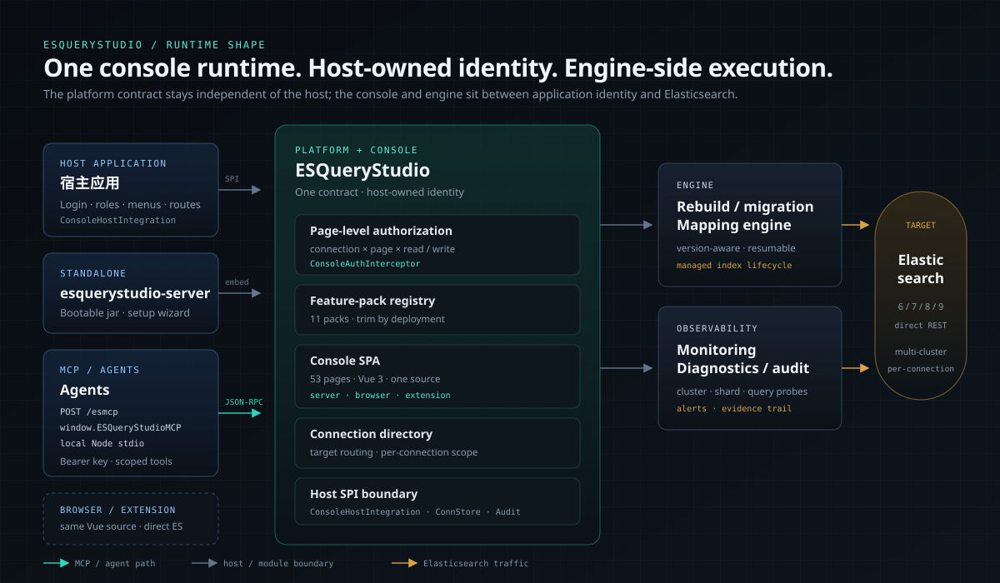

**分层**：平台内核（品牌/功能包/宿主 SPI）→ 控制台模块（查询/索引/观测/安全）→
引擎模块（重建/迁移/映射）。功能包在合约层显式声明，后端页面门仍按完整契约执法。

### 项目结构

```text
esquerystudio/
├─ platform/                 esquerystudio-platform：页面契约 / 功能包 / 宿主 SPI（console 与 boot-support 共用）
├─ modules/console/          esquerystudio-console：完整控制台核心（Spring 5.3 编译，独立 jar 与 Boot 2.7 宿主共用）
├─ modules/es-rest/          esquerystudio-es-rest：Java 8 低层 REST 契约（异步/取消，四基线共用）
├─ modules/es-engine/        esquerystudio-es-engine：Spring 中立的索引/别名/reindex 引擎（基于 es-rest，console 与宿主共用）
├─ modules/mcp-core/         esquerystudio-mcp-core：Spring 中立的 MCP 密钥/配额/密文/任务台账核心（console 与宿主共用）
├─ modules/mcp-server/       esquerystudio-mcp-server：传输中立的 17 组 MCP 端点（console 与 Boot 2.3–4.2 宿主共用）
├─ modules/boot-support/     共享 REST/探针核心（Spring 5.3 编译，Boot 2/3/4 共用）
├─ modules/console-boot2/    Boot 2.7 / Java 17 宿主适配器
├─ modules/console-boot3/    Boot 3.5 / Java 17 宿主适配器
├─ modules/console-boot4/    Boot 4.2 / Java 17 宿主适配器
├─ apps/server/              独立 jar 启动器（完整控制台）
├─ docs/                     架构、接入与设计文档
├─ ui/                       @esquerystudio/ui：Vue 3 控制台源码
├─ extensions/chrome/       MV3 Chrome 扩展：前端直连查询工作台
└─ examples/demo-host/       可运行宿主示例
```

`es-rest` / `es-engine` / `mcp-core` 是不依赖 Spring 的共享字节码；`console` 与
`boot-support` 都建立在它们之上，`mcp-server` 让两端共享同一份 17 组 MCP 端点；同一段引擎
逻辑不会在宿主形态里再实现一遍。

### 兼容矩阵

| 维度 | 支持范围 |
|---|---|
| JDK | 8+（独立 jar / Boot 2.x 宿主）；17（Boot 3.5）、21（Boot 4.2）适配器实测 |
| Spring Boot（宿主适配器） | 2.3 / 2.7 / 3.5 / 4.2（同一 `boot-support` 自动装配；2.3 走 `spring.factories`，Java 8 / Spring 5.2 实测） |
| Elasticsearch（宿主适配器） | 6.7–9.x（同一条现代请求路径 + 通用回退，如 `_sql` → `_xpack/sql`；不保留 6.x/7.x 代码分支） |
| Elasticsearch（浏览器模式） | 6.7–9.x（直连 REST；版本能力按 `minVer` 标注） |
| 操作系统 | Linux / macOS / Windows，纯 JVM 运行 |
| 部署形态 | 独立 jar（完整控制台）、Boot 2.3–4.2 宿主嵌入（含 17 组 `/esmcp`）、Chrome 扩展 |
| 浏览器 | 现代 Chromium / Firefox / Safari，支持 iframe 嵌入与主题跟随 |

---

## 🎛️ 交互宪法

控制台的设计不是「能看就行」，而是一套可测试的约束：

1. **最短路径**：高频动作 ≤1 次点击直达；低频动作收进 ⋯ 菜单。
2. **位置恒定**：状态转换后同一动作仍在同一像素位置。
3. **状态不重置**：翻页/刷新/切模式后，筛选、滚动、草稿、焦点全部保留。
4. **多按钮合一**：互斥/成对动作合并为双态钮、分段控件或下拉聚合。
5. **弹层四要素**：白底 + 边框 + 阴影 + 圆角；Esc 关闭且焦点回触发器。
6. **第二通道等价**：表格/列表/卡片行的右键与菜单键（Shift+F10）打开同一菜单；行与可点击片段可聚焦，Enter/Space 等价于点击；菜单焦点入首项，Home/End 跳首末，Esc 回触发行。

完整条款与交付序列见 [docs/design.md](docs/design.md)。

---

## ✅ 质量与验证

- **前端契约锁 + 真机行为链**：契约派生、DSL 往返、表格内核、权限门、快捷键盘与右键/菜单键第二通道都有源码/行为断言；右键面键盘入口另有目录普查守卫，新增面漏补即红。
- **后端全量门禁**：Maven 测试覆盖认证、页面授权、重建状态机、映射对账、跨集群迁移与存储档。
- **真实浏览器验证**：Mock ES + 真实控制台，验证补全、lint、导航裁剪、深链停用页与权限矩阵。
- **反向对照**：非法契约、未知功能包、空页面授权等失败样本必须先红后绿，不靠「没报错」证明正确。
- **可复现发布**：固定 `project.build.outputTimestamp`；release profile 产出 sources/javadoc/SBOM；
  同一源码重复构建的 `platform` / `console` / `server` jar SHA-256 必须一致。
- **供应链与安全自动化**：CodeQL、OpenSSF Scorecard、Dependency Review、Dependabot 与 tag 驱动的
  Release workflow（校验版本、生成校验和与 provenance attestation）。

```bash
# 前端
cd ui && npm ci
npm run typecheck          # vue-tsc 0
npm test                   # 分片全量

# 后端
./mvnw clean package       # 自动复用 ui 构建产物
./mvnw test -Dconsole.build.skip=true
```

---

## 🗺️ 路线图

- [x] **阶段 1 · 查询工作台成型**：六模式共用现场、mapping 感知补全与 lint、树⇄文本双向同步、相关性实验室。
- [x] **阶段 2 · 平台化与多模块**：`platform` / `console` / `server` 三模块拆分，页面契约、功能包与宿主 SPI。
- [x] **阶段 3 · ESQueryStudio 1.0**：品牌与坐标统一、双语 README、示例宿主、接入文档与可复现发布。
- [ ] **阶段 4 · 引擎独立**：解除 `auth ↔ multicluster ↔ xmigrate ↔ config` 依赖环，把重建/迁移引擎拆成独立 artifact。
- [ ] **阶段 5 · 生态与成本**：版本化页面契约、插件清单、更多宿主模板与一键接入脚手架。

---

## 🛠️ 从源码构建

```bash
git clone https://github.com/dengmeiluan/esquerystudio.git
cd esquerystudio

# 前端（Node 18+）
cd ui && npm ci && npm run build && cd ..

# 后端（核心 / 独立 jar 可 JDK 8；Boot 3.5 / 4.2 适配器需 17 / 21，reactor 自动复用 ui 构建产物）
./mvnw clean package

# 测试
cd ui && npm test && cd ..
./mvnw test -Dconsole.build.skip=true
```

可运行示例：[examples/demo-host](examples/demo-host/) —— 一个 `@Document` 实体 +
`@SpringBootApplication`，即得全套查询与运维控制台。

---

## ⭐ 让更多 Spring Boot 团队看到

如果 ESQueryStudio 让你少部署一套 Kibana、少写一段 DSL，或者第一次看清了「为什么这条命中」，请点一个 **Star**。它不会改变代码，但会让下一次搜索更容易找到这个项目；也欢迎把[在线演示](https://dengmeiluan.github.io/esquerystudio/demo/)转给正在搭 ES 控制台的同事。

---

## 贡献

欢迎 Issue / PR。开始之前请读 [贡献指南](CONTRIBUTING.md)、[架构说明](docs/architecture.md)、
[文档索引](docs/README.md) 与 [设计宪法](docs/design.md)。参与即表示遵守
[行为准则](CODE_OF_CONDUCT.md)；决策与发布流程见 [治理](GOVERNANCE.md)，提问渠道见
[支持](SUPPORT.md)。涉及宿主集成时，优先通过 SPI 扩展，不要在平台里硬编码业务字段。

## License

[Apache-2.0](LICENSE)

## 友情链接

- [LINUX DO 社区](https://linux.do)
