# ESQueryStudio · Elasticsearch Query Workbench

> **The Elasticsearch query workbench built for Spring Boot, with a console that covers Elasticsearch 6.7 → 9.x.**
> Six query modes share one live session: a DSL builder and raw editor in two-way sync, mapping / analyzer /
> version-aware completion and lint, score trees and Profile flames. Embed it in your host and it shares
> login, routes and permissions; 53 pages collapse into 11 feature packs.

[](https://dengmeiluan.github.io/esquerystudio/)
[](https://github.com/dengmeiluan/esquerystudio/releases)
[](https://github.com/dengmeiluan/esquerystudio/actions/workflows/ci.yml)
[](https://openjdk.java.net)
[](https://spring.io/projects/spring-boot)
[](https://www.elastic.co)
[](extensions/chrome/README.md)
[](LICENSE)
[](#contributing)
[](https://linux.do)
[](https://github.com/dengmeiluan/esquerystudio/actions/workflows/codeql.yml)
[](https://securityscorecards.dev/viewer/?uri=github.com/dengmeiluan/esquerystudio)

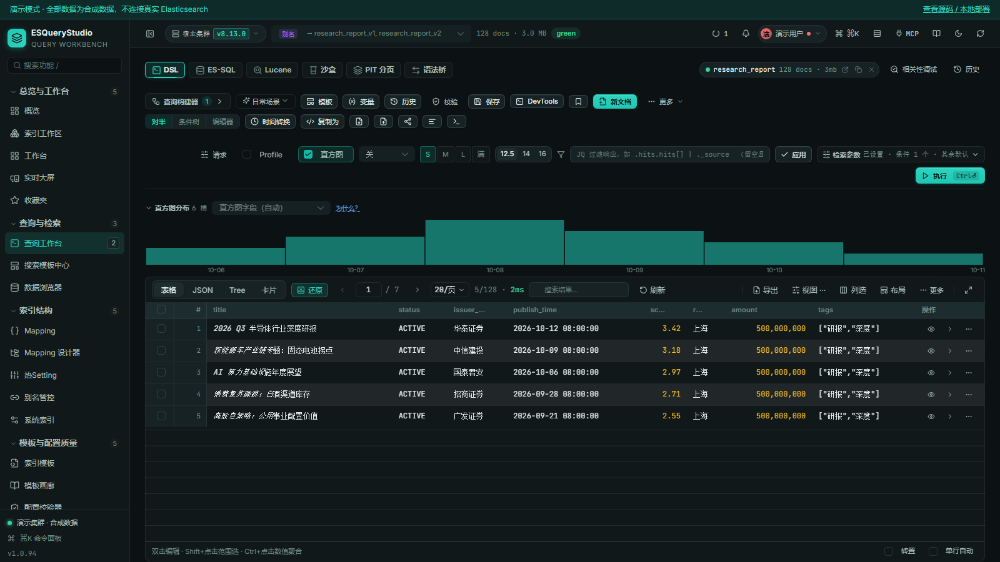

**In one sentence**: most tools give you a query box. ESQueryStudio gives you one continuous path from "write the query" to "read the result", "explain the score", "locate the slow part" and "rebuild with zero downtime".

**Direct links**: [🎪 Live demo (synthetic data, no setup)](https://dengmeiluan.github.io/esquerystudio/) · [GitHub](https://github.com/dengmeiluan/esquerystudio) · [Releases (including the Chrome extension zip)](https://github.com/dengmeiluan/esquerystudio/releases) · [Docs index](docs/README.md) · [LINUX DO community](https://linux.do)

**[Five-minute integration](#-five-minute-integration)** · [MCP guide](docs/mcp.md) · [中文 README](README.md) · [Release article](docs/announcement-1.0.98.md) · [Query workbench](docs/query-workbench.md) · [Chrome extension](#-chrome-extension-native-vue-console-one-source-two-modes) · [Feature packs](#-feature-packs) · [Host integration](docs/integration/README.md) · [Architecture](docs/architecture.md)

> **Fixed in 1.0.99**: the MCP panel now reports “MCP not enabled” honestly and stops probing `/mcp/keys` · standalone AI setup defaults to the service root `/esmcp` · [1.0.98 release article](docs/announcement-1.0.98.md) · [changelog](CHANGELOG.md)

---

## 🧭 Elasticsearch 6.7 → 9.x, one version-aware console layer

This is not "7.x only, with 8/9 as a best effort". The query workbench, standalone jar and Chrome-extension browser mode run from 6.7 to 9.x: request shapes, SQL endpoints, templates and mapping type are driven by the cluster's `version.number`. When the version is unknown it does not guess a major; it uses a request shape valid on both 6.x and 7.x+, then resolves after probing.

| Version | What happens in the console |
|---|---|
| **6.7–6.8** | typed mapping, `_xpack/sql`, legacy `_template` fallback; lower-version capabilities are labeled at the entry point via `minVer` |
| **7.x** | typeless mapping, `_sql`, 7.8+ composable templates, 7.9+ data streams |
| **8.x** | typeless REST, kNN / `dense_vector`, the 8.x query and aggregation catalog |
| **9.x** | typeless REST passthrough, 9.x query types such as `bitmap_terms` |
| **Unknown** | no guess: use the dual-compatible 6.x / 7.x+ request shape, then resolve after probing |

<details>
<summary><b>Compatibility and boundaries (expand)</b></summary>

> **Three boundaries, stated separately**:
> - **Console / browser mode**: the 6.7–9.x range above is handled by the full console; the Chrome extension talks directly to ES REST, and the standalone jar's console follows the same REST contract.
> - **Host form (`boot-support` auto-configuration)**: one shared [`es-rest`](modules/es-rest/) + [`boot-support`](modules/boot-support/) core. **A Boot 2.3 host embeds it by adding the dependency** (the same configuration class is registered in `spring.factories`; verified on Java 8 / Spring 5.2), with thin Boot 2.7 / 3.5 / 4.2 adapter apps alongside; ES 6.7–9.x uses one modern request path plus generic fallback (e.g. `_sql` → `_xpack/sql`), with no 6.x/7.x code branches. There is no 2.3-specific fork: the full console is compiled against Spring 5.3 and the same bytecode serves both the standalone jar and Boot 2.7 hosts, while Boot 3.5 / 4.2 are carried by the same `boot-support` auto-configuration. The same [`mcp-server`](modules/mcp-server/) core also gives host forms the **17-group MCP endpoint** (service-token auth; console-only actions such as adhoc/cross-cluster return an explicit unavailable error).
> - **Verified**: tests are green on all three host baselines (JDK 17 / 17 / 21) plus Boot 2.3 embedding 6/6 (Java 8 + Spring 5.2 via `spring.factories`); the host MCP endpoint passes 4/4 on all four lanes (401, discovery of 17 groups, tools/list, real `es_search`, honest console-only errors); on a 6.7 stub the typed create-index/put-mapping retry and numeric `hits.total` passthrough were measured; on a 9.1-shaped stub search / SQL / mapping / query take the `_sql` and typeless routes with zero calls to `_xpack/sql` or `_doc/_mapping`; a real browser run of the existing Vue console made 42 page routes **404-free**, with up to 17 API calls per page returning 200.

> **Still migrating in the `boot-support` host form** (the full console is unaffected): sdes mapping auto-register, hosted rebuild, host-side MCP API-key governance (the endpoint itself works with the service token), and concrete Spring Security adapters. The full console (standalone jar) ships MCP and the operations depth today; see the [Boot 2/3/4 migration plan](docs/boot3-migration.md).

</details>

### 30-second version

- **No second Kibana deployment**: the console ships with your Spring Boot app; login, routes, permissions and menus stay in the host.
- **Queries are not an island**: DSL / SQL / Lucene / sandbox / PIT / syntax bridge share one session, so results, histogram, history and drafts stay put.
- **Agent access is first-class**: 17 action groups / 171 actions, per-connection read/write, quotas and real cancellation.

### Every ES version × every delivery form

| Form | How it runs | ES 6.7–9.x | Spring Boot | MCP |
|---|---|---|---|---|
| **Standalone jar** | `java -jar esquerystudio-server.jar` | ✅ | 2.7 | 17 groups at `/esmcp` |
| **Host embedding** | depend on `esquerystudio-boot-support` | ✅ | 2.3 / 2.7 / 3.5 / 4.2 | 17 groups (service token) |
| **Full console embedding** | depend on `esquerystudio-console` | ✅ | 2.7 | 17 groups + key governance |
| **Chrome MV3** | extension talks to ES directly | ✅ | — | in-page `window.ESQueryStudioMCP` |
| **Local stdio** | `esquerystudio-mcp` / `.exe` | ✅ | — | 17 groups + resources/prompts |

### Versus Kibana Dev Tools / common admin consoles

| What you care about | Typical setup | ESQueryStudio |
|---|---|---|
| Query authoring | One JSON / DSL box | DSL tree ⇄ raw ⇄ SQL / Lucene in one session, with semantic lint before execution |
| Relevance | Read `_score` only | Score explain / rank detective / Profile flame graph answer "why did it hit / why is it slow" |
| Versions | Configure for one ES release | 6.7–9.x through one path + generic fallbacks (typed/typeless, `_sql` / `_xpack/sql`) |
| Agent access | Add a gateway or bridge | Three transports, 17 groups, keys / quotas / real cancellation |
| Delivery | Deploy another system | Ships with Spring Boot (2.3–4.2), or runs as a Chrome extension |
| Deep operations | Scattered scripts | Zero-downtime rebuilds, cross-cluster migration, snapshots / ILM / SLM, audit and health reports |

## 🎪 Live demo

[**Open the demo →**](https://dengmeiluan.github.io/esquerystudio/demo/) It is built from the same Vue source and runs entirely on synthetic data: no Elasticsearch, no credentials, no setup. Try the query workbench, SQL results, score explain, mapping and cluster overview directly.

## ✨ What makes ESQueryStudio different

| Differentiator | What it means in the product | Why it is uncommon |
|---|---|---|
| **Six modes, one live session** | DSL builder / raw editor, ES-SQL, Lucene, sandbox, PIT and syntax bridge switch in one page; tree, JSON, results, histogram, history and drafts stay together | Most consoles split query styles into unrelated tool pages |
| **A real ES semantic layer** | Mapping, analysis, version, field roles and sortability drive completion, lint, value enums and pre-execution checks; tree ⇄ text stays in sync and unknown clauses fall back to raw JSON | Not "a few autocomplete keywords"; it prevents syntactically valid but semantically wrong queries |
| **Relevance lab** | Score explain, rank detective, query X-ray, clause hit matrix, boost tuner and Profile flame graph share the query session | Most ES admin consoles do not treat "why did it hit / why is it slow" as a first-class workflow |
| **One Vue source, multiple surfaces** | The same 53-page Vue console runs on a Spring Boot server or inside the Chrome extension; browser mode keeps local connections, monitoring, audit, jobs and guarded actions | No separate server UI and plugin UI to drift apart |
| **MCP-native, real-time key governance** | Server `/esmcp`, browser `window.ESQueryStudioMCP` and local Node stdio share 17 action-typed tools (171 fine-grained actions), 14 read-only resources + 1 MCP Apps resource and 7 guided prompts (including one-shot deploy & connect); any signed-in user can issue a key scoped to their own grants, with per-connection read/write (QA/UAT write, production read-only), shared atomic rpm/daily/monthly quotas across instances and live edit/rotation/revocation | MCP is not an appendix; agent access and least privilege are first-class |
| **Cancellable long calls that don't pin production** | A hard 3-minute budget per MCP call; `tasks/cancel` and `notifications/cancelled` truly interrupt (thread / wire-level abort for REST passthrough and SQL via `Cancellable` / ES `_tasks/{id}/_cancel`); task records survive restarts and are readable across instances (control-cluster index or host JDBC table); Tasks-capable clients get `working` then resume; the console's live "tool calls" strip cancels agent-started calls; the local stdio bridge ships as a Node-free single-file `.exe` | Most MCP bridges only wait, and "cancel" merely changes a status word while production connections stay occupied |
| **Host-first, trimmable surface** | Page contract + 11 feature packs + `ConsoleHostIntegration` / auth / connection / audit SPI; disabled deep links land on an explainable page | Not a logo swap, and not a platform with business semantics hard-coded in it |
| **Verifiable open-source delivery** | Full frontend/backend suites, real-browser probes, permission matrix, reproducible release, SBOM, CodeQL / Scorecard / Dependabot | It ships evidence, not only screenshots |

## 🖼️ Three screenshots to get it

<p align="center">
  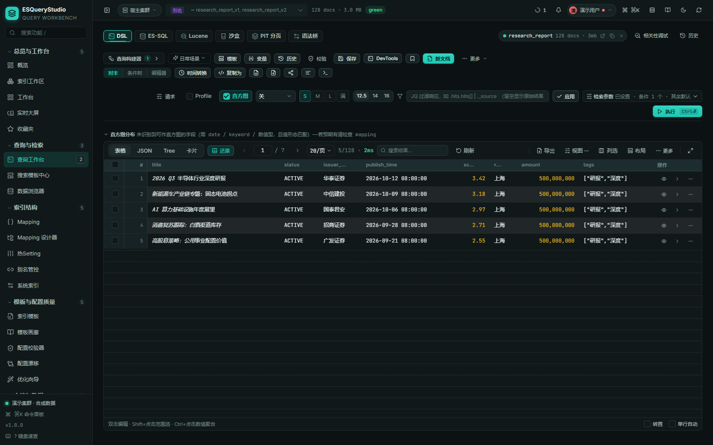
  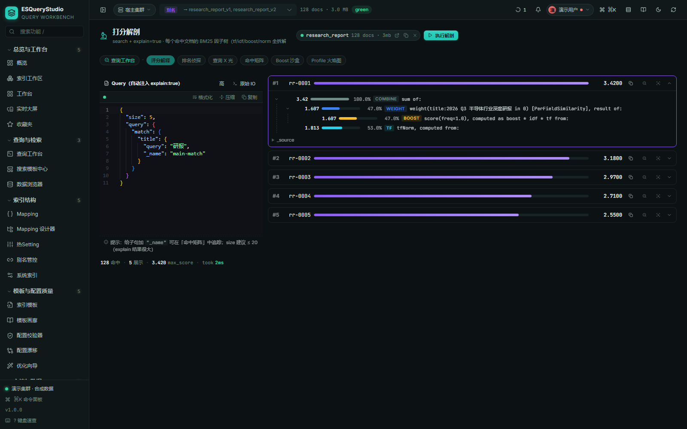
</p>

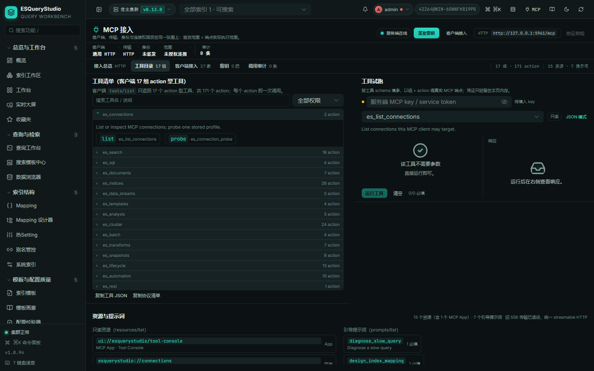

> All three are rendered from the current source in a real Chromium (synthetic data), identical to the live demo — not design mockups.

## 🎯 Core: a query workbench that understands Elasticsearch

The star of ESQueryStudio is not another index-admin table. It is the **query workbench**: instead of
"remember DSL syntax, paste JSON, switch to another browser tab and read the result", you get one
continuous surface — condition tree on the left, raw request body on the right, results, histogram
and timing below. Switch to SQL, Lucene or PIT and the live session stays with you.

### Six modes, one session

| Mode | What you get |
|---|---|
| **DSL builder** | Condition tree ⇄ raw editor in two-way sync; 40+ clause types appear by field type, rare clauses have a dedicated entry, unknown clauses fall back to raw editing |
| **ES-SQL** | `_sql` queries, `cursor` deep pagination, field health check, table / JSON / Tree / card views, one-click SQL ⇄ DSL conversion |
| **Lucene** | Direct Lucene syntax, original highlights and hit rows preserved, can be carried into the builder for refinement |
| **Sandbox** | Free-form DSL, raw response inspection, `_source` and highlight comparison — for testing one hypothesis fast |
| **PIT pagination** | Stable deep pagination on Point-in-Time; a broken cursor is explained and resumable instead of stopping at the 10k window |
| **Syntax bridge** | SQL ⇄ DSL translation with semantic-difference hints; "translated" is not silently treated as "equivalent" |

### Not "a few autocomplete keywords" — it understands your index

- **Mapping-aware**: field types, `text` / `keyword` sub-fields, nested objects and date formats come from the live mapping of the current index; completion and lint never suggest something ES will reject.
- **Analysis-aware**: tokenizers, normalizers, synonyms and `analysis` settings feed the candidates; field-value enums come from the index instead of guesswork.
- **Version-aware**: `minVer` is labeled against the current cluster version, so 6.x typed / 7.x typeless / 7.9+ data streams / 8.x kNN / 9.x typeless REST differences are visible at the entry point instead of surfacing as "the query is wrong".
- **Two-way sync**: edit the tree, the JSON updates immediately; edit the JSON, the tree rebuilds semantically. One side never goes silently stale.
- **Lint is semantic**: missing fields, non-sortable types, `text` without `.keyword`, date-format mismatches and aggregation/sort conflicts all get actionable fixes before execution.
- **Replayable session**: cross-mode query history, favorites, drafts and shareable deep links share one session; switching modes, paging or refreshing never wipes a half-written query.

### From "why did this hit" to "why is it slow"

The workbench is not an isolated input box. It shares the query session with the relevance lab:

- **Score explain**: expand every hit's BM25 factor tree down to `tf` / `idf` / `boost` / `norm`.
- **Rank detective**: interrogate one document — why it won under this query versus another.
- **Query X-ray**: per-clause terms, hit counts and the post-analyzer query that ES actually ran.
- **Clause hit matrix**: which clause matched which document, aligned on one screen — catches "written but ineffective" conditions.
- **Profile flame graph**: expand `profile=true` query/collector timings to find whether time goes to rewrite, build_scorer or next_doc.

> These pages share `?idx=` and the query session; they are not six unrelated tools. All screenshots
> are rendered by the current source in a real Chromium session (Mock ES data); no design mockups,
> composites or legacy UI captures are published. The live demo is built from the same source and
> labels itself as synthetic data, never as a real cluster.

---

## 🛳️ What it is

ESQueryStudio is an **embeddable Elasticsearch query and operations platform**, not a single-purpose
index-rebuild tool:

- **Query workbench** — DSL / ES-SQL / Lucene / sandbox / PIT / syntax bridge, mapping-aware completion, lint, tree ⇄ text sync, history and favorites.
- **Index lifecycle** — alias write-index flip + server-side `_reindex` for zero-downtime rebuilds; cross-cluster migration, reindex estimation, snapshots / SLM / ILM, and delete-resurrection compensation.
- **Observability and governance** — node KPIs, alerts, slow requests, top indices, task trees, topology, health reports, config drift and permission surfaces.
- **Host integration** — authentication delegation, connection directory, page-contract menus, branding and feature-pack selection through the `ConsoleHostIntegration` SPI, with no coupling to a specific business system.

### Who it is for

| What you are doing | What ESQueryStudio gives you |
|---|---|
| A Java / Spring Boot team using ES as the primary search or log store | No second Kibana deployment; the console ships with your app and login, routes, permissions and menus stay in the host |
| A search-quality / relevance team | Builder, score tree, rank detective, X-ray, hit matrix and Profile flame in one session |
| A platform team delivering "queryable, editable, governable" ES capability | Page-level authorization, feature-pack trimming, connection directory, audit contribution, standalone jar (migration window) or host adapters |
| Rebuilding / migrating / capacity-tuning indices | Hosted rebuild, cross-cluster migration, reindex estimation, snapshots and lifecycle as one suite |

### What it is not

| It is | It is not |
|---|---|
| An Elasticsearch 6.7–9.x query / ops / governance workbench | A general-purpose BI or drag-and-drop dashboard builder |
| Deployable standalone or embeddable as a Spring Boot starter | Tied to a specific cloud or SaaS |
| A console whose product surface and auth can be owned by the host | A business system with built-in domain semantics |
| Page-level authorization (connection × page × read/write) | "Fake permissions" based on hidden menus |
| A `provided` contract: the host supplies the ES client stack | A bundle that forces a full ES client stack into the host classpath |

---

## 🧩 Why ESQueryStudio

1. **Workbench first**: make "write a query, read the result, explain the score, locate the slow part" one continuous flow — then grow index and operations capability around it, instead of stitching admin pages together.
2. **A real ES semantic layer**: mapping, analysis, version, field roles and sortability feed completion, lint, value enums and pre-execution checks, reducing "syntactically valid but semantically wrong".
3. **One platform, two shapes**: Kibana-style `java -jar` standalone, or embedded in a Spring Boot host sharing authentication and routing.
4. **Trimmable product surface**: 11 feature packs plus per-page exclusion; deep links to disabled modules land on an explainable "module not enabled" page instead of a blank or 404.
5. **Host-first SPI**: `ConsoleAuthDelegate`, `ConnStore`, `ConsoleAuditContributor` and `ConsoleHostIntegration` have clear roles; the page contract is the single source of truth for frontend navigation, backend page gates and host menu registration.

### Compared with the usual setup

| What you do today | The common gap | What ESQueryStudio does |
|---|---|---|
| Kibana Dev Tools | A raw request box; not embeddable in the host; no score explanation; MCP needs another layer | Six modes in one session + semantic lint + relevance lab + MCP on three transports |
| A generic REST client (Head, etc.) | Sends requests but does not understand mapping / analyzers / versions | Completion, lint, value enums and pre-flight checks read the current index |
| An in-house admin page | Query, rebuild, migration and permissions become four systems; a version bump breaks them | Page contract + 11 feature packs + host SPI; one source, multiple shapes |
| A rebuild-only starter | After the rebuild there is nothing else | Rebuild / migration and query / observability / governance in one stack |

---

## 📦 Feature packs

All packs are on by default. List the packs you need in `esquerystudio.console.features.packs` to trim
the surface; `exclude-pages` hides individual pages on top. A feature pack is a **deployment
choice**, not a permission — authorization still comes from page-level read/write keys in
`grantedPages`.

| Pack | Pages | What you do inside |
|---|---:|---|
| `platform` | 5 | Overview, index workspace, workbench, live dashboard, favorites |
| `search` | 3 | Query workbench (DSL/SQL/Lucene/sandbox/PIT/bridge), search templates, data browser |
| `index` | 5 | Mapping and designer, hot settings, alias control, system indices |
| `quality` | 5 | Index templates, template gallery, config validation, config drift, optimizer |
| `data` | 3 | Bulk editor, Update By Query, document diff |
| `text` | 4 | Analyze validation, analyzer lab, synonym dictionary, analysis overview |
| `relevance` | 6 | Score explain, rank detective, boost tuner, hit matrix, query X-ray, Profile flame |
| `lifecycle` | 8 | Hosted rebuild, cross-cluster migration, advanced/estimated reindex, snapshots, SLM, ILM, lifecycle |
| `observe` | 9 | Diagnostics, health report, topology, Watcher, tasks/task tree, cluster settings, plugins, remote clusters |
| `security` | 1 | Security center: accounts, permission surface, ops audit |
| `devtools` | 4 | REST console, Dev Tools tabs, MCP access, Painless sandbox |

> The page contract `META-INF/esquerystudio-pages.json` is the single source of truth: frontend
> navigation, backend page gates and the host menu registrar all derive from it. Feature packs
> change the exposed surface, not page keys.

**Page map** (13 groups / 53 pages, trimmable by group or page):

| Group | Pages | Representative capability |
|---|---:|---|
| `core` | 5 | Cluster overview, index workspace, Dev workbench, live dashboard, favorites |
| `search` | 3 | Six-mode query workbench, search templates, data browser |
| `index` | 5 | Mapping and designer, hot settings, alias control, system indices |
| `quality` | 5 | Index templates, template gallery, config validation, config drift, optimizer |
| `data` | 3 | Bulk editor, Update By Query, document diff |
| `text` | 4 | Analyze validation, analyzer lab, synonym dictionary, analysis overview |
| `rank` | 6 | Score explain, rank detective, boost tuner, hit matrix, query X-ray, Profile flame |
| `rebuild` | 4 | Hosted rebuild, cross-cluster migration, advanced/estimated reindex |
| `protect` | 4 | Snapshots, SLM, ILM, lifecycle |
| `health` | 4 | Diagnostics, health report, topology, Watcher |
| `cluster` | 5 | Tasks/task tree, cluster settings, plugins, remote clusters |
| `security` | 1 | Security center: accounts, permission surface, ops audit |
| `devx` | 4 | REST console, Dev Tools tabs, MCP access, Painless sandbox |

---

## 🖥️ Console gallery

**Query workbench** — condition tree, raw DSL, histogram and result table on one screen; mapping-aware completion and lint update as you type:


**Score explain** — the BM25 factor tree for every hit, `tf` / `idf` / `boost` / `norm` expanded layer by layer:


**SQL console** — `_sql` queries, cursor deep pagination, field health check, multi-view results and DSL conversion:

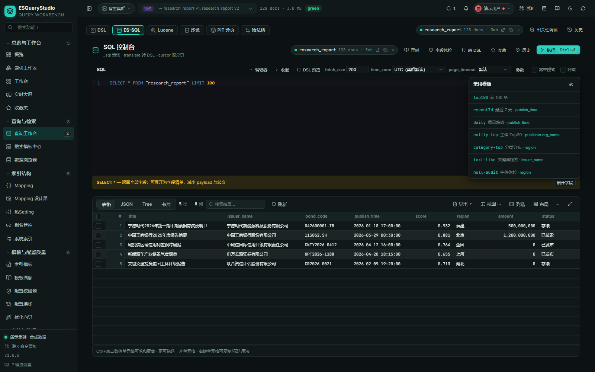

**Cluster overview** — health, storage, document distribution and monitoring history:

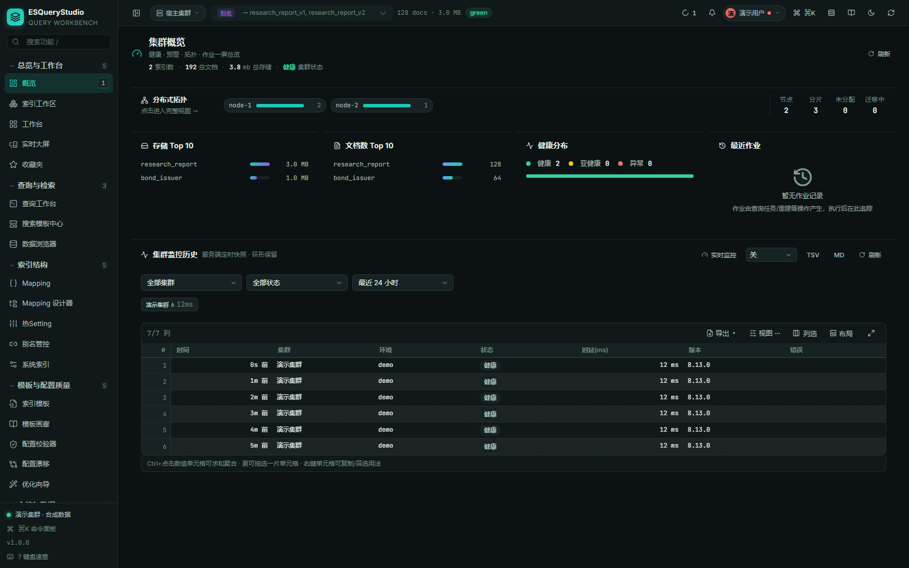

### Ops console capabilities

- **Ad-hoc rebuilds** — guided zero-downtime rebuild: pick index → review settings/mapping → catch-up policy → confirm preview → watch execution.
- **Index workspace** — index list plus embedded document grid: filter / column stats / snapshot / export / inline edit.
- **Query workbench** — DSL / ES-SQL / Lucene / sandbox / PIT / syntax bridge with semantic completion and highlighting.
- **Data browser** — document CRUD, column stats, CSV / Markdown / XLSX export.
- **Cluster governance** — indices / aliases / mapping / ILM / snapshots / task tree / config drift / health reports.
- **Audit** — page-level grants (connection × page × read/write) plus host audit contribution.
- **Live monitoring** — node KPIs / alerts / slow requests / top indices across clusters.

---

## 🚀 Delivery forms in detail (standalone / embed / SPI)

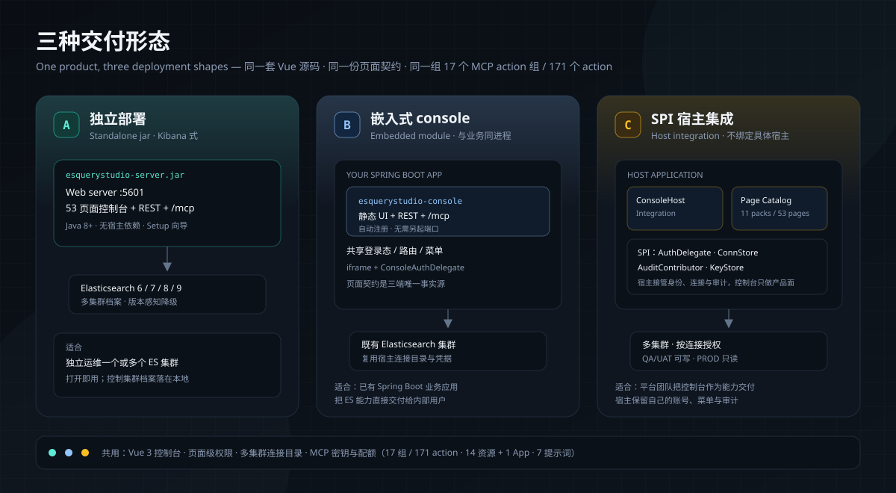

### ① Standalone (Kibana-style)

```bash
java -jar esquerystudio-server.jar
```

Ships its own web server (default port `5601`) and ES client stack, with no host app required.
Open `http://localhost:5601/esquerystudio.html` and finish the Setup wizard against your control cluster.

The bootstrap profile persists under `~/.esquerystudio/` and survives restarts. See [apps/server/README.md](apps/server/README.md).

### ② Embedded console module

Add `esquerystudio-console` to a Spring Boot host and the console static resources and HTTP endpoints
register automatically; authentication can be delegated to the host (iframe shares the login).
Best for delivering one integrated product with your business system.

### ③ Host integration (SPI-driven, host-agnostic)

ESQueryStudio does not require the host to become a particular business shape. Implement
`ConsoleHostIntegration` to declare branding and preferred packs, then add auth delegation,
connection directory and audit contribution as needed:

```java
@Bean
public ConsoleHostIntegration esQueryStudioHostIntegration() {
    return new ConsoleHostIntegration() {
        public String id() { return "acme"; }
        public String displayName() { return "Acme Search"; }
        public List<String> preferredPacks() {
            return Arrays.asList("platform", "search", "index", "data",
                    "lifecycle", "observe", "security", "devtools");
        }
    };
}
```

Every host-specific surface is an interface: `ConsoleAuthDelegate` (auth), `ConnStore` (connection
directory), `ConsoleAuditContributor` (audit), `ConsolePageCatalog` (menus). Full integration
surface and acceptance checklist: [docs/integration/README.md](docs/integration/README.md).

**Choose by scenario**:

| Your scenario | Use | Extra work |
|---|---|---|
| Operate one or more ES clusters standalone | `esquerystudio-server` jar | None; open the Setup wizard |
| You already have a Spring Boot app | `esquerystudio-console` embedded | Declare `@Document` entities; optional auth delegation |
| Integrate with host accounts, menus and audit | `esquerystudio-console` + host SPI | Implement `ConsoleHostIntegration` and `ConsoleAuthDelegate` |
| **Any Boot 2.3–4.2 host needing the workbench + MCP** | `esquerystudio-boot-support` + shared core jars | Set `esquerystudio.mcp.enabled` and a service token |
| No backend deployment | Chrome MV3 extension / static demo zip | Enter the ES URL in the extension |
| Local agent access | `esquerystudio-mcp.exe` / Node stdio | Write the client MCP config |
| Only the rebuild / migration engine | `esquerystudio-console`, `mode=rebuild-only` | No console pages or static resources exposed |

---

## 🤖 MCP access

One tool contract (read-only by default; admins can issue write-scoped keys), three transports:

> **The endpoint defaults to `/esmcp`** (project-scoped, so a host or another integration can keep `/mcp`); hosts that need the old address set
> `esquerystudio.mcp.path=/mcp`. Malformed paths fail startup. The console follows `setup/status.mcpPath`.
>
> **The MCP server ships with the full console and with every host form**: the standalone jar, the Boot 2.7 console embed, and `boot-support` hosts on Boot 2.3–4.2 all mount the same 17-group `/esmcp` core. Host forms authenticate with the service token (`esquerystudio.mcp.enabled=true` + `esquerystudio.mcp.token`); per-user API keys and actions that need console stores (adhoc rebuild / cross-cluster migration / config lab, …) remain full-console capabilities and return an explicit unavailable error in host forms. The browser bridge and local Node transports are unaffected.

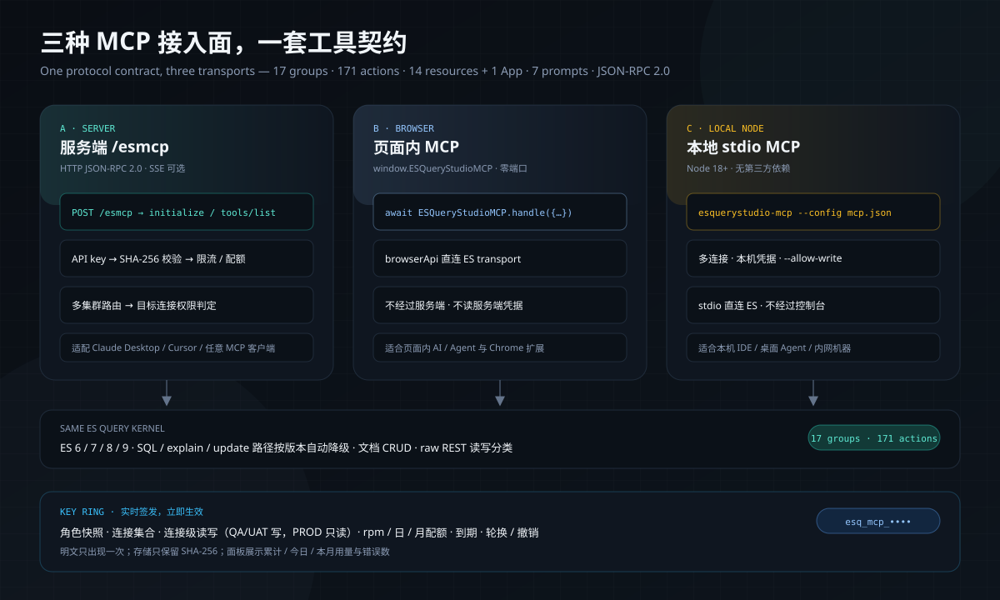

- **Server mode**: `POST /esmcp` JSON-RPC 2.0 with **MCP 2026-07-28** (`server/discover`, cache hints, stateless requests) and backward-compatible 2025-11-25 / 2025-06-18 / 2025-03-26 / 2024-11-05 `initialize`; a service Bearer token or per-user/per-role MCP API keys (connection set, per-connection read/write scope, tool allowlist, per-minute rate, daily/monthly quotas (shared atomic counters across instances) and expiry — one key can write QA/UAT while staying read-only on production); 17 action-typed tools (171 fine-grained actions: index lifecycle (create/delete index, mapping, settings, aliases, rollover, merge, templates, data streams, clone/shrink/split, transform lifecycle), batch update/delete/reindex, analysis settings/synonyms/query validation/term vectors, cluster settings/reroute, shard diagnostics, node/hot-thread/plugin/Watcher observability, snapshots/ILM/SLM, scripts, ingest pipeline lifecycle, managed rebuild / cross-cluster migration job governance and event timelines, settings/aliases/templates/nodes/tasks/stats and raw REST passthrough), plus 14 read-only resources (connections/cluster/index/aliases/data streams/component templates/mapping/migration jobs/tasks), 1 MCP Apps resource (`ui://esquerystudio/tool-console`, bound by all 17 action tools via `_meta.ui.resourceUri`) and 7 guided prompts (including one-shot deploy & connect); the Tasks (`io.modelcontextprotocol/tasks`) and MCP Apps (`io.modelcontextprotocol/ui`) extensions are advertised, and MRTR elicitation confirmation is supported for destructive writes; keys persist to control-cluster ES or host JDBC; the bundled `mcp/esquerystudio-mcp-stdio.mjs` bridge connects Claude Desktop / Cursor through stdio.
- **Browser mode**: the browser build installs `window.ESQueryStudioMCP`, so in-page agents can call `handle` / `callTool` directly. A browser tab cannot listen on TCP; external process clients should use server mode or the local Node mode.
- **Local Node mode**: `node mcp/esquerystudio-local-mcp.mjs --config ~/.esquerystudio/mcp.json` (or `cd mcp && npm install -g .` then `esquerystudio-mcp`) on Node 18+ with no third-party dependencies; it talks directly to one or more ES connections. Browser mode can export its profiles as the Node MCP config, so Claude Desktop / Cursor need neither Spring Boot nor a browser.
- **Management surface**: server-mode **Dev Tools → MCP → Keys & usage** creates/revokes keys and shows request counts and quotas; browser/demo modes state the honest HTTP-key boundary.
- **One-shot AI onboarding**: paste the prompt in [AGENT_SETUP.md](AGENT_SETUP.md), or use **MCP → Overview → AI setup & connect** in the running console to generate, copy or download the same prompt for a chosen mode/client/endpoint; MCP clients can also call `prompts/get` (`deploy_and_connect`).
- **Client onboarding**: a client chip row in the panel plus `esquerystudio-mcp-cli` (`list` / `detect --json` / `config` / `install`) covers Claude Code, Claude Desktop, Cursor, CodeBuddy Code CLI, ZCode, TRAE, VS Code, Windsurf, Codex, DeepSeek Harness, OpenCode, Pi, Cherry Studio, Qoder, WorkBuddy, Antigravity, Cline, Roo Code, Kilo Code, Gemini CLI, GitHub Copilot CLI, Zed, Continue, Amp, Crush and JetBrains AI Assistant; Cursor / VS Code / Windsurf / OpenCode / Qoder / TRAE / CodeBuddy / ZCode / WorkBuddy / Pi / Antigravity / Cline / Roo Code / Kilo Code are merged safely, the rest emit paste-ready config or an executable command (Crush gets a TOML section for `~/.config/charm/crush/config.toml`; JetBrains gets a stdio-bridge XML for the project-level `.idea/mcp.xml`, native since IDE 2025.2). System-management tools can only be issued to and invoked by ADMIN-role keys. `detect --json` reports `commandFound` / `configFound` / `installed`, and `--local` points any client at the local Node stdio bridge without Spring Boot.

Shortest setup, Claude/Cursor config, per-connection grants and a 30-second check: **[MCP quickstart](docs/mcp.md#快速开始)**. Full configuration, tool table and honest boundaries follow in the same doc. The server UI exposes all three surfaces under **Dev Tools → MCP**.

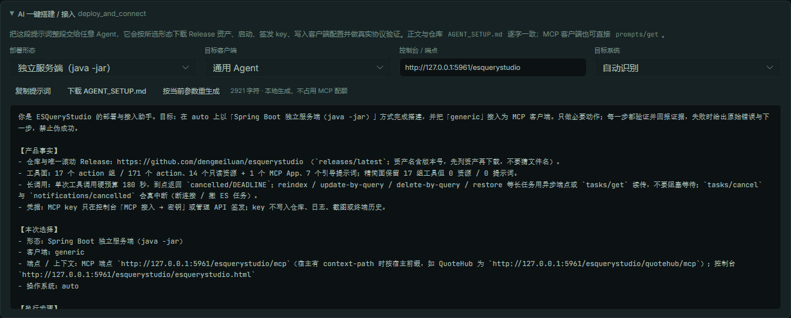


### Console endpoint cheat sheet (full console)

| Endpoint | Purpose |
|---|---|
| `/internal/es/index/rebuild` | Managed rebuild / reindex (full console) |
| `/internal/es/index/keys` | MCP keys and usage |
| `/internal/es/index/desired-state.html` | Desired-state echo (mapping auto-register) |

> These endpoints belong to the full console (standalone jar); the `boot-support` host form currently
> covers read-only overview, the query workbench and document/index write surfaces; see the boundaries above.

## 🧩 Chrome extension: native Vue console, one source, two modes

The same `ui/` Vue console source powers both modes. Server mode keeps the Spring Boot
`/internal/es/index` backend; browser mode swaps only the transport and talks directly to
Elasticsearch from the extension. There is no second UI to drift. The extension's main page
is the full 53-page Vue console (browser build); first open asks for the ES URL, then routes,
components and styles are identical to server mode.

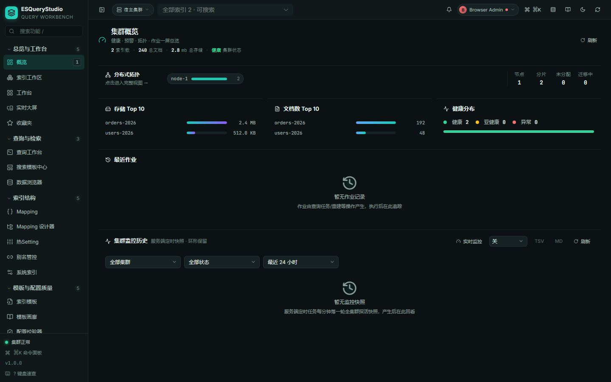

- **Server mode**: the same Vue source is served by the Spring Boot server through `/internal/es/index`; all 53 pages, 11 packs and host SPI remain.
- **Browser mode**: the extension runs the same Vue source in a `browser` build; the `api.ts` transport switches to direct Elasticsearch. The native connection layer stores credentials locally only; multiple local profiles can be saved and switched from the top bar.
- **Coverage**: indices, mappings, settings, aliases, templates, snapshots, ILM/SLM, Watcher, tasks, nodes, REST, SQL, PIT, reindex, bulk, managed rebuild, cross-cluster migration (client `scroll` + `_bulk`), config validation (L1 + L2 dry-run), config drift (local baseline) and system indices (local job locks) work. Task progress, settings impact and the guarded apply flow (local ES 7.10 classification + confirmToken), monitor history/alerts, operation audit and rebuild/migration jobs keep the same API contract while data stays in local IndexedDB/localStorage.
- **Boundary**: browser mode has no cross-instance distributed lock or code provider; the system page shows local job locks and config drift compares against the first local baseline. Monitoring samples once per minute (an open console tab samples the current target; the service worker writes cluster, per-node and top-index rows for every local profile; restricted accounts without `_nodes` / `_cat` / `_stats` permissions keep the real cluster-health row), stays local and never fabricates history; accounts remain Elasticsearch-native.
- **Install**: open `chrome://extensions` → enable Developer mode → **Load unpacked** → select the folder containing `manifest.json` (`extensions/chrome` in the repo; extract the release zip first — do not select the zip itself).

Browser-mode capability matrix and honest limits: [docs/browser-mode.md](docs/browser-mode.md). Install and security notes: [extensions/chrome/README.md](extensions/chrome/README.md).

---

## ⚡ Five-minute integration

> **Two delivery forms (honest boundary)**: the full console (53 pages + MCP + operations depth)
> ships as a standalone jar; **any Boot 2.3 / 2.7 / 3.5 / 4.2 host** can embed the query workbench
> plus the same 17-group `/esmcp` through `esquerystudio-boot-support` (auto-configured, writes off
> by default). Section A runs the demo apps first; B is host embedding.

### A. Run a host adapter app (available now)

```bash
# Boot 2.7 / Java 17 (Spring 5.3 · default port 5602)
JAVA_HOME=/path/to/jdk-17 ./mvnw -Pboot2 -pl modules/console-boot2 -am spring-boot:run

# Boot 3.5 / Java 17 (ES 8.x client · default port 5603)
JAVA_HOME=/path/to/jdk-17 ./mvnw -Pboot3 -pl modules/console-boot3 -am spring-boot:run

# Boot 4.2 / Java 21 (ES 9.x client · default port 5604)
JAVA_HOME=/path/to/jdk-21 ./mvnw -Pboot4 -pl modules/console-boot4 -am spring-boot:run
```

Target cluster: `ESQ_ES_URL` / `ESQ_ES_USERNAME` / `ESQ_ES_PASSWORD`; open `/esquerystudio.html` on
`http://localhost:5602` (Boot 2.7), `http://localhost:5603` (Boot 3.5) or `http://localhost:5604` (Boot 4.2).

**Identity and writes**: register a `ConsoleAuthProvider` bean in production (returns a
`ConsolePrincipal`); the core never parses host sessions. Without it, only the local
`esquerystudio.boot.dev-bootstrap-auth=true` fallback exists. Writes are 403 unless
`esquerystudio.boot.allow-writes=true`.

### B. Embeddable integration (available: auto-configuration)

Embedding needs exactly one dependency: `esquerystudio-boot-support`. It is Java 8 bytecode with
no Spring version binding (`spring.factories` for Boot 2.3, `AutoConfiguration.imports` for 2.7+),
and keeps the host's own `spring-boot-starter-web`, Jackson and `elasticsearch-rest-client`
versions. The current version is not on Maven Central yet; install it from this repository first:

```bash
# Any boot profile includes the shared modules; boot3 is used as the build profile here
./mvnw -Pboot3 -pl modules/boot-support -am -DskipTests install
```

```xml
<dependency>
    <groupId>io.github.dengmeiluan</groupId>
    <artifactId>esquerystudio-boot-support</artifactId>
    <version>1.0.99</version>
</dependency>
```

With `esquerystudio.elasticsearch.url` set, the console shell and API mount themselves. Boot 2.3
hosts (the QuoteHub baseline) also add only this dependency: the configuration class is listed in
`spring.factories` and the console assets travel inside the library jar on the classpath. Boot
2.7 / 3.5 / 4.2 hosts use `AutoConfiguration.imports`. For agent access add
`esquerystudio.mcp.enabled=true` and `esquerystudio.mcp.token=<token>`; the host then mounts the
same 17-group `/esmcp` surface as the full console (service-token auth). Release assets also ship
`esquerystudio-boot-support` with its shared core jars (`es-rest` / `es-engine` / `mcp-core` /
`mcp-server`) for `mvn install:install-file` or direct classpath use. **Boot 4 hosts** must also add
Jackson 2.x explicitly (Boot 4 no longer ships it; the adapter app bundles 2.18.11).

> Verified: deleting the explicit `@Import` from all three demo apps still passes (Boot 2.7 11/11,
> Boot 3.5 16/16, Boot 4.2 5/5), and Boot 2.3 embedding passes 6/6 (Java 8 + Spring 5.2,
> `spring.factories` mount, 6.7-shaped numeric `hits.total` and `_xpack/sql` fallback),
> proving the mount comes from auto-configuration. The host MCP endpoint passes 4/4 on all four
> lanes (401 / discovery / tools-list / real `es_search` / honest console-only errors).

### C. `@Document` entities and hosted rebuilds (Phase 2, not implemented yet)

> Target shape only. The `boot-support` core has no sdes mapping auto-register or hosted rebuild yet;
> the full console already implements `esquerystudio.elasticsearch.mapping.auto-register`,
> `MappingReconcile`, `conflict-policy` and the `USE_ADHOC_REBUILD` state machine; see the
> [mapping guide](docs/integration/mapping.md).

```java
@Document(indexName = "bond_quote")
public class BondQuoteES {
    @Id
    private String id;

    @Field(type = FieldType.Keyword)
    private String bondCode;

    @Field(type = FieldType.Text, analyzer = "ik_max_word", searchAnalyzer = "ik_smart")
    private String shortName;
}
```

```text
Build the new index (new mapping) → server-side _reindex backfill → atomic alias flip → observation window → retire the old index
```

### D. Shared-core configuration (Boot 2.7 / 3.5 / 4.2)

```yaml
esquerystudio:
  elasticsearch:
    url: http://localhost:9200
    username: elastic
    password: ${ES_PASSWORD:}
  boot:
    dev-bootstrap-auth: false   # local verification only
    allow-writes: false         # write gate; GET/HEAD unaffected
```

### E. Implemented endpoints (honest list)

| Endpoint | Status |
|---|---|
| `GET /internal/es/index/setup/status`, `/auth/me`, `/pages`, `/ui/config` | available |
| `GET /clusters`, `/overview`, `/health`, `/cluster/{health,indices,aliases,shards,tasks,pending-tasks,snapshot/status,nodes-stats-brief}`, `/monitor-history` | available (real ES REST) |
| `GET /cluster/mapping-detail`, `/cluster/inspect`, `/cluster/index-settings` | available |
| `POST /cluster/query`, `/cluster/profile`, `/cluster/sql` | available (`_sql`, generic `_xpack/sql` fallback) |
| `POST /cluster/raw`, `/cluster/devtools/execute` | available (writes gated) |
| `POST /cluster/{delete-by-id,update-document,update-partial,put-mapping,update-settings,create-index,delete-index,force-merge}` | available (writes gated) |
| Backup / lifecycle / cluster reads: `/cluster/{settings,snapshot/repos,ilm/policies,ilm/status,slm/policies,slm/status,watcher,remote-clusters,plugins,templates}` | available |
| Security / MCP / migration reads: `/auth/{users,ops-audit,audit-facets}`, `/mcp/keys*`, `/internal/es/xmigrate/jobs` | available (honest empty: no user store, audit store or migration jobs yet) |
| `/adhoc-rebuild/*`, `/config-lab/validate`, `/xmigrate/{start,resume,...}`, MCP key issuance | **not implemented** (Phase 2+) |

> All 42 page routes were crawled in a real browser: **zero 404s**. Unimplemented endpoints still surface as real 404s; no fake success.

---

## 🏗️ Architecture

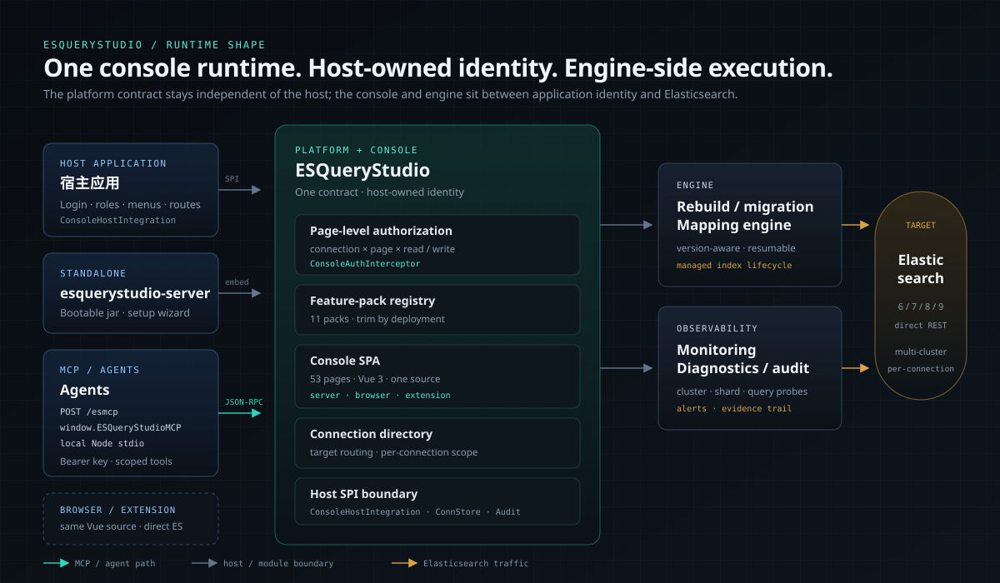

**Layers**: platform kernel (branding / feature packs / host SPI) → console module (query / index /
observability / security) → engine module (rebuild / migration / mapping). Feature packs are
declared at the contract layer; backend page gates still enforce the full contract.

### Project structure

```text
esquerystudio/
├─ platform/                 esquerystudio-platform: page contract / feature packs / host SPI (shared)
├─ modules/console/          esquerystudio-console: full console core (Spring 5.3; standalone jar and Boot 2.7 hosts)
├─ modules/es-rest/          esquerystudio-es-rest: Java 8 low-level REST contract (async/cancel, all baselines)
├─ modules/es-engine/        esquerystudio-es-engine: Spring-neutral index/alias/reindex engine (es-rest based)
├─ modules/mcp-core/         esquerystudio-mcp-core: Spring-neutral MCP key/quota/secret/task core (shared)
├─ modules/mcp-server/       esquerystudio-mcp-server: transport-neutral 17-group MCP endpoint (console + Boot 2.3–4.2 hosts)
├─ modules/boot-support/     shared REST/probe core (compiled with Spring 5.3; Boot 2/3/4)
├─ modules/console-boot2/    Boot 2.7 / Java 17 host adapter
├─ modules/console-boot3/    Boot 3.5 / Java 17 host adapter
├─ modules/console-boot4/    Boot 4.2 / Java 17 host adapter
├─ apps/server/              standalone jar launcher (full console)
├─ docs/                     architecture, integration and design documents
├─ ui/                       @esquerystudio/ui: Vue 3 console source
├─ extensions/chrome/       MV3 Chrome extension: direct ES query workbench
└─ examples/demo-host/       runnable host example
```

`es-rest` / `es-engine` / `mcp-core` are Spring-free shared bytecode; both `console` and
`boot-support` build on them, while `mcp-server` gives both the same 17-group MCP endpoint — no
engine logic is reimplemented for the host form.

### Compatibility matrix

| Dimension | Supported range |
|---|---|
| JDK | 8+ (standalone jar / Boot 2.x hosts); 17 (Boot 3.5) and 21 (Boot 4.2) adapters verified |
| Spring Boot (host adapters) | 2.3 / 2.7 / 3.5 / 4.2 (one `boot-support` auto-configuration; 2.3 via `spring.factories`, verified on Java 8 / Spring 5.2) |
| Elasticsearch (host adapters) | 6.7–9.x (one modern request path + generic fallback, e.g. `_sql` → `_xpack/sql`; no 6.x/7.x code branches) |
| Elasticsearch (browser mode) | 6.7–9.x (direct REST; feature gates via `minVer`) |
| OS | Linux / macOS / Windows, pure JVM |
| Delivery | Standalone jar (full console), Boot 2.3–4.2 host embedding (incl. 17-group `/esmcp`), Chrome extension |
| Browser | Modern Chromium / Firefox / Safari, iframe embedding and theme following |

---

## 🎛️ Interaction constitution

The console is not "if it renders, it is done"; it is a testable set of constraints:

1. **Shortest path**: high-frequency actions are one click away; rare actions live in the ⋯ menu.
2. **Stable position**: after a state transition, the same action stays at the same pixel.
3. **State never resets**: paging / refresh / mode switch preserve filters, scroll, drafts and focus.
4. **Merge controls**: mutually exclusive or paired actions become a two-state button, segmented control or dropdown group.
5. **Overlay four elements**: surface + border + shadow + radius; Esc closes and returns focus to the trigger.
6. **Second channel parity**: right-click and the Menu key (Shift+F10) on table/list/card rows open the same menu; rows and clickable fragments are focusable, Enter/Space equal click; menu focus enters the first item, Home/End jump, Esc returns to the row.

Full clauses and delivery sequences: [docs/design.md](docs/design.md).

---

## ✅ Quality and verification

- **Frontend contract locks + real-browser behavior chains**: contract derivation, DSL round-trip, table kernel, permission gates, hotkeys and the right-click/Menu-key second channel all have source/behavior assertions; a keyboard-entry census guards new surfaces and goes red when one is missing.
- **Backend full gate**: Maven tests cover auth, page authorization, rebuild state machine, mapping reconcile, cross-cluster migration and storage tiers.
- **Real browser verification**: Mock ES + the real console, covering completion, lint, navigation trimming, disabled-module deep links and the permission matrix.
- **Negative controls**: illegal contracts, unknown feature packs and empty page grants must fail first and pass after the fix; "no error" is never accepted as proof.
- **Reproducible releases**: fixed `project.build.outputTimestamp`; the release profile produces sources/javadoc/SBOM; repeated builds of `platform` / `console` / `server` / host jars must have identical SHA-256.
- **Supply chain and security automation**: CodeQL, OpenSSF Scorecard, Dependency Review, Dependabot and a tag-driven Release workflow (version check, checksums, provenance attestation).

```bash
# Frontend
cd ui && npm ci
npm run typecheck          # vue-tsc 0
npm test                   # sharded full suite

# Backend
./mvnw clean package       # reuses the UI build automatically
./mvnw test -Dconsole.build.skip=true
```

---

## 🗺️ Roadmap

- [x] **Phase 1 · Query workbench**: six modes sharing one session, mapping-aware completion and lint, tree ⇄ text sync, relevance lab.
- [x] **Phase 2 · Platform and modules**: `platform` / `console` / `server` split, page contract, feature packs and host SPI.
- [x] **Phase 3 · ESQueryStudio 1.0**: unified brand and coordinates, bilingual README, demo host, integration docs and reproducible releases.
- [x] **Phase 4 · Shared kernel**: `es-rest` / `es-engine` / `mcp-core` / `mcp-server` extracted; the console and Boot 2.3–4.2 hosts share the same bytecode.
- [x] **Phase 5 · Every version × every form**: ES 6.7–9.x, zero-fork Boot 2.3–4.2, four-transport MCP, automatic Pages/Release publishing.
- [ ] **Phase 6 · Ecosystem**: more host templates, plugin inventory and a one-command bootstrap.

---

## 🛠️ Build from source

```bash
git clone https://github.com/dengmeiluan/esquerystudio.git
cd esquerystudio

# Frontend (Node 18+)
cd ui && npm ci && npm run build && cd ..

# Backend (core / standalone jar builds on JDK 8; Boot 3.5 / 4.2 adapters need 17 / 21; the reactor reuses the UI build)
./mvnw clean package

# Tests
cd ui && npm test && cd ..
./mvnw test -Dconsole.build.skip=true
```

Runnable example: [examples/demo-host](examples/demo-host/) — one `@Document` entity plus a
`@SpringBootApplication`, and the full query and ops console is up.

---

## ⭐ Help more Spring Boot teams find it

If ESQueryStudio saved you a Kibana deployment, a hand-written DSL, or finally showed you why a document matched, please give it a **Star**. It does not change the code, but it makes the project easier to find; forwarding the [live demo](https://dengmeiluan.github.io/esquerystudio/demo/) to a teammate building an ES console helps too.

---

## Contributing

Issues and PRs are welcome. Before starting, read [CONTRIBUTING.md](CONTRIBUTING.md),
[architecture](docs/architecture.md), the [docs index](docs/README.md) and the
[design constitution](docs/design.md). Participation implies adherence to the
[Code of Conduct](CODE_OF_CONDUCT.md); decision and release process live in
[GOVERNANCE.md](GOVERNANCE.md), support channels in [SUPPORT.md](SUPPORT.md). For host integration,
extend through the SPI instead of hard-coding business fields into the platform.


## License

[Apache-2.0](LICENSE)

## Friendly links

- [LINUX DO community](https://linux.do)
