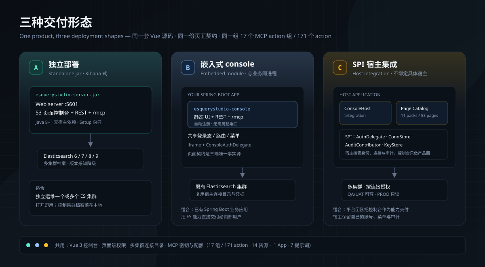

# 文档索引

按你的任务选择阅读路径。所有指南都与 ESQueryStudio 1.0.95 当前版本对齐。
控制台（独立 jar / Chrome 扩展 / 宿主适配器）的 REST 查询与运维路径支持 **Elasticsearch 6.7–9.x**：typed / typeless、SQL 端点、模板、data streams 与 kNN 的差异由统一版本感知层处理，不需要为 8/9 换一套 UI。宿主模式提供 **Boot 2.7 / 3.5 / 4.2** 三个薄适配器，共用不依赖 Spring 的 `es-rest` 核心与 Spring 5.3 编译的 `boot-support` 探针层，按宿主自己的 Spring 与客户端栈运行。

> 在线演示（合成数据，点开即玩）：<https://dengmeiluan.github.io/esquerystudio/demo/>

## 阅读路径

| 我在做什么 | 按顺序阅读 |
|---|---|
| **让 Agent 通过 MCP 访问 ES** | [MCP 接入](mcp.md#快速开始) → [宿主集成清单](integration/README.md#宿主接入-mcp-检查清单) |
| 把控制台接入 Spring Boot 应用 | [README 快速接入](../README.md#-5-分钟接入) → [接入快速开始](integration/quickstart.md) → [配置参考](integration/configuration-reference.md) → [故障排查](integration/troubleshooting.md) |
| 运维控制台 | [期望状态](integration/desired-state.md) → [Mapping 冲突](integration/mapping.md#mapping-冲突转-adhoc-重建) → [故障排查](integration/troubleshooting.md) |
| 把控制台嵌入宿主 | [架构](architecture.md) → [宿主集成](integration/README.md) → [设计宪法](design.md) |
| 参与贡献代码 | [CONTRIBUTING](../CONTRIBUTING.md) → [架构](architecture.md) → [设计宪法](design.md) → [GOVERNANCE](../GOVERNANCE.md) |

## 文档地图

| 文档 | 用途 |
|---|---|
| [架构](architecture.md) | 模块、依赖规则、页面契约、运行时分层与交付形态 |
| [查询工作台](query-workbench.md) | 六种查询模式、语义补全、树 ⇄ 文本同步、相关性实验室 |
| [重建与迁移选型](rebuild-guide.md) | 托管重建 / Reindex 高级 / Reindex 预估 / 跨集群迁移四页的决策表与能力对照 |
| [浏览器模式](browser-mode.md) | Chrome 扩展内的同一套 Vue 控制台：transport、本机存储、护栏执行与诚实边界 |
| [Boot 2/3/4 迁移](boot3-migration.md) | 统一核心 + Boot 2.7/3.5/4.2 宿主适配器、Boot 2.3 嵌入、ES 6.7–9.x 单路径回退 |
| [MCP 接入](mcp.md) | 服务端 `/esmcp`、stdio 桥、本地 Node MCP（多连接）、按用户/角色 API key 与频率配额、纯前端 `window.ESQueryStudioMCP` 与工具契约 |
| [Chrome 扩展](../extensions/chrome/README.md) | 前端直连查询工作台：能力、裁剪清单、安装与安全 |
| [Chrome 商店提交](../extensions/chrome/STORE-SUBMISSION.md) | 打包、商店字段、权限理由、审核与版本更新 |
| [隐私政策](privacy-policy.md) | Chrome 扩展的数据边界、权限、保留与删除方式 |
| [设计宪法](design.md) | 控制台的交互规则与视觉语言 |
| [集成索引](integration/README.md) | 业务端 / 宿主端接入指南索引 |
| [接入快速开始](integration/quickstart.md) | 第一个托管实体、Mapping 自动登记与重建 |
| [配置参考](integration/configuration-reference.md) | 每个配置键及其 Java 默认值 |
| [故障排查](integration/troubleshooting.md) | Mapping 对账、认证、重建与迁移失败 |
| [期望状态](integration/desired-state.md) | 从业务应用复制期望并选择目标集群 |
| [Mapping 指南](integration/mapping.md) | 注解写法、启动自动登记（写入边界与多实例行为）、冲突转 Adhoc 重建 |
| [发布流程](releasing.md) | 版本对齐、标签驱动发布、构建产物、SBOM 与回滚 |
| [Release 正文](release-body.md) | 「初版（滚动更新）」的唯一发布说明源 |
| [ES 栈契约](es-stack-contract.md) | 两种形态的 ES 栈约束：宿主适配器只带 low-level REST；旧嵌入式模块的 provided 校验与配套矩阵 |
| [安全策略](../SECURITY.md) | 凭据边界与漏洞报告 |
| [支持](../SUPPORT.md) | 在哪里提问、需要附上什么 |
| [治理](../GOVERNANCE.md) | 角色、决策与发布策略 |

## 文档规则

- 使用现在时，不写时间线、不写占位符。集成指南中的 `TODO`、`TBD`、`待补充`、`待完善` 会被文档契约测试拦截。
- 配置键写作 `esquerystudio.elasticsearch.*`（引擎）或 `esquerystudio.console.*`（平台），不引入兼容别名。
- 页面键与功能包 id 从 `platform/src/main/resources/META-INF/esquerystudio-pages.json` 派生。
- 截图必须来自真实控制台；不伪造演示状态。
