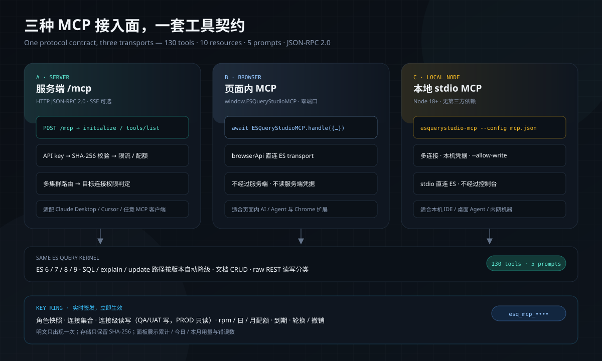
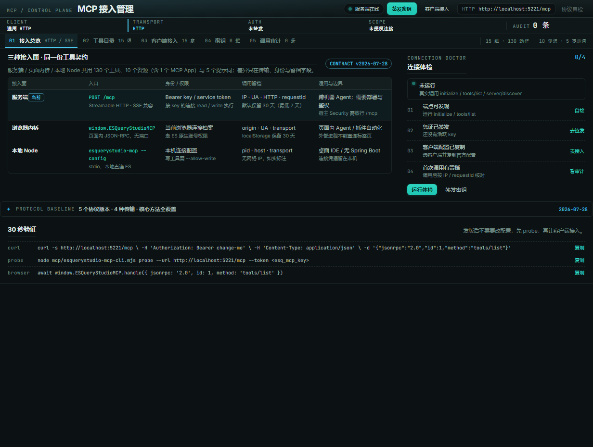
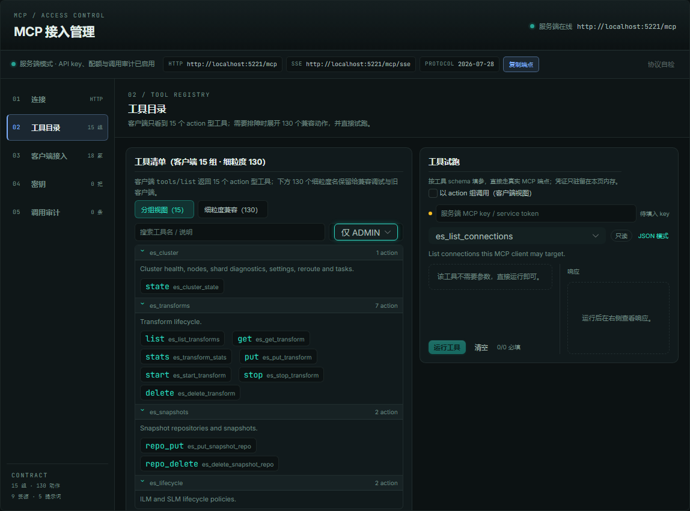
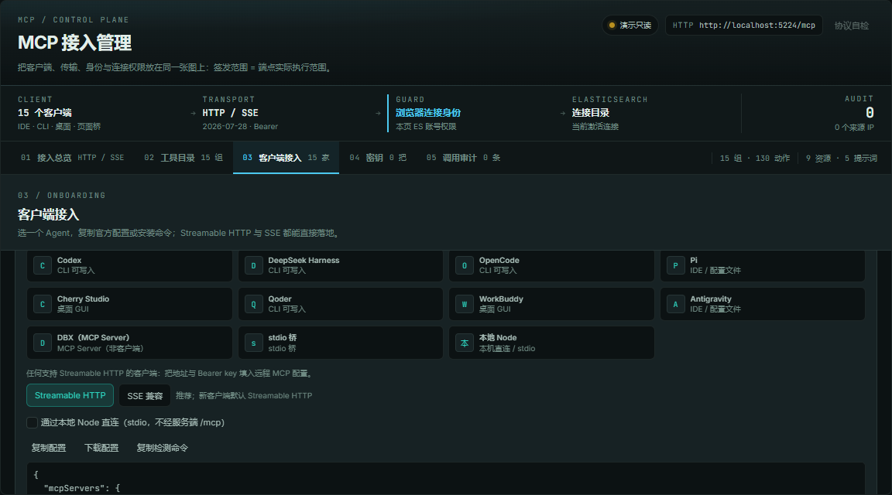
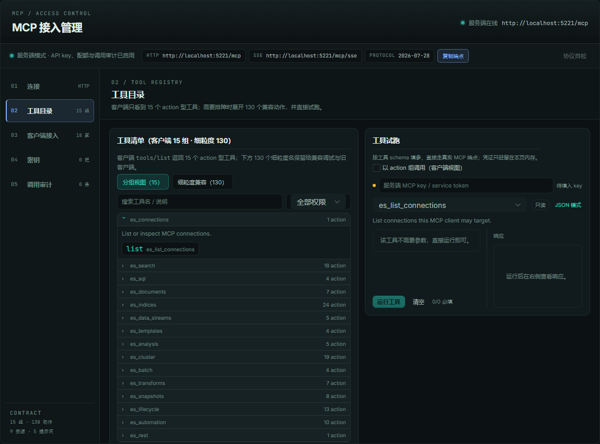
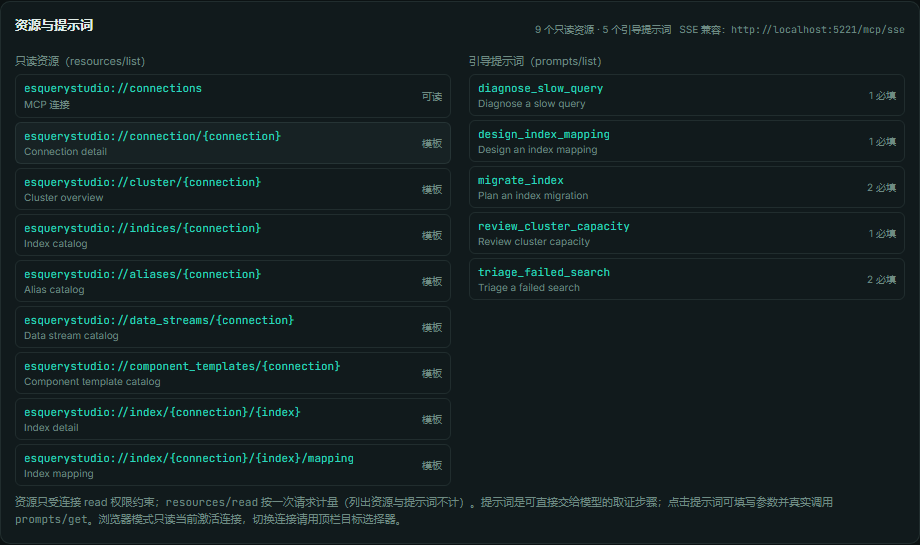
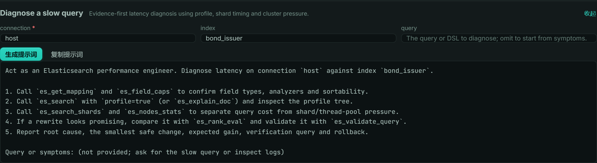
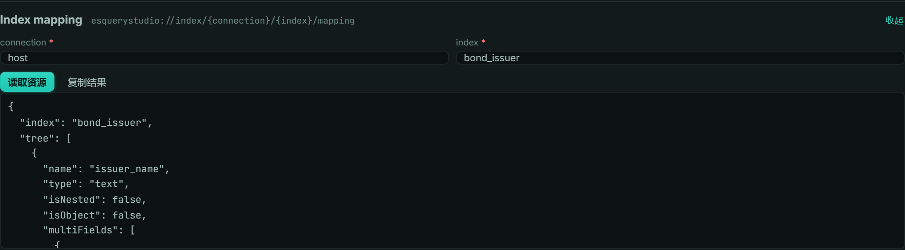
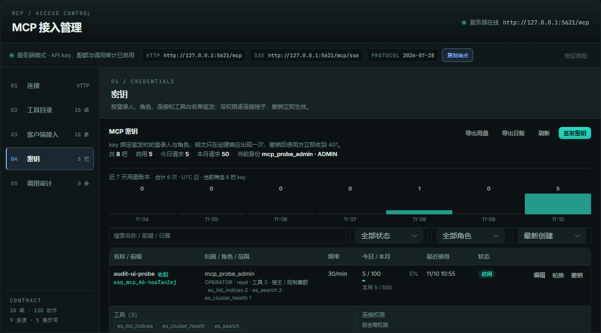
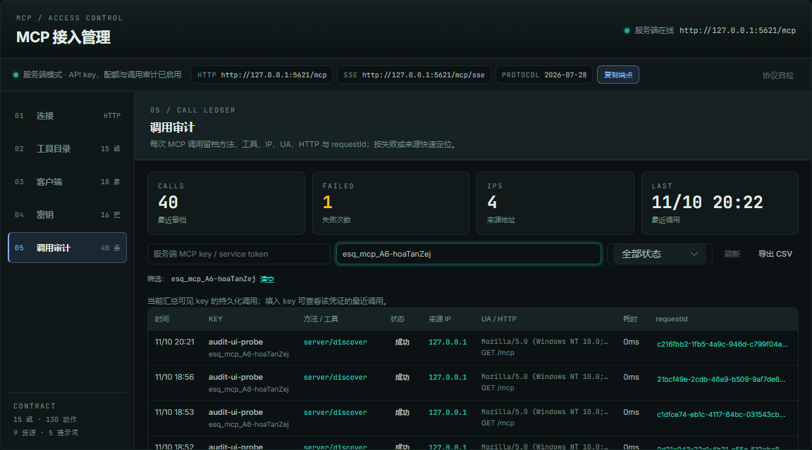

# MCP 接入



ESQueryStudio 提供三种 MCP（Model Context Protocol）接入面：服务端模式的标准 HTTP JSON-RPC、纯前端模式的内页 JSON-RPC 桥，以及本地 Node stdio 桥。三者共用同一组工具、只读资源与引导提示词契约（读工具 + 显式授权的写工具），避免出现「服务端一套、前端另一套」的能力漂移。

第一次接入建议先读 **[MCP 快速开始](mcp-quickstart.md)**（含 Claude/Cursor 配置、实时签发 key、连接级读写与 30 秒验收）。

**目录：** [能力矩阵](#能力矩阵) · [服务端模式](#服务端模式) · [API key 与配额](#api-key角色与配额推荐) · [stdio 桥](#stdio-桥claude-desktop--cursor) · [本地 Node](#本地-node-mcp无-spring-boot--无浏览器) · [纯前端](#纯前端模式) · [工具表](#工具) · [资源与提示词](#资源与提示词) · [REST 分类](#raw-rest-的读写分类) · [ES 6/7/8/9](#es-6--7--8--9-兼容) · [验证](#验证)

## 能力矩阵

| 模式 | 接入方式 | 适合谁 | 边界 |
|---|---|---|---|
| 服务端模式 | `POST /mcp`（JSON-RPC 2.0）+ 可选 SSE 兼容 | Claude Desktop、Cursor、任意 MCP 客户端 | 需要启用 `esquerystudio.mcp.enabled`；支持服务级 Bearer token 或按登录人/角色签发的 API key |
| 纯前端模式 | `window.ESQueryStudioMCP` | 页面内 AI / Agent、控制台插件内的自动化 | 浏览器标签页不能监听 TCP；外部进程客户端请使用服务端模式，或在本地桥中复用同一套工具契约 |
| 本地 Node 模式 | `mcp/esquerystudio-local-mcp.mjs`（stdio） | 本地 Claude Desktop / Cursor / Agent，无 Spring Boot、无浏览器 | Node 18+ 直连 ES；多连接配置在本机；写工具默认关闭，需 `--allow-write` |

纯前端的工具执行仍走 `browserApi` 的直连 ES transport；不经过服务端，不读取服务端凭据。

## 服务端模式

### 启用

```yaml
esquerystudio:
  mcp:
    enabled: true
    token: change-me
```

`GET /mcp` 服务卡同时返回 `protocolVersion`、`capabilities`、`instructions`、`tools`、`resources`、`resourceTemplates` 与 `prompts`，客户端可先发现再初始化。使用 API key 时还会返回 `role`、`connections`、`permissions` 与 `connectionPermissions`，Agent 可在首次连接时就读取自己的真实读写范围；`recommendedTools`（服务 token 为 15 个 action 组，API key 只列其 `allowedTools` 命中的组）与对应的 `maxRecommendedTools` 给出客户端工具面；客户端不再一次加载 130 个细粒度工具。`recentCalls` 返回该 key 的最近 100 条预览；独立审计端点 `GET /internal/es/index/mcp/keys/calls` 返回按时间保留的完整调用记录（默认 30 天，最低 7 天），含 `requestId`、调用方 IP、UA、HTTP、耗时与状态。浏览器桥/本地 Node 的 `server/discover` 也返回进程内 `recentCalls`（transport/origin 或 pid/host；无网络 IP），三种模式字段形状一致。

### 传输方式

- **Streamable HTTP（推荐）**：`POST /mcp` 发 JSON-RPC，`GET /mcp` 取服务卡。所有新客户端优先选这一项。
- **HTTP+SSE（兼容旧客户端）**：`GET /mcp/sse`（带同一个 `Authorization: Bearer`）建立事件流；服务端先发 `endpoint` 事件，值为 `/mcp/message?sessionId=...`；随后把 JSON-RPC 请求 `POST` 到该地址，响应从 SSE 流以 `message` 事件返回。`GET /mcp` 在 `Accept: text/event-stream` 时也会自动切到 SSE，兼容把 `/mcp` 直接当 SSE 地址的客户端。
- **stdio**：仅本地 Node / stdio 桥使用；服务端 HTTP 端点不提供 stdio。

> WorkBuddy 等客户端的 MCP 菜单里同时有 Streamable HTTP / SSE / Stdio 时，选 **Streamable HTTP**；只有 SSE 选项时才填 `/mcp/sse`，不要用 `/mcp` 的 JSON discovery 地址当 SSE。WorkBuddy 写入 `~/.workbuddy/mcp.json` 的 `mcpServers` 段，`type` 用 `http`，`url` 用完整端点（含 context-path）：
>
> ```json
> {
>   "mcpServers": {
>     "esquerystudio": {
>       "type": "http",
>       "url": "http://host:7788/quotehub/mcp",
>       "headers": { "Authorization": "Bearer <esq_mcp_key>" }
>     }
>   }
> }
> ```
>
> 客户端一次加载 130 个细粒度工具会超时；现在客户端只看到 15 个 action 型工具，签发 key 时仍可用 32 个「核心查询」细粒度动作控制 action 白名单。

`token` 是服务级自举 token（拥有全部工具）；未设置时，若 key 存储可用仍可用 API key 认证。缺少或错误的 Bearer 凭证返回 `401`，撤销/过期的 key 同样返回 `401`。key 默认只读；写工具仍须在目标连接上有 `write` 授权。内置身份（`grantedPages=null`）没有页面模型时，写权限按角色门：OPERATOR 及以上可在 `connectionPermissions` 里逐连接授予 `write`，VIEWER 仍只读；宿主下发页面授权后，写权限只认 `conn:{id}:w:{page}`（与拦截器同一份裁决）。

MCP 端点同时受 `esquerystudio.elasticsearch.web-enabled` 约束（默认 `true`）；显式关闭 Web 面时端点不会装配，避免出现「控制台已关闭、MCP 仍对外」的旁路。

宿主应用如果有自己的 Spring Security，需像放行 `/esquerystudio.html` 一样放行 `/mcp`（含 context-path）；MCP 的 Bearer API key 由 starter 校验，不能被宿主的 JWT 过滤器提前拦掉。

### API key、角色与配额（推荐）

日常接入建议在控制台左侧 **开发者工具 → MCP 接入**（独立页 `/mcp`，顶栏 MCP 按钮可快速打开同一面板）签发 key，而不是共享服务级 token：



- key 绑定签发时的 `owner` 与 `role`。任意登录人都可为本人签发，但连接、工具和连接级读写只能落在本人页面授权范围内；ADMIN 可代任意用户签发、查看全部、撤销任意 key。目标用户在用户目录中可解析时，ADMIN 代签的角色不得高于该用户实际角色（例如不能为 VIEWER 用户代签 ADMIN key）；用户目录不可用（宿主委托身份）且宿主未实现页面解析时，ADMIN 代签他人 key 只能签发宿主连接；写权限按角色门，角色解析不到或低于 OPERATOR 时 403，其他连接一律不可代签。宿主实现 `McpKeyOwnerResolver.pagesOf(username)` 时，ADMIN 代签的连接/工具/写权限会与目标用户的**页面授权**逐项求交（`GET /internal/es/index/mcp/keys/owner-scope?owner=` 可在签发前预览），既不超过目标用户实际能打开的页面，也不漏掉其已有写授权。
- 非 ADMIN 的可用工具受其页面授权收窄（`search` / `mapping` / `score-explain` / `indices` / `overview`）；ADMIN 不受页面收窄。
- 系统管理类工具（Transform / Watch / SLM / Snapshot repository / Ingest pipeline / `es_cluster_state`）仅 ADMIN 角色的 key 可签发与调用；普通 key 的工具目录、可签发清单和执行面一致排除这些工具。ADMIN 代签 OPERATOR 等低角色 key 时同样不能勾选这些工具，避免“签发了却永远不会下发”的漏权快照。


- 每个 key 独立设置 `allowedTools`（可填 action 组名，如 `es_indices` 会展开为该组全部 legacy action 后逐项校验读写权限；组内包含写 action 而 key 没有 write 权限时会明确拒绝，不会静默漏发，因此只读 key 请传具体 legacy 工具名或由面板按权限勾选；`es_search`/`es_sql`/`es_rest` 因同名保留 legacy 语义）、`connections`（ADMIN 可选全部连接；非 ADMIN 只能选自己有页面授权的连接）、`permissions`（全局 read；写权限用 `connectionPermissions` 逐连接授予）、`requestsPerMinute`（固定 60 秒窗口）、`dailyQuota`、`monthlyQuota`、`expiresInDays`；每个用户最多 10 把活跃 key（ADMIN 100 把），防止用多把 key 绕过单 key 配额。宿主实现 `McpKeyOwnerResolver` 后按真实角色放行（例如 QuoteHub：admin → ADMIN、manager → OPERATOR、其余 → VIEWER）；未接入时 ADMIN 代签他人 key 只能签发 VIEWER 只读 key，写权限或更高角色一律 403（fail-closed，不靠请求体自报角色）。
- `connectionPermissions` 支持连接级权限覆盖：同一把 key 可以让 QA/UAT 为 `["read","write"]`、生产连接为 `["read"]`，未列出的连接沿用 `permissions`。工具清单按「任意连接」汇总，真正执行时按目标连接再判一次，越权写返回 tool error（不会把生产写请求发给 ES）。
- 明文 `esq_mcp_...` 只在创建响应出现一次；存储只保留 SHA-256，管理面永远不回显明文。
- 频率超限返回 `429` + `Retry-After`；日/月配额超限也返回 `429`。用量（累计/今日/本月请求数、错误数、最近使用时间）在面板展示。
- key 记录默认落在控制集群索引 `esquerystudio_mcp_keys`；可用 `esquerystudio.elasticsearch.console.mcp-key-index-name` 改索引名。首次写入自动创建；若集群关闭了动态建索引，请预先建好该索引。认证仍只认 SHA-256；完整 key 以 AES-256-GCM 密文保存在 `secretEncrypted`，owner/ADMIN 可在面板随时「复制 key」。主密钥优先取 `esquerystudio.mcp.key-encryption-key`，其次 `esquerystudio.mcp.token`，未配置时落在 `~/.esquerystudio/mcp-secret.key`（多实例请显式配置共享主密钥）。
- **持久化档**：`esquerystudio.elasticsearch.console.store=jdbc` 时自动改用宿主 `DataSource` 的 `esquerystudio_mcp_key` 表（首次使用幂等建表），key、连接、权限与用量计数跨重启保留；`control-es` 时用控制集群索引。宿主还可自定义 `McpKeyStore` Bean 完全接管。
- 面板里的请求数是**工具调用 + 资源读取**口径（`tools/call` 与 `resources/read`；资源列表/提示词列表不计量），可直接对接外部计费/账单系统；`requestCount` 是累计值，`todayCount` / `monthCount` 按 UTC 自然日/月重置。每个 key 还持久化 `toolCounts`（按工具名计数，资源读取记为 `resources/read`，管理面按调用量倒序返回前 20 项）、`lastTool` 与 `dailyCounts`（最近 31 天 UTC 每日请求数，用于趋势和按日账单），方便按工具/按日计费与排查。每次 JSON-RPC 调用（含 `tools/list`、`server/discover`、资源/提示词读取）都会写一条持久化审计（一次调用一条，默认保留 30 天，最低 7 天）：`method` / `tool` / `requestId` / `at` / `ok` / `ms` / `ip`（优先 X-Forwarded-For 首跳）/ `remoteIp` / `ua` / `http` / `origin` / `transport`（http / sse）；key 详情另保留最近 100 条 `recentCalls` 预览；浏览器桥与本地 Node 也保留最近 100 条，字段同形，分别以 `origin` / `pid`+`host` 替代网络 IP；服务端同时输出 `[mcp-call]` 日志（key、方法、工具、requestId、IP、UA、HTTP、耗时），认证/鉴权失败输出 `[mcp-denied]`（状态码、code、命中的 key 前缀、requestId、IP、HTTP 方法/路径、UA），便于后端区分客户端 key 配错（撤销/轮换后仍用旧 key）与网络/代理问题，并可用同一 `requestId` 关联响应头。`X-Request-Id` 可由客户端传入，未传时服务端生成并通过同名响应头返回。独立页「调用审计」按时间列出 `method` / `tool` / 成功失败 / 来源 IP / UA / HTTP / 耗时 / `requestId`，支持按工具、IP、`requestId` 搜索和按状态过滤，并可导出 CSV；管理动作 `create/update/rotate/revoke` 会写入 `auditLog`（保留最近 30 条，含操作人与角色），面板密钥详情可直接查看。
- **代签预览**：ADMIN 在面板选择归属用户时会调用 `GET /internal/es/index/mcp/keys/owner-scope?owner=<user>`，返回目标角色、页面授权是否可解析、可签发连接/工具与本角色配额上限；签发按钮按该范围收窄，不会先让 UI 勾选再在提交时 403。
- **写权限所见即所得**：`GET /mcp/keys` 的每个连接同时返回 `writeTools` / `writePages`。面板只为当前身份真正可写、且覆盖已选写工具的连接渲染写复选框；写工具没有可写连接、或连接缺少对应页面写权时直接阻止提交。后端 `validateWriteToolPageCoverage` 用同一组页面写权复核，避免「能勾选、提交 403」或「能签发、执行 403」。
- **实时创建、实时管理**：发版时只需要一次能力开关（`esquerystudio.mcp.enabled`，QuoteHub 已默认开启）；之后在 **MCP 接入页 → 密钥** 或 `POST /internal/es/index/mcp/keys` 签发、编辑、轮换、撤销 key，立即生效，不需要重启、不需要改 `application.yml`、不需要重新发版。频率/配额/用量按 key 实时累计。

混合环境 key 示例（测试可写、生产只读）：

```json
{
  "name": "qa-uat-rw-prod-ro",
  "role": "ADMIN",
  "connections": ["qa", "uat", "prod-1", "prod-2"],
  "permissions": ["read"],
  "connectionPermissions": {
    "qa":  ["read", "write"],
    "uat": ["read", "write"],
    "prod-1": ["read"],
    "prod-2": ["read"]
  },
  "allowedTools": ["es_search", "es_count", "es_rest", "es_index_doc"]
}
```

| 角色 | 查看 key | 签发 | 撤销 |
|---|---|---|---|
| VIEWER | 自己的 | 本人，按页面授权范围 | 自己的 |
| OPERATOR / rank3 | 自己的 | 本人，按页面授权范围 + 角色配额上限 | 自己的 |
| ADMIN | 全部 | 任意用户/角色；可选连接集合与 read/write 权限 | 任意 |

| 角色 | 每分钟上限 | 每日上限 | 每月上限 | 有效期上限 |
|---|---|---|---|---|
| OPERATOR | 120 | 20,000 | 500,000 | 90 天 |
| rank3（REBUILD_OP / CLUSTER_OP / AUDIT_OP） | 300 | 50,000 | 1,000,000 | 90 天 |
| ADMIN | 600 | 200,000 | 5,000,000 | 3650 天 |

### 工具包与客户端上限

客户端工具面是 **15 个 action 型工具**（`es_search`、`es_indices`、`es_cluster` 等），每个 action 对应一个 legacy 细粒度工具；内部 handler 与旧客户端兼容名仍保留 130 个。签发 key 时默认只勾选 32 个「核心查询」动作，用 legacy 白名单收窄每个 action 组实际暴露的 action；控制台提供四档兼容工具包：

| 工具包 | 内容 | 适用 |
|---|---|---|
| 核心查询 | 连接、搜索、SQL、Mapping、集群健康等 32 个只读工具 | 默认，日常问答与分析 |
| 核心 + 写入 | 核心包 + 文档写入 / 索引运维 | 需要改数据的可信 Agent |
| 只读全量 | 全部只读工具 | 分析型 Agent |
| 全量 | 130 个细粒度动作（仍只暴露 15 个 action 组） | 脚本 / 一次性运维 |

已选超过 80 个时面板会提示；key 列表对超限 key 提供「精简」按钮，打开编辑并预选核心包，保存后才真正收窄权限，不会静默改 key。工具包只改变 `allowedTools`，不改变连接的 read/write 边界。

管理面端点（使用控制台登录态，不是 MCP key）：

- `GET /internal/es/index/mcp/keys`：当前身份可见的 key + 角色上限 + 可用工具。
- `POST /internal/es/index/mcp/keys`：签发；响应返回 `secret`，同时以密文持久化，后续可通过 `GET /internal/es/index/mcp/keys/{id}/secret` 取回（owner/ADMIN）。
- `PUT /internal/es/index/mcp/keys/{id}`：原地修改名称、工具白名单、连接集合/连接级读写、频率/日/月配额与有效期；保留 id、明文哈希与用量。
- `POST /internal/es/index/mcp/keys/{id}/rotate`：轮换自己的 key（保留权限/用量，旧明文立即失效）；ADMIN 可轮换任意 key。旧版本未保存完整值的 key 首次复制时会明确询问轮换。
- `GET /internal/es/index/mcp/keys/calls?keyId=&limit=`：持久化调用审计（默认 30 天，最低 7 天）；ADMIN 看全部，普通用户只看自己的 key。
- `POST /internal/es/index/mcp/keys/{id}/revoke`：撤销自己的 key；ADMIN 可撤销任意 key。

限流计数在进程内完成。多实例部署时每个实例独立计数，严格的全局配额应在网关或宿主侧按 key 维度实施——这是一个明确的部署边界，不是伪造的分布式配额。宿主可以注册自己的 `McpKeyStore` Bean 替换默认的 ES 存储（例如 QuoteHub 的数据库存储），管理面与 `/mcp` 认证会继续复用同一 SPI。

### 端点

- `GET /mcp`：返回协议版本、`supportedVersions`、serverInfo、工具目录和 transport 信息。
- `POST /mcp`：JSON-RPC 2.0，支持：
  - `server/discover`（含 `serverInfo` 身份）
  - `initialize`（兼容 2025-11-25 / 2025-06-18 / 2025-03-26 / 2024-11-05 客户端）
  - `notifications/initialized`
  - `ping`
  - `tools/list` / `tools/call`
  - `resources/list` / `resources/templates/list` / `resources/read`
  - `prompts/list` / `prompts/get`
  - `completion/complete`

当前支持 **MCP 2026-07-28**（最新稳定版）、**2025-11-25**、**2025-06-18**、**2025-03-26** 与 **2024-11-05**；`initialize` 对受支持版本原样回显，未知旧版本回落到 2025-06-18，避免老 SDK 误判“服务器返回了不支持的版本”。2026-07-28 客户端可以跳过 `initialize`，直接用 `server/discover` 读取 `supportedVersions` / `capabilities` / `serverInfo` / `instructions`；所有成功 `result` 显式带 `resultType: "complete"`，`tools/list`、`resources/list`、`resources/read`、`prompts/list` 等服务卡统一带 `ttlMs` 与 `cacheScope: "private"`。

**协议覆盖矩阵**：四种传输（Streamable HTTP / SSE 兼容 / 页面内桥 / 本地 stdio）、五个版本与上述核心方法均对齐；`resources.subscribe=false`、`tools.listChanged=false`，因此不对外声明订阅能力。2026-07-28 的 **Tasks 扩展**（`io.modelcontextprotocol/tasks`）已支持：客户端在请求 `_meta` 显式声明后，长工具返回 durable task，支持 `tasks/get` / `tasks/update` / `tasks/cancel`。**MCP Apps**（`io.modelcontextprotocol/ui`）已支持：`resources/list` 暴露 `ui://esquerystudio/tool-console`（`text/html;profile=mcp-app`，带 `_meta.ui.csp`），15 个 action 工具的 `_meta.ui.resourceUri` 指向该资源；不支持 Apps 的宿主可继续读取普通文本结果。**MRTR InputRequired** 已支持：声明 `elicitation` 的 2026 客户端在 `es_delete_by_query` / `es_delete_index` / `es_delete_doc` / `es_delete_data_stream` / 非 GET·HEAD 的 `es_rest` 前收到 `input_required`，确认后带 `inputResponses` + `requestState` 重试；`requestState` 由服务端 HMAC 签名并绑定工具与参数摘要，浏览器/本地 Node 用一次性随机状态。**subscriptions/listen** 仍未声明；`roots` / `sampling` / `logging` 是 2026 规范已废弃或移除的特性，本实现不使用。客户端只用核心 tools / resources / prompts / completion 时无需这些扩展。

```bash
curl -s http://localhost:5601/mcp \
  -H 'Authorization: Bearer change-me' \
  -H 'Content-Type: application/json' \
  -d '{"jsonrpc":"2.0","id":1,"method":"tools/list"}'
```

### 客户端接入向导与 CLI

客户端配置默认使用 **精简工具面**（`/mcp?surface=compact` 或请求头 `X-MCP-Surface: compact`）：保留全部 15 个 action 组（130 个细粒度动作仍按 key 白名单执行），只把 resources / prompts 列表置空，避免 CodeBuddy / WorkBuddy 被 10 个资源 + 5 个提示词铺满面板；切换「完整工具面」即恢复 15 组 + 10 资源 + 5 提示词。精简面只影响 discovery，不改变 key 已签发的工具权限。

面板独立的「客户端接入」页以可搜索矩阵预置 Claude Code、Cursor、CodeBuddy Code CLI、ZCode、TRAE、VS Code、Windsurf、Codex、DeepSeek Harness、OpenCode、Pi、Cherry Studio、Qoder、WorkBuddy、Antigravity、通用 HTTP、stdio 桥、本地 Node、浏览器页面内桥等类型；选中后显示对应配置文件位置与提示，可复制或下载配置，HTTP/stdio 会自动填入当前试跑 key。



`mcp/esquerystudio-mcp-cli.mjs`（安装包内命令 `esquerystudio-mcp-cli`）提供同样的客户端识别：

```bash
esquerystudio-mcp-cli list
esquerystudio-mcp-cli detect --json
esquerystudio-mcp-cli probe --url http://localhost:5601/mcp --token esq_mcp_xxx
esquerystudio-mcp-cli install --client cursor --url http://localhost:5601/mcp --token esq_mcp_xxx --write
esquerystudio-mcp-cli install --client cursor --local --write
esquerystudio-mcp-cli config --client claude-code --url http://localhost:5601/mcp --token esq_mcp_xxx
```

`detect` 输出每个客户端的 `commandFound`（CLI 是否在 PATH）、`configFound`（配置文件是否存在）与 `installed`（配置里是否已有 `esquerystudio`；配置读不懂时为 `null`），便于先确认本机装了哪些 Agent、是否已接入过，再选择安装或跳过。`probe --url ... --token ...` 真实执行 `initialize` + `tools/list` 并读取服务卡，打印协议、工具数、key 角色、连接与逐连接读写；401/地址错误直接给出状态码与错误码，是接入排障的第一条命令。

> **DBX 互操作**：DBX 0.6+ 是 MCP **Server**（把自己的数据库连接暴露给 AI 客户端），不是 MCP 客户端，不能直接消费本端点；若同一个 Agent 要同时使用 DBX 与本控制台，请在 Agent 配置里并列注册两个 server。DBX 侧可用 `dbx agent setup` 安装它的官方 Agent Skill。

Cursor / VS Code / Windsurf / OpenCode / Qoder / TRAE / CodeBuddy / ZCode / WorkBuddy / Pi / Antigravity 支持合并写入 MCP 配置（OpenCode 写入 `mcp.servers` 的 `type: "remote"`，ZCode 写入 `mcp.servers` 的 `type: "http"`，Qoder / CodeBuddy 写入带 `type: "http"` 的 `mcpServers`）；Claude Code 输出 `.mcp.json` 配置与可执行 `claude mcp add` 命令，Codex 输出 `~/.codex/config.toml` 的 `[mcp_servers.esquerystudio]` TOML；DeepSeek Harness 输出 `cordis.yml` 的 `@deepseek-ai/dsh-mcp-client` 插件条目（`transport: streamable-http`）；其余客户端输出标准 `mcpServers` JSON。`--transport sse` 会把 `.../mcp` 自动映射为 `.../mcp/sse`，并按客户端输出 `type: "sse"` / `--transport sse` / `transport: sse`。CLI 不执行第三方命令，也不覆盖已有配置。

### stdio 桥（Claude Desktop / Cursor）

只支持 stdio 启动命令的客户端使用 `mcp/esquerystudio-mcp-stdio.mjs` 转发到服务端端点：

```json
{
  "mcpServers": {
    "esquerystudio": {
      "command": "node",
      "args": ["/path/to/esquerystudio/mcp/esquerystudio-mcp-stdio.mjs"],
      "env": {
        "ESQ_MCP_URL": "http://localhost:5601/mcp",
        "ESQ_MCP_TOKEN": "esq_mcp_xxxxxxxx.xxxxxxxx"
      }
    }
  }
}
```

### 本地 Node MCP（无 Spring Boot / 无浏览器）

如果只有本地客户端 Agent（Claude Desktop、Cursor、命令行 Agent），又不想启动 Spring Boot，可直接用 Node 直连 ES：

```bash
# 方式 A：仓库内直接运行（无需安装依赖）
node mcp/esquerystudio-local-mcp.mjs --config ~/.esquerystudio/mcp.json
# 方式 B：本机安装为命令（Node 18+，无第三方依赖）
cd mcp && npm install -g . && esquerystudio-mcp --config ~/.esquerystudio/mcp.json
# 单连接环境变量形态
ESQ_ES_URL=http://localhost:9200 ESQ_ES_USERNAME=elastic ESQ_ES_PASSWORD=*** \
  node mcp/esquerystudio-local-mcp.mjs
```

浏览器模式配好连接后，可在 **MCP 接入页 → 工具目录 → 导出 Node MCP 配置** 直接生成
`esquerystudio-mcp.json`，再让本地 Node MCP 读取；文件包含本机凭据，保存到受限目录。

`mcp.json` 支持多连接：

```json
{
  "defaultConnection": "prod",
  "connections": [
    { "id": "prod", "name": "生产", "url": "http://localhost:9200", "username": "elastic", "password": "***" },
    { "id": "qa", "name": "QA", "url": "https://qa.example:9200", "apiKey": "base64-id:key" }
  ]
}
```

客户端配置示例：

```json
{
  "mcpServers": {
    "esquerystudio-local": {
      "command": "node",
      "args": ["/path/to/esquerystudio/mcp/esquerystudio-local-mcp.mjs", "--config", "/home/me/.esquerystudio/mcp.json"]
    }
  }
}
```

- 15 个 action 型工具（覆盖 130 个 legacy 操作）+ 9 个只读资源 + 1 个 MCP App + 5 个引导提示词与服务端/浏览器同族；`es_connections` 的 `action=list` 用于选择连接，其余工具可带 `connection`；`es_rest` 的 `action=call` 可透传任意 REST，非 GET/HEAD 需要 `--allow-write`。
- 默认只读；需要写入时显式加 `--allow-write`（或 `ESQ_MCP_ALLOW_WRITE=true`）。
- 配置和 ES 凭据只在本机进程内，不经过控制台服务端；本地文件权限请自行按最小权限保护。
- Node 18+（使用内置 `fetch`），无第三方依赖。

## 纯前端模式

浏览器控制台在 browser 构建启动时安装：

```js
window.ESQueryStudioMCP = {
  protocolVersion: '2026-07-28',
  supportedVersions: ['2026-07-28', '2025-11-25', '2025-06-18', '2025-03-26', '2024-11-05'],
  tools,                       // 与服务端相同的工具定义
  handle(request),             // MCP JSON-RPC 处理
  callTool(name, arguments)    // 直接调用某个工具
}
```

页面内 AI / Agent 可以按标准 JSON-RPC 请求：

```js
const response = await window.ESQueryStudioMCP.handle({
  jsonrpc: '2.0',
  id: 1,
  method: 'tools/call',
  params: {
    name: 'es_search',
    arguments: { index: 'research_report', query: { match: { title: '研报' } }, size: 5 }
  }
});
```

### 纯前端边界（诚实说明）

- 浏览器标签页没有 TCP listener，不能直接把 `window.ESQueryStudioMCP` 暴露给 Claude Desktop 之类的本地进程客户端。
- 外部 MCP 客户端需要标准进程/HTTP 传输时使用服务端模式；纯前端模式服务的是**页面内** Agent，而不是伪装成一个不存在的本地端口。
- 工具执行仍受当前浏览器连接档案和 ES 原生账号权限约束。读工具直接可用；页面内写工具默认关闭，需要在 **MCP 接入页 → 工具目录** 显式打开「允许页面内写工具」，打开后使用当前 ES 账号执行文档写入与索引生命周期工具（建/删索引、mapping、settings、别名、rollover、merge、模板）。
- 服务端 key 的 `write` 权限与浏览器页面内的写开关是两套独立授权：前者由签发人按本人页面授权签发，后者由本机用户显式打开；两者都不会让只读 ES 账号产生写能力。
- 多集群通过工具参数 `connection` 选择；key 的 `connections` 是硬边界，未授权的连接不会出现在 `es_list_connections`，也无法通过参数越过。
- 不伪造历史：浏览器模式没有跨实例锁、代码 provider 或服务端审计账本，这些边界在对应页面仍如实展示。

### action 型工具（客户端可见 15 个）

| 工具 | action（legacy 工具名） | 说明 |
|---|---|---|
| `es_connections` | `list`→`es_list_connections` | List or inspect MCP connections. |
| `es_search` | `search`→`es_search`, `count`→`es_count`, `msearch`→`es_msearch`, `mget`→`es_mget`, `explain`→`es_explain_doc`, `search_shards`→`es_search_shards`, `rank_eval`→`es_rank_eval`, `terms_enum`→`es_terms_enum`, `field_caps`→`es_field_caps`, `validate`→`es_validate_query`, `search_template`→`es_search_template`, `render_template`→`es_render_template`, `scroll_start`→`es_scroll_start`, `scroll_next`→`es_scroll_next`, `scroll_clear`→`es_scroll_clear`, `pit_open`→`es_pit_open`, `pit_search`→`es_pit_search`, `pit_close`→`es_pit_close` | Search, count, multi-search, explain, scroll, PIT and search-time helpers. |
| `es_sql` | `query`→`es_sql`, `cursor`→`es_sql_cursor`, `close`→`es_sql_close`, `translate`→`es_sql_translate` | Run ES-SQL, cursors and SQL-to-DSL translation. |
| `es_documents` | `get`→`es_get_doc`, `index`→`es_index_doc`, `update`→`es_update_doc`, `delete`→`es_delete_doc`, `bulk`→`es_bulk`, `term_vectors`→`es_term_vectors`, `mtermvectors`→`es_mtermvectors` | Read and mutate documents, bulk operations and term vectors. |
| `es_indices` | `list`→`es_list_indices`, `detail`→`es_index_detail`, `stats`→`es_get_index_stats`, `settings`→`es_get_settings`, `update_settings`→`es_update_settings`, `settings_defaults`→`es_index_settings_defaults`, `mapping`→`es_get_mapping`, `put_mapping`→`es_put_mapping`, `aliases`→`es_get_aliases`, `alias`→`es_alias`, `create`→`es_create_index`, `delete`→`es_delete_index`, `clone`→`es_clone_index`, `shrink`→`es_shrink_index`, `split`→`es_split_index`, `refresh`→`es_refresh_index`, `flush`→`es_flush_index`, `close`→`es_index_close`, `open`→`es_index_open`, `force_merge`→`es_force_merge`, `rollover`→`es_rollover`, `resolve`→`es_resolve_index`, `recovery`→`es_index_recovery`, `segments`→`es_index_segments` | Index catalog, settings, mappings, aliases and index lifecycle. |
| `es_data_streams` | `list`→`es_list_data_streams`, `get`→`es_get_data_stream`, `stats`→`es_data_stream_stats`, `create`→`es_create_data_stream`, `delete`→`es_delete_data_stream` | Data stream catalog and lifecycle. |
| `es_templates` | `list`→`es_list_templates`, `put`→`es_put_template`, `delete`→`es_delete_template`, `component_list`→`es_list_component_templates` | Index templates and component templates. |
| `es_analysis` | `analyze`→`es_analyze`, `settings`→`es_analysis_settings`, `update_settings`→`es_update_analysis_settings`, `reload`→`es_reload_analyzers`, `synonyms_upsert`→`es_synonyms_upsert` | Analyze text, analysis settings, reload analyzers and synonyms. |
| `es_cluster` | `health`→`es_cluster_health`, `stats`→`es_cluster_stats`, `state`→`es_cluster_state`, `nodes`→`es_list_nodes`, `nodes_stats`→`es_nodes_stats`, `cat_shards`→`es_cat_shards`, `cat_allocation`→`es_cat_allocation`, `allocation_explain`→`es_allocation_explain`, `shard_stores`→`es_shard_stores`, `pending_tasks`→`es_pending_tasks`, `hot_threads`→`es_hot_threads`, `remote_clusters`→`es_remote_clusters`, `plugins`→`es_plugins`, `settings`→`es_get_cluster_settings`, `update_settings`→`es_update_cluster_settings`, `reroute`→`es_reroute`, `tasks`→`es_list_tasks`, `task_detail`→`es_task_detail`, `task_cancel`→`es_task_cancel` | Cluster health, nodes, shard diagnostics, settings, reroute and tasks. |
| `es_batch` | `update_by_query`→`es_update_by_query`, `delete_by_query`→`es_delete_by_query`, `reindex`→`es_reindex`, `reindex_preview`→`es_reindex_preview` | Batch update, delete, reindex and reindex preview. |
| `es_transforms` | `list`→`es_list_transforms`, `get`→`es_get_transform`, `stats`→`es_transform_stats`, `put`→`es_put_transform`, `start`→`es_start_transform`, `stop`→`es_stop_transform`, `delete`→`es_delete_transform` | Transform lifecycle. |
| `es_snapshots` | `repos`→`es_list_snapshot_repos`, `repo_put`→`es_put_snapshot_repo`, `repo_delete`→`es_delete_snapshot_repo`, `list`→`es_list_snapshots`, `status`→`es_snapshot_status`, `create`→`es_create_snapshot`, `delete`→`es_delete_snapshot`, `restore`→`es_restore_snapshot` | Snapshot repositories and snapshots. |
| `es_lifecycle` | `ilm_policies`→`es_ilm_policies`, `ilm_explain`→`es_ilm_explain`, `ilm_status`→`es_ilm_status`, `ilm_put`→`es_put_ilm_policy`, `ilm_delete`→`es_delete_ilm_policy`, `ilm_move`→`es_ilm_move`, `ilm_start`→`es_ilm_start`, `ilm_stop`→`es_ilm_stop`, `slm_policies`→`es_slm_policies`, `slm_put`→`es_put_slm_policy`, `slm_delete`→`es_delete_slm_policy`, `slm_status`→`es_slm_status`, `slm_execute`→`es_slm_execute` | ILM and SLM lifecycle policies. |
| `es_automation` | `watchers`→`es_watcher`, `watch_put`→`es_put_watch`, `watch_delete`→`es_delete_watch`, `watch_execute`→`es_execute_watch`, `ingest_list`→`es_ingest_pipelines`, `ingest_put`→`es_put_ingest_pipeline`, `ingest_delete`→`es_delete_ingest_pipeline`, `scripts`→`es_list_scripts`, `script_put`→`es_put_script`, `script_delete`→`es_delete_script` | Watcher, ingest pipelines and stored scripts. |
| `es_rest` | `call`→`es_rest` | Raw Elasticsearch REST passthrough; write methods need write permission. |

细粒度工具名仍可被旧客户端直接调用（向后兼容）；新客户端优先用 `action` 参数。分组会按 key 的 `allowedTools` 只暴露被授权的 action，不会把未授权动作列出来。

## 工具



下面是 130 个细粒度兼容工具的参数索引；分组视图里点任一 action 会直接选中对应条目。表内名称仍可被旧客户端直接调用。

| 工具 | 参数 | 说明 |
|---|---|---|
| `es_list_connections` | 无 | 列出当前 MCP 凭证可选择的连接（id / 名称 / env / active） |
| `es_list_indices` | 无 | 列出非系统索引 |
| `es_cluster_health` | 无 | 集群健康、版本与分片 |
| `es_get_mapping` | `index` | 实时 mapping、字段树与类型 |
| `es_get_doc` | `index`, `id` | 读取单个文档 |
| `es_get_settings` | `index` | 索引 settings |
| `es_get_aliases` | 无 | 别名与指向索引 |
| `es_list_templates` | 无 | 索引模板（legacy 归一化） |
| `es_list_data_streams` | 无 | 列出数据流及其后备索引 |
| `es_get_data_stream` | `name` | 单个数据流的 generation、模板与后备索引 |
| `es_data_stream_stats` | `name` | 数据流文档数与存储统计 |
| `es_create_data_stream` | `name` | 创建数据流（write 权限，需匹配的 data-stream 模板；7.9+） |
| `es_delete_data_stream` | `name` | 删除数据流及其后备索引（write 权限，高危） |
| `es_list_component_templates` | 无 | 列出 composable component templates（7.8+） |
| `es_clone_index` | `index`, `target`, `body?` | 克隆索引（write 权限；源索引需只读） |
| `es_shrink_index` | `index`, `target`, `body?` | 收缩索引分片（write 权限；源索引需只读） |
| `es_split_index` | `index`, `target`, `body?` | 拆分索引分片（write 权限；源索引需只读） |
| `es_list_nodes` | 无 | 节点、角色与健康 |
| `es_list_tasks` | `actions?` | 运行中的任务 |
| `es_index_recovery` | `index` | 分片恢复状态（`_recovery`） |
| `es_cat_shards` | `index?` | 分片分配明细（`_cat/shards` JSON） |
| `es_cluster_state` | `metrics?`, `index?` | 集群状态（默认 metadata，可按指标/索引收窄） |
| `es_mtermvectors` | `body`, `index?` | 多文档词频/term vectors |
| `es_index_segments` | `index` | Lucene 段、大小与合并状态 |
| `es_list_transforms` | 无 | Transform 列表、状态与目标索引 |
| `es_get_transform` | `id` | 单个 Transform 定义与元数据 |
| `es_transform_stats` | `id` | Transform 进度与失败统计 |
| `es_put_transform` | `id`, `body` | 创建/更新 Transform（write 权限） |
| `es_start_transform` | `id` | 启动 Transform（write 权限） |
| `es_stop_transform` | `id` | 停止 Transform（write 权限） |
| `es_delete_transform` | `id` | 删除 Transform（write 权限，高危） |
| `es_search` | `index`, `body?`, `query?`, `size?`, `explain?`, `profile?` | DSL 查询；`body` 可带 aggs/sort/search_after/highlight，返回原始响应 |
| `es_count` | `index`, `query?` | 条件计数 |
| `es_sql` | `query`, `fetchSize?` | ES-SQL 查询，返回 columns / rows / cursor |
| `es_explain_doc` | `index`, `id`, `query?` | 单文档 `_explain` |
| `es_get_index_stats` | `index` | 索引统计 |
| `es_msearch` | `index?`, `searches` | 一次请求执行多条 DSL 搜索；每条可带完整 `body`（`_msearch`） |
| `es_mget` | `index`, `ids` | 按 id 批量读取文档（`_mget`） |
| `es_scroll_start` | `index`, `scroll?`, `body?`, `query?`, `size?` | 启动 scroll 分页（ES 6/7 兼容） |
| `es_scroll_next` | `scrollId`, `scroll?` | 获取 scroll 下一页 |
| `es_scroll_clear` | `scrollId?`, `scrollIds?` | 清理 scroll 上下文 |
| `es_resolve_index` | `name` | 解析索引 / 别名 / 数据流（模式可通配） |
| `es_search_shards` | `index`, `routing?` | 搜索请求的分片路由 |
| `es_rank_eval` | `index`, `body` | 排序效果评估（`_rank_eval`） |
| `es_cluster_stats` | 无 | 集群级统计 |
| `es_refresh_index` | `index` | 刷新索引使新写入可搜索（write 权限） |
| `es_flush_index` | `index` | 落盘 flush（write 权限） |
| `es_index_close` | `index` | 关闭索引（write 权限） |
| `es_index_open` | `index` | 打开索引（write 权限） |
| `es_bulk` | `index?`, `operations`, `refresh?`, `pipeline?`, `timeout?`, `waitForActiveShards?` | 批量文档操作（write 权限） |
| `es_terms_enum` | `index`, `field`, `query?`, `size?`, `caseInsensitive?` | 字段值枚举 |
| `es_field_caps` | `index`, `fields?` | 跨索引字段类型能力 |
| `es_task_cancel` | `taskId` | 取消运行中的任务（write 权限） |
| `es_sql_cursor` | `cursor`, `timeZone?`, `columnar?` | SQL cursor 分页 |
| `es_sql_close` | `cursor` | 关闭 SQL cursor |
| `es_sql_translate` | `body` | SQL 转 DSL |
| `es_pit_open` | `index`, `keepAlive?` | 开启 PIT 深分页上下文 |
| `es_pit_search` | `body` | 在 PIT 内搜索（body 必须含 `pit.id`） |
| `es_pit_close` | `pitId` | 关闭 PIT |
| `es_create_index` | `index`, `settings?`, `mappings?` | 显式创建物理索引（write 权限） |
| `es_delete_index` | `index` | 删除物理索引（write 权限，高危） |
| `es_put_mapping` | `index`, `mappings` | 新增/更新字段 mapping（write 权限，6.x typed 自适应） |
| `es_update_settings` | `index`, `settings` | 热更新索引 settings（write 权限） |
| `es_alias` | `actions` | 原子别名操作 add/remove（write 权限） |
| `es_rollover` | `alias`, `conditions?`, `dryRun?` | 别名 rollover，可 dry-run（write 权限） |
| `es_force_merge` | `index`, `maxNumSegments?` | 强制合并 segment（write 权限） |
| `es_put_template` | `name`, `kind?`, `template` | 创建/更新索引或组件模板（write 权限） |
| `es_delete_template` | `name`, `kind?` | 删除索引或组件模板（write 权限，非 ADMIN 先读回守卫） |
| `es_update_by_query` | `index`, `query?`, `script?`, `maxDocs?`, `waitForCompletion?`, `refresh?` | 按 query 批量更新（write 权限） |
| `es_delete_by_query` | `index`, `query`, `maxDocs?`, `waitForCompletion?`, `refresh?` | 按 query 批量删除（write 权限，query 必填） |
| `es_reindex` | `body`, `slices?`, `waitForCompletion?`, `refresh?`, `requestsPerSecond?` | 自定义 reindex（write 权限，body 含 source/dest） |
| `es_analyze` | `body`, `index?` | 分词器/分析器测试；省略 index 走全局 `_analyze` |
| `es_validate_query` | `index`, `body` | 查询校验与 Lucene rewrite 透视 |
| `es_term_vectors` | `index`, `id`, `fields?` | 文档词频取证（tf/ttf/doc_freq） |
| `es_search_template` | `index`, `body` | 执行内联搜索模板 |
| `es_render_template` | `body` | 渲染内联模板，不执行搜索 |
| `es_analysis_settings` | `index` | 索引 analyzer / tokenizer / filter / normalizer 全景 |
| `es_update_analysis_settings` | `index`, `body` | close→PUT→open 更新 analysis 配置（write 权限） |
| `es_reload_analyzers` | `index` | 热重载 search analyzer（write 权限） |
| `es_synonyms_upsert` | `index`, `entries`, `filter?`, `expand?` | 替换 synonym_graph 过滤器（write 权限） |
| `es_reindex_preview` | `source`, `query?` | 只读预估 reindex 文档数与目标大小 |
| `es_index_settings_defaults` | `index` | 含默认值的索引 settings |
| `es_index_detail` | `index`, `sampleSize?` | 索引详情聚合（mapping / settings / aliases / 样本文档） |
| `es_allocation_explain` | `body?` | 分片分配诊断 |
| `es_shard_stores` | `index`, `status?` | 分片存储与副本健康 |
| `es_pending_tasks` | 无 | Master 待处理任务 |
| `es_slm_policies` | 无 | SLM 策略列表 |
| `es_put_slm_policy` | `policyId`, `body` | 创建/更新 SLM 策略（write 权限） |
| `es_delete_slm_policy` | `policyId` | 删除 SLM 策略（write 权限，高危） |
| `es_slm_status` | 无 | SLM 服务状态 |
| `es_slm_execute` | `policyId` | 立即执行 SLM 策略（write 权限） |
| `es_nodes_stats` | 无 | 各节点 JVM / 文件系统 / OS / 线程池统计 |
| `es_hot_threads` | `threads?`, `interval?`, `type?`, `nodeId?` | 热点线程文本报告 |
| `es_remote_clusters` | 无 | 远程集群连接与本集群身份 |
| `es_plugins` | 无 | 节点插件矩阵与安装一致性 |
| `es_watcher` | 无 | Watcher 状态与 watch 列表（可用时） |
| `es_put_watch` | `id`, `body` | 创建/更新 Watch（write 权限） |
| `es_delete_watch` | `id` | 删除 Watch（write 权限，高危） |
| `es_execute_watch` | `id` | 立即执行 Watch（write 权限） |
| `es_ingest_pipelines` | `id?` | ingest pipeline 列表或单个详情 |
| `es_put_ingest_pipeline` | `id`, `body` | 创建/更新 Ingest pipeline（write 权限） |
| `es_delete_ingest_pipeline` | `id` | 删除 Ingest pipeline（write 权限，高危） |
| `es_cat_allocation` | 无 | 节点分片分配与磁盘占用 |
| `es_get_cluster_settings` | 无 | 集群 persistent/transient/defaults 设置 |
| `es_update_cluster_settings` | `body` | 更新集群设置（write 权限） |
| `es_reroute` | `body`, `dryRun?`, `explain?`, `retryFailed?` | 集群 reroute，可 dry-run（write 权限） |
| `es_list_snapshot_repos` | 无 | 快照仓库；非 ADMIN 脱敏凭据 |
| `es_put_snapshot_repo` | `repo`, `body` | 创建/更新快照仓库（write 权限） |
| `es_delete_snapshot_repo` | `repo` | 删除快照仓库（write 权限，高危） |
| `es_list_snapshots` | `repo` | 仓库内快照列表 |
| `es_snapshot_status` | `repo?`, `name?` | 快照进度 |
| `es_create_snapshot` | `repo`, `name`, `body?` | 创建快照（write 权限） |
| `es_delete_snapshot` | `repo`, `name` | 删除快照（write 权限） |
| `es_restore_snapshot` | `repo`, `name`, `body?` | 恢复快照（write 权限） |
| `es_ilm_policies` | 无 | ILM 策略列表 |
| `es_ilm_explain` | `index` | 索引 ILM 状态 |
| `es_ilm_status` | 无 | ILM 服务状态 |
| `es_put_ilm_policy` | `name`, `policy` | 创建/更新 ILM 策略（write 权限） |
| `es_delete_ilm_policy` | `name` | 删除 ILM 策略（write 权限） |
| `es_ilm_move` | `index`, `body` | 手动推进 ILM step（write 权限） |
| `es_ilm_start` | 无 | 启动 ILM 服务（write 权限） |
| `es_ilm_stop` | 无 | 停止 ILM 服务（write 权限） |
| `es_list_scripts` | 无 | 已存脚本列表 |
| `es_put_script` | `id`, `script` | 创建/更新已存脚本（write 权限） |
| `es_delete_script` | `id` | 删除已存脚本（write 权限） |
| `es_task_detail` | `taskId` | 单任务详情 |
| `es_index_doc` | `index`, `id`, `document` | 按 id 创建/覆盖文档（write 权限） |
| `es_update_doc` | `index`, `id`, `document` | 按 id 部分更新字段（write 权限） |
| `es_delete_doc` | `index`, `id` | 按 id 删除文档（write 权限） |
| `es_rest` | `method`, `path`, `body?` | 原始 REST 透传；GET/HEAD 只读，POST/PUT/DELETE 需 write 权限 |

服务端模式每个工具还接受可选 `connection` 参数（`host` 或 key 被授权的连接 id）；未传时使用 key 连接集合的第一个。浏览器模式忽略该参数，使用当前连接档案。

数据流工具需要 ES 7.9+（组件模板 7.8+、Transform 7.5+）；老版本返回真实 ES 错误，不伪造成功。`es_clone_index` / `es_shrink_index` / `es_split_index` 的源索引必须已设为只读（`index.blocks.write=true`），目标索引名不能已存在；MCP 只透传 ES 的真实响应。

`tools/list` 的每个工具同时携带 MCP annotations：`readOnlyHint` 区分读/写，`destructiveHint` 标记删除/覆盖类工具（如删索引、删文档、删快照、restore、bulk、原始 REST），`openWorldHint=false`。面板工具目录会对破坏性工具显示红色「破坏性」标记，并支持按分类、搜索和权限类型（只读 / 写 / 破坏性）筛选。

`tools/call` 同时返回 `content[0].text`（兼容只读文本客户端）与 `structuredContent`（对象直接透传；数组/标量包在 `result` 下），客户端可直接读取结构化结果。

### 资源与提示词



除 tools 外，三种接入面同时实现 MCP 的 `resources/*` 与 `prompts/*`：

| 资源 | 类型 | 返回 |
|---|---|---|
| `esquerystudio://connections` | 静态 | 当前身份可访问的连接与读写范围 |
| `esquerystudio://connection/{connection}` | 模板 | 连接的健康 + 集群统计 |
| `esquerystudio://cluster/{connection}` | 模板 | 健康、统计、节点 |
| `esquerystudio://indices/{connection}` | 模板 | 非系统索引目录 |
| `esquerystudio://aliases/{connection}` | 模板 | 索引别名目录 |
| `esquerystudio://data_streams/{connection}` | 模板 | 数据流目录 |
| `esquerystudio://component_templates/{connection}` | 模板 | 组件模板目录 |
| `esquerystudio://index/{connection}/{index}` | 模板 | mapping、settings、别名、索引统计 |
| `esquerystudio://index/{connection}/{index}/mapping` | 模板 | 实时 mapping 与扁平字段树 |

`resources/list` 返回静态连接资源与当前可访问的连接；`resources/templates/list` 返回 8 个模板。资源只读，仍受 key 的连接硬边界、逐连接 read 权限和工具白名单约束（例如读取 index 详情需要 `es_get_settings` 等工具在白名单中）。`resources/read` 按一次 MCP 请求计入该 key 的 rpm / 日 / 月配额与 `toolCounts`（记为 `resources/read`），资源列表与提示词列表不计量。浏览器模式只读当前激活连接，切换连接请用顶栏目标选择器。

| 提示词 | 参数 | 用途 |
|---|---|---|
| `diagnose_slow_query` | `connection`（必填）、`index?`、`query?` | 用 profile、分片耗时和线程池证据定位慢查询 |
| `design_index_mapping` | `index`（必填）、`sample?`、`access?` | 从样例与访问模式产出 mapping/settings 方案并用真集群校验 |
| `migrate_index` | `source`、`target`（必填）、`notes?` | reindex / 跨集群迁移、校验与别名切换 |
| `review_cluster_capacity` | `connection`（必填）、`window?` | 分片、磁盘、JVM、热线程风险排序 |
| `triage_failed_search` | `connection`、`symptom`（必填）、`index?` | 失败搜索的分配、分片与熔断取证 |

`prompts/get` 返回可直接交给模型的 `messages[0].content.text`，其中引用真实工具名；客户端可在 UI 里让用户先填参数再执行。面板的「协议自检」会真实往返 `initialize` / `tools/list` / `resources/list` / `prompts/list` 并显示协议版本、耗时与数量。

三面还实现 `completion/complete`：对提示词/资源的 `connection` 参数按当前身份可见的 key 连接集合返回 id 补全；`index` / `source` / `target` 参数在 key 允许 `es_list_indices` 时回填当前连接可见索引名。大小写不敏感前缀匹配、最多 50 项，只读且不计配额；面板的连接/索引输入框已接入候选 datalist。





### 集群运维工具的安全边界

- 非 ADMIN key 的 `es_list_snapshot_repos` 递归脱敏云存储凭据；ADMIN 才返回完整 settings。
- `es_create_snapshot` 非 ADMIN 必须显式给出业务 `indices`，禁止全量/控制面/feature states；`es_delete_snapshot` / `es_restore_snapshot` 会先读回快照索引清单，命中控制面或无法证明内容时拒绝。
- `es_update_cluster_settings`、`es_reroute`、`es_ilm_*`、`es_put_script` 等写工具按下发的连接级 `write` 授权签发，并受 key 的工具白名单约束；读工具则逐个所选连接校验对应页面可见授权。ADMIN 仍可走 `es_rest` 逃生通道。
- ILM/快照工具在 ES 6/7/8/9 上使用同一 REST 语义；老版本缺少对应 API 时返回真实 ES 错误，不伪造成功。

### raw REST 的读写分类

`es_rest` 不按 HTTP 方法粗判读写——ES 的查询大量走 POST：

- GET / HEAD 一律只读。
- POST 仅当路径是查询型 API 时只读：`_search`、`_count`、`_msearch`、`_mget`、`_search/template`、`_search/scroll`、`_render/template`、`_sql` / `_xpack/sql` / `_sql/translate`、`_field_caps`、`_analyze`、`_validate/query`、`_explain/{id}`、`_terms_enum`、`_termvectors`、`_mtermvectors`、`_rank_eval`、`_pit`、`_scripts/painless/_execute`。
- POST 的写 API（`_bulk`、`_reindex`、`_update_by_query`、`_delete_by_query`、`_close`、`_cluster/reroute` 等）和所有未知 POST、PUT、DELETE 一律按写操作 fail-closed；只有 DELETE `_search/scroll` / `_pit` / `_sql/close` 这类游标清理按读处理。
- 只读 key 可以发 POST 查询；写操作需要 `write` 权限。浏览器/本地 Node 另有写开关，同样按此分类。

读工具需要 `read` 权限，写工具需要 `write` 权限；写能力不会因为 token/key 有效而自动开放。

`es_rest` 的 `annotations.readOnlyHint` 固定为 `false`（`destructiveHint` 为 `true`）：GET/HEAD 仍按只读执行，但 MCP 宿主不应把原始 REST 当成只读工具自动放行，否则 POST/PUT/DELETE 可能绕过人工确认。

### ES 6 / 7 / 8 / 9 兼容

- 服务端工具走既有 `EsIndexAdmin` 版本感知层：SQL 在 6.x 使用 `_xpack/sql`、7+ 使用 `_sql`；`_explain` / `_update` / mapping / 建索引对 6.x typed 路由有回退；composable 模板在 7.8 以下回退 legacy `_template`；9.x 的 typeless REST 保持透传。
- 连接测试与集群切换器都会显示 `version.number`：`POST /internal/es/index/clusters/test` 返回 `{clusterName, version, status, nodes}`；连接档案持久化 `esVersion`，顶栏切换器直接显示 `vX.Y.Z`；低于 7.x 显示「兼容」并提示 7.x 专属能力按 `minVer` 禁用。
- 本地 Node MCP 启动时探测 `GET /` 版本：SQL、explain、update、建索引 mapping 在 6.x 自动回退 typed 路径；模板在 7.8 以下回退 `_template`；7/8/9 使用 typeless 路径；无法识别的版本先试 typeless，再让真实 ES 错误上抛。
- `es_rest` 是跨版本逃生通道：任何版本可用；查询型 POST 按路径语义判读（见下），写操作仍需 `write`。
- ES SQL 的可用性随插件/版本而异；不可用时返回真实 ES 错误，不伪造空结果。

## 错误与边界

| 现象 | 原因 | 处理 |
|---|---|---|
| 客户端报 `Unexpected token '<', "<!doctype ..."` | 请求打到了网页/404，不是 MCP JSON 端点（最常见：漏了宿主 context-path，把控制台页面地址填成 MCP 地址） | 复制面板的完整端点，必须形如 `http://host:port/<context-path>/mcp`；QuoteHub 为 `.../quotehub/mcp` |
| `401 INVALID_MCP_KEY` / `MCP_KEY_REVOKED` / `MCP_KEY_EXPIRED` | key 不存在、已撤销或过期；撤销/轮换后旧明文立即失效 | 在「密钥」页重新签发或轮换，把新 key 更新到客户端；密钥列表可复制前缀；完整 key 从服务端 AES-256-GCM 密文取回，owner/ADMIN 可随时「复制 key」或「接入配置」带入客户端配置（认证缓存 5 秒内传播）；只有旧版本未保存完整值的 key 首次复制时才询问轮换 |
| `429` + `Retry-After` | 超过 `requestsPerMinute`（固定 60 秒窗口） | 按 `Retry-After` 退避 |
| `429 MCP_DAILY_QUOTA_EXCEEDED` / `MCP_MONTHLY_QUOTA_EXCEEDED` | UTC 日/月配额用尽 | 调高配额或等自然日/月 |
| tool `isError` + `Connection ... is read-only` | 目标连接没有 `write` | 使用 QA/UAT 等可写连接，或调整 `connectionPermissions` |
| tool `isError` + `Tool not allowed for this key` | 工具未进白名单 | 签发时勾选工具；写工具还需要 write |
| tool `isError` + `Connection not allowed for this key` | 连接不在 key 的连接集合 | 重建 key 或改用已授权连接 |
| `411 LENGTH_REQUIRED`（宿主） | 流式 body 没有 Content-Length | MCP 客户端使用普通 JSON body；网关不要强制 chunked |

## 验证

```bash
# 服务端 MCP 单测与装配守卫（含 key 角色/配额/撤销）
./mvnw -pl modules/console -Dconsole.build.skip=true -Dtest=McpControllerTest,McpKeyManagementTest,McpWiringTest test

# 服务端 / 纯前端 / 文档工具契约对齐（带负控）
node scripts/check-mcp-parity.mjs
node scripts/check-mcp-parity.mjs --negative-control

# 本地 Node MCP：stdio 握手、多连接、读工具、写开关、resources/prompts、直连 ES HTTP
node scripts/verify-local-mcp.mjs

# 客户端 CLI：15+ Agent 识别、HTTP/stdio/local 配置、JSON 合并安全
node scripts/verify-mcp-cli.mjs

# 独立 server jar 的真实 HTTP 冒烟（先构建 apps/server）
# 401 无凭证 / 200 service token / 15 action groups / 5 prompts / 8 resource templates / annotations 对齐
node scripts/verify-server-mcp.mjs

# 前端 MCP 桥与 UI
cd ui && npx vitest run src/__tests__/browserMcp.spec.ts
cd ui && npm run build:extension
```

服务端 UI 的 **Dev Tools → MCP** 面板包含 01–05 五个工作台标签（接入总览 / 工具目录 / 客户端 / 密钥 / 调用审计）：接入总览用一张矩阵对齐三种接入面的端点、15 个 action 组与 130 个兼容细粒度工具目录（支持复制工具 JSON 与完整协议清单）、9 个只读资源、1 个 MCP App 与 5 个引导提示词，并支持 schema 驱动的工具试跑（必填/类型/描述/枚举字段表单、对象与数组 JSON 校验、JSON 高级模式、成功/失败与耗时响应面板；凭证仅驻留页面内存）、服务端 key 直连 `/mcp` 试跑、最近调用留档（方法/工具/IP/UA/requestId/耗时）与真实 `initialize` / `server/discover` / `tools/list` / `resources/list` / `resources/templates/list` / `prompts/list` / `completion/complete` 协议自检、资源/提示词填参试跑；客户端页以可搜索的客户端矩阵提供 Claude Code、Cursor、CodeBuddy、ZCode、TRAE、VS Code、Windsurf、Codex、DeepSeek Harness、OpenCode、Pi、Cherry Studio、Qoder、WorkBuddy、Antigravity、通用 HTTP、stdio/本地 Node 的配置复制、下载与 CLI 安装命令，并标注 DBX 是 MCP Server（非客户端）的边界；可勾选「通过本地 Node 直连」把当前客户端配置切到 stdio 桥；密钥页实时签发/编辑/轮换/撤销 key、按连接勾选写权限，提供只读分析 / QA-UAT 可写 / 批量写入快捷预设，并查看频率、日/月配额用量、近 7 天账本、近 14 天请求趋势、工具详情/最近调用（含调用方 IP/UA/耗时）、管理记录与即将耗尽的 key；支持按当前筛选结果导出 CSV 用量账本（UTF-8 BOM，含连接级写权限、工具计数、近 7/14 天合计、每日计数与管理记录），并可按日展开导出日账（date / key / owner / role / count）。密钥页以「台账 + Key Inspector」双栏展示，右侧检查器按「概览 / 范围 / 调用 / 记录」四个 tab 切换（概览含动作/工具组/连接/可写连接统计与 14 天请求，范围含 15 组工具网格与逐连接权限，调用含工具计数与最近调用，记录含管理记录），每把 key 可直接复制前缀（用于日志检索）、查看用量与详情；`复制 key`/`接入配置` 会从服务端加密保存的完整值直接取回；旧版本 key 未保存完整值时才明确询问轮换（旧 key 立即失效）；`更多` 聚合编辑/轮换/撤销/精简；签发与轮换会打开一次性明文弹窗，自动聚焦「复制 key」，支持全选、下载 `.env` 和可粘贴客户端配置，Esc/遮罩不会误关；所有复制在 HTTP 非安全上下文走 copy 事件回退，失败时全选并提示 Ctrl+C。客户端接入页内置「连不上？先核对三件事」排障（context-path、`Unexpected token '<'`、`MCP_KEY_REVOKED`），并给出 WorkBuddy `type: "http"` 的 `~/.workbuddy/mcp.json` 示例。纯前端/演示站只在同一面板展示真实边界，不伪造可用的 HTTP key。






