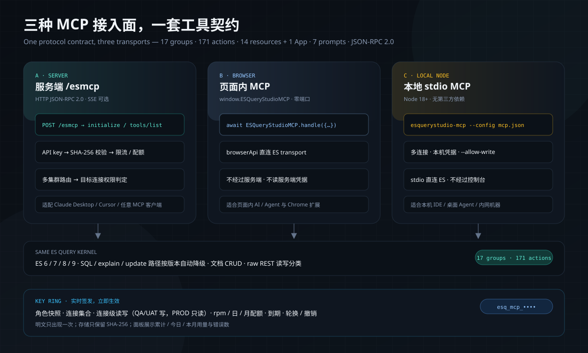
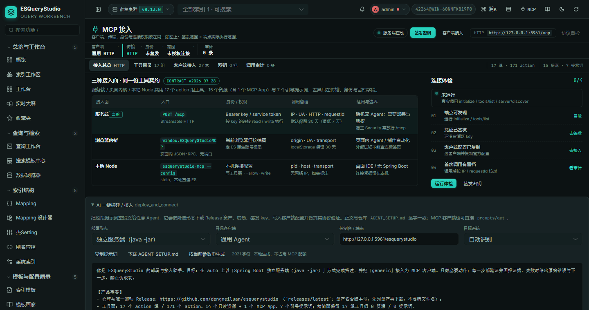
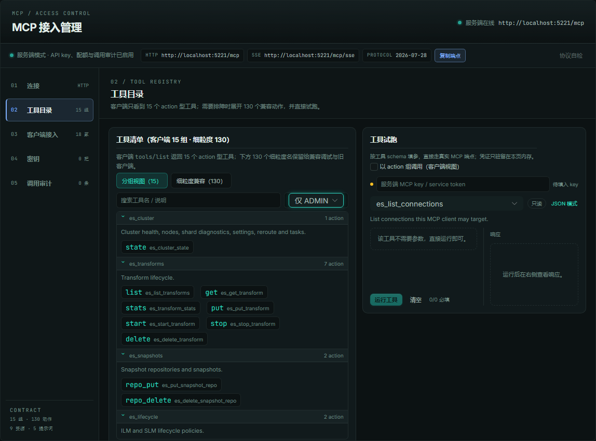
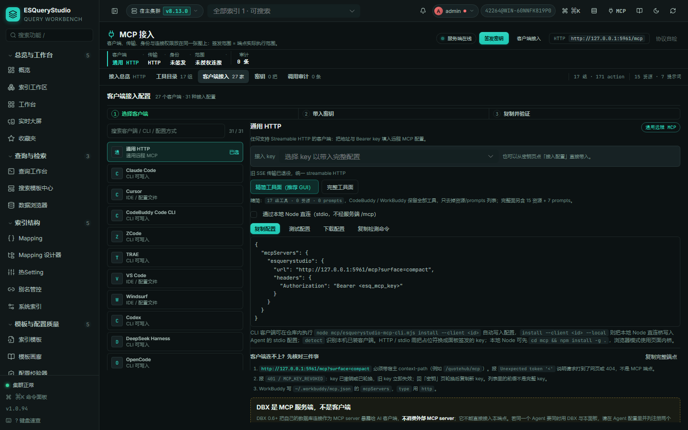
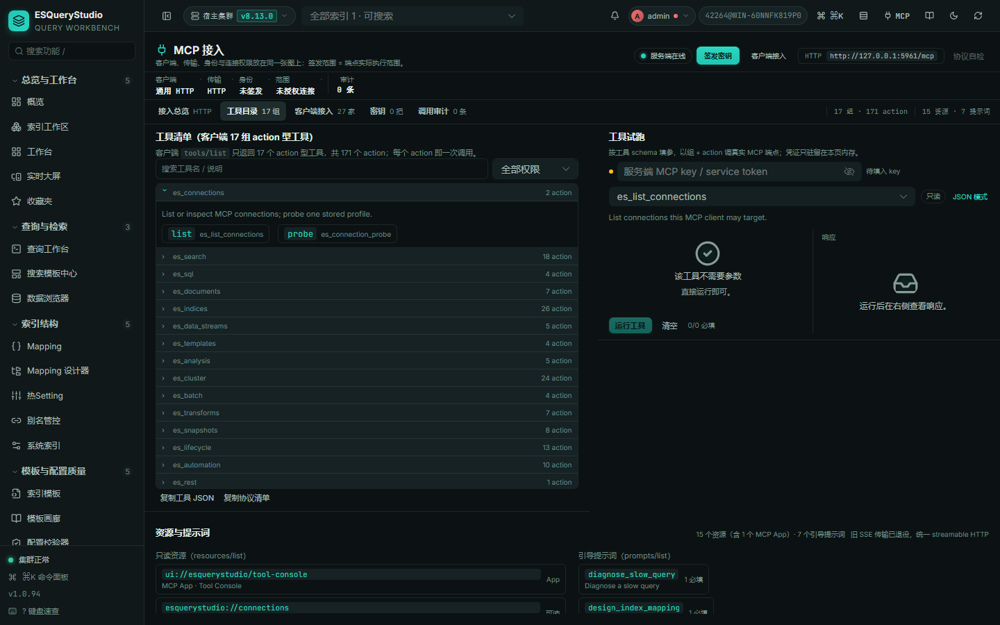
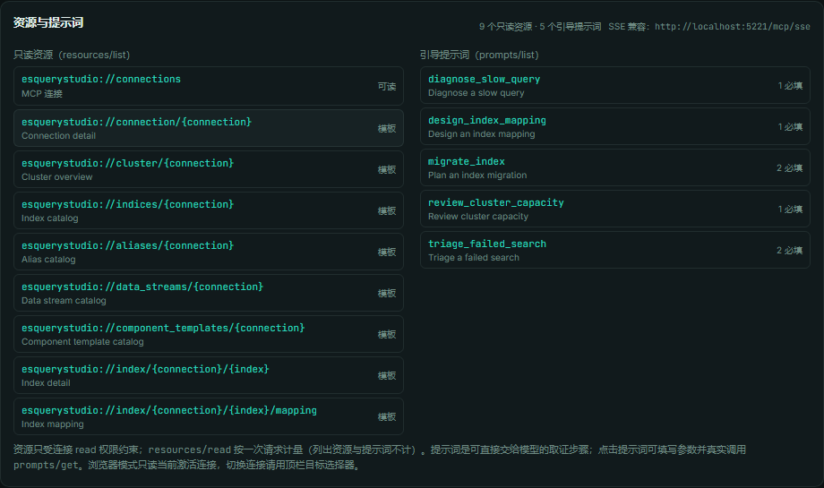
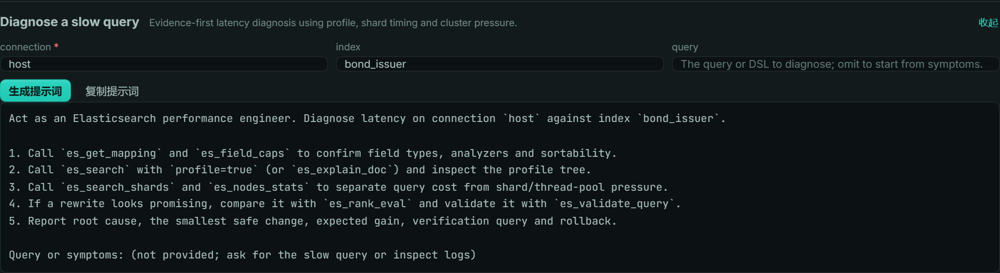
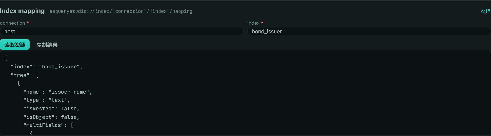
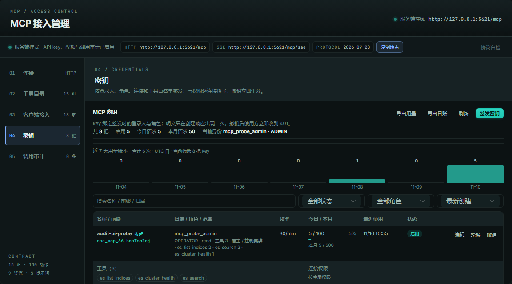
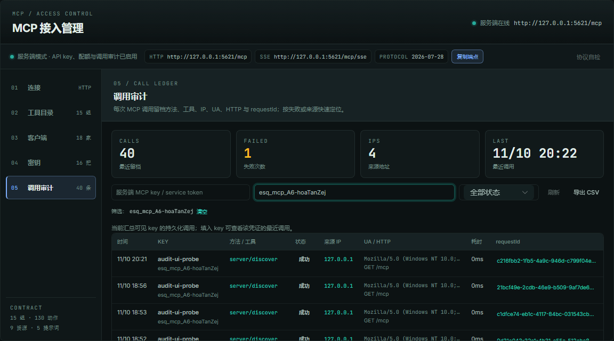

# MCP 接入



ESQueryStudio 提供三种 MCP（Model Context Protocol）接入面：服务端模式的标准 HTTP JSON-RPC、纯前端模式的内页 JSON-RPC 桥，以及本地 Node stdio 桥。三者共用同一组工具、只读资源与引导提示词契约（读工具 + 显式授权的写工具），避免出现「服务端一套、前端另一套」的能力漂移。

## 快速开始


ESQueryStudio 把 MCP 做成产品的一等公民，而不是控制台旁边的脚本：
服务端、浏览器页面内、本地 Node 三种接入面共用一套工具、只读资源与引导提示词契约；key 按登录人/角色签发，
可按连接设置 read/write，实时轮换、撤销与计量。

| 接入面 | 一条命令 / 一个对象 | 适合 |
|---|---|---|
| 服务端 | `POST {context-path}/mcp` JSON-RPC 2.0 | Claude Desktop、Cursor、任意 MCP 客户端；需要多集群与配额 |
| 浏览器 | `window.ESQueryStudioMCP.handle(...)` | 页面内 AI / Agent、控制台插件自动化；零端口 |
| 本地 Node | `esquerystudio-mcp --config mcp.json`（stdio） | 本机 IDE / 桌面 Agent；直连 ES，无 Spring Boot |

除 `tools/*` 外，三面都实现 `resources/list` / `resources/templates/list` / `resources/read` 与 `prompts/list` / `prompts/get`：资源只读（连接、集群、索引、mapping），提示词是可直接交给模型的取证步骤。面板「协议自检」会真实走一轮 `initialize` + 工具/资源/提示词列表。

客户端接入可用面板「客户端接入」标签页或 CLI：

```bash
cd mcp && npm install -g .
esquerystudio-mcp-cli list
esquerystudio-mcp-cli detect --json
esquerystudio-mcp-cli probe --url http://localhost:5601/mcp --token esq_mcp_xxx
esquerystudio-mcp-cli install --client cursor --url http://localhost:5601/mcp --token esq_mcp_xxx --write
```

`probe` 是接入自检：真实走 `initialize` + `tools/list`，打印协议、工具数、key 角色、连接与逐连接读写；401 / 地址错误会直接给出状态码和错误码。

支持 Claude Code、Cursor、VS Code、Windsurf、TRAE、Codex、Qoder、CodeBuddy、ZCode、DeepSeek Harness、OpenCode、Pi、Cherry Studio、WorkBuddy、Antigravity；未知客户端会输出可粘贴的 `mcpServers` 片段。
`detect --json` 会逐家回报 `commandFound`（CLI 是否在 PATH）、`configFound`（官方配置路径是否存在）与 `installed`（配置里是否已有 `esquerystudio`，读不懂时为 `null`），Agent 可据此判断是「新装、覆盖还是跳过」。

完整工具表、错误语义与架构见 [MCP 接入](mcp.md)。

### 1. 服务端模式（推荐给团队 / 生产）

#### 1.1 打开能力

```yaml
esquerystudio:
  mcp:
    enabled: true
```

- 这是**一次性装配开关**：决定 `/mcp` 与密钥管理端点是否存在。
- 日常使用不需要在配置里写 key。key 发版后在面板或 API **实时创建**，立即生效。
- QuoteHub 已默认开启；宿主自己的 Spring Security 需要像放行 `/esquerystudio.html` 一样放行 `/mcp`。

#### 1.2 创建第一把 key

顶栏有一个常驻 **MCP** 按钮（插头图标），点击直接进入 **Dev Tools → MCP**；
也可以手动打开 **开发者工具 → Dev Tools**，再点页面工具栏的 **MCP**。


进入 **密钥与用量 → 签发密钥**：


也可以直接调管理 API（使用控制台登录态，不是 MCP key）：

```bash
curl -s http://localhost:5601/internal/es/index/mcp/keys \
  -H "Authorization: Bearer <console-token>" \
  -H 'Content-Type: application/json' \
  -d '{
    "name": "ci-agent",
    "role": "OPERATOR",
    "connections": ["host"],
    "permissions": ["read"],
    "allowedTools": ["es_search:search", "es_search:count", "es_indices:mapping"],
    "requestsPerMinute": 60,
    "dailyQuota": 5000,
    "monthlyQuota": 100000,
    "expiresInDays": 30
  }'
```

`allowedTools` 的词表是「组:action」限定名（如 `es_search:search`）；填组名（如 `es_search`）会整组展开。响应里的 `secret` 只出现一次。存储只保留 SHA-256；管理面永远不回显明文。

#### 1.3 接 Claude Desktop / Cursor

使用仓库自带的 stdio 桥把本地 MCP 客户端转发到 HTTP 端点：

```json
{
  "mcpServers": {
    "esquerystudio": {
      "command": "node",
      "args": ["/path/to/esquerystudio/mcp/esquerystudio-mcp-stdio.mjs"],
      "env": {
        "ESQ_MCP_URL": "http://localhost:5601/mcp",
        "ESQ_MCP_TOKEN": "esq_mcp_xxxxxxxx.yyyyyyyy"
      }
    }
  }
}
```

QuoteHub 部署的 context path 是 `/quotehub`，端点对应为
`http://<host>:7788/quotehub/mcp`。

### 2. 浏览器模式（零端口）

浏览器构建会在页面内安装同一套 JSON-RPC 入口：

```js
await window.ESQueryStudioMCP.handle({
  jsonrpc: '2.0',
  id: 1,
  method: 'tools/list'
});

await window.ESQueryStudioMCP.callTool('es_search', {
  action: 'search',
  index: 'research_report',
  query: { match_all: {} },
  size: 5
});
```

读工具使用当前浏览器连接；写工具默认关闭，需在 MCP 面板显式打开。
浏览器标签页不能监听 TCP，外部进程客户端请走服务端或本地 Node。

### 3. 本地 Node 模式（给本机 Agent）

```bash
# 仓库内直接运行
node mcp/esquerystudio-local-mcp.mjs --config ~/.esquerystudio/mcp.json

# 或安装为全局命令（Node 18+，无第三方依赖）
cd mcp && npm install -g . && esquerystudio-mcp --config ~/.esquerystudio/mcp.json
```

`mcp.json`：

```json
{
  "defaultConnection": "qa",
  "connections": [
    { "id": "qa",  "name": "QA",  "url": "https://qa-es.example:9200",  "apiKey": "base64-id:key" },
    { "id": "prod","name": "PROD","url": "https://prod-es.example:9200", "apiKey": "base64-id:key" }
  ]
}
```

本地配置里的凭据只在 Node 进程内；默认只读，写工具需要显式加 `--allow-write`。
浏览器模式可在 **Dev Tools → MCP → 导出 Node MCP 配置** 生成同结构文件。

让本机 Agent 直接以 stdio 方式接入本地 Node 模式（不经过 Spring Boot）：

```bash
# 先看目标客户端是否已装、是否已经接入过
esquerystudio-mcp-cli detect --json

# 生成或写入 stdio 配置；--connection-config 指向上面的 mcp.json
esquerystudio-mcp-cli config  --client codex --local
esquerystudio-mcp-cli install --client cursor --local --write
esquerystudio-mcp-cli install --client claude-code --local --connection-config ~/.esquerystudio/mcp.json
```

`--local` 对 Claude Code 会输出 `mcp add --transport stdio ... -- node <local-mcp.mjs> --config <mcp.json>`，对 Codex 输出等价的 `[mcp_servers.esquerystudio]` TOML，对其余 JSON 客户端则写入等价的 `stdio` 条目；生成的命令和配置都指向本机 Node 桥，不需要复制服务端 URL 或 key。

### 4. 一把 key 覆盖多环境：QA/UAT 可写、生产只读

`connectionPermissions` 是连接级权限覆盖；未列出的连接沿用全局 `permissions`。

```json
{
  "name": "qa-uat-rw-prod-ro",
  "role": "ADMIN",
  "connections": ["qa", "uat", "prod-1", "prod-2"],
  "permissions": ["read"],
  "connectionPermissions": {
    "qa":     ["read", "write"],
    "uat":    ["read", "write"],
    "prod-1": ["read"],
    "prod-2": ["read"]
  },
  "allowedTools": ["es_search:search", "es_search:count", "es_rest:call", "es_documents:index"]
}
```

调用时必须带目标连接：

```json
{
  "jsonrpc": "2.0",
  "id": 2,
  "method": "tools/call",
  "params": {
    "name": "es_rest",
    "arguments": {
      "action": "call",
      "connection": "qa",
      "method": "PUT",
      "path": "/probe_20261107"
    }
  }
}
```

把 `connection` 换成 `prod-1`，同样的 PUT 会在控制台边界被拒绝，不会到达生产 ES。
工具目录按“任意连接”汇总；真正执行时按目标连接再判一次。

### 5. 频率、配额与错误

| HTTP / 结果 | 含义 | 处理 |
|---|---|---|
| `401` + `INVALID_MCP_KEY` / `MCP_KEY_REVOKED` | key 无效、已撤销或已过期 | 在面板重新签发或轮换 |
| `429` + `Retry-After` | 超过 `requestsPerMinute`（固定 60 秒窗口） | 按秒数退避 |
| `429` + `MCP_DAILY_QUOTA_EXCEEDED` / `MCP_MONTHLY_QUOTA_EXCEEDED` | 日/月配额（UTC）用尽 | 调整配额或等次日/次月 |
| `result.isError=true` + `Connection ... is read-only` | 目标连接只读 | 改用可写连接，或由 ADMIN 调整连接级权限 |
| `result.isError=true` + `Tool not allowed for this key` | action 不在白名单 | 在签发时勾选 action |
| `result.isError=true` + `Connection not allowed for this key` | 目标连接不在连接集合 | 重建 key 或改用已授权连接 |

### 6. 30 秒验收

```bash
# 1) 握手
curl -s "$ESQ_MCP_URL" \
  -H "Authorization: Bearer $ESQ_MCP_TOKEN" \
  -H 'Content-Type: application/json' \
  -d '{"jsonrpc":"2.0","id":1,"method":"server/discover"}'

# 2) 工具目录（三面都应有 17 个 action 组、6 个提示词、8 个资源模板）
curl -s "$ESQ_MCP_URL" \
  -H "Authorization: Bearer $ESQ_MCP_TOKEN" \
  -H 'Content-Type: application/json' \
  -d '{"jsonrpc":"2.0","id":2,"method":"tools/list"}'

# 3) 生产写应被拒绝
curl -s "$ESQ_MCP_URL" \
  -H "Authorization: Bearer $ESQ_MCP_TOKEN" \
  -H 'Content-Type: application/json' \
  -d '{"jsonrpc":"2.0","id":3,"method":"tools/call","params":{"name":"es_rest","arguments":{"action":"call","connection":"prod-1","method":"PUT","path":"/should-not-exist"}}}'
```

### 7. 安全边界

- 明文 key 只在创建/轮换响应出现一次；存储只保留 SHA-256。
- key 绑定签发时的 `owner` / `role` 快照；角色变更后应撤销旧 key 再签发。
- 任意登录人都可为自己签发 key；key 的连接、工具和连接级读写只能落在本人页面授权范围内，不能代签、不能提权。
- 频率与配额在进程内计数；多实例部署时每实例独立，严格全局配额请由网关按 key 维度实施。
- 宿主自己注册 `McpKeyStore` 时，新的连接级权限重载默认**明确报错**，不会静默丢弃权限。

**目录：** [能力矩阵](#能力矩阵) · [服务端模式](#服务端模式) · [API key 与配额](#api-key角色与配额推荐) · [stdio 桥](#stdio-桥claude-desktop--cursor) · [本地 Node](#本地-node-mcp无-spring-boot--无浏览器) · [纯前端](#纯前端模式) · [工具表](#工具) · [资源与提示词](#资源与提示词) · [REST 分类](#raw-rest-的读写分类) · [ES 6/7/8/9](#es-6--7--8--9-兼容) · [验证](#验证)

## 能力矩阵

| 模式 | 接入方式 | 适合谁 | 边界 |
|---|---|---|---|
| 服务端模式 | `POST /mcp`（JSON-RPC 2.0） | Claude Desktop、Cursor、任意 MCP 客户端 | 需要启用 `esquerystudio.mcp.enabled`；支持服务级 Bearer token 或按登录人/角色签发的 API key |
| 纯前端模式 | `window.ESQueryStudioMCP` | 页面内 AI / Agent、控制台插件内的自动化 | 浏览器标签页不能监听 TCP；外部进程客户端请使用服务端模式，或在本地桥中复用同一套工具契约 |
| 本地 Node 模式 | `mcp/esquerystudio-local-mcp.mjs`（stdio） | 本地 Claude Desktop / Cursor / Agent，无 Spring Boot、无浏览器 | Node 18+ 直连 ES；多连接配置在本机；写工具默认关闭，需 `--allow-write` |

纯前端的工具执行仍走 `browserApi` 的直连 ES transport；不经过服务端，不读取服务端凭据。

## 服务端模式

### 启用

```yaml
esquerystudio:
  mcp:
    enabled: true
    token: change-me
```

`GET /mcp` 服务卡同时返回 `protocolVersion`、`capabilities`、`instructions`、`tools`、`resources`、`resourceTemplates` 与 `prompts`，客户端可先发现再初始化。使用 API key 时还会返回 `role`、`connections`、`permissions` 与 `connectionPermissions`，Agent 可在首次连接时就读取自己的真实读写范围；`recommendedTools`（服务 token 为 17 个 action 组，API key 只列其 `allowedTools` 命中的组）与对应的 `maxRecommendedTools` 给出客户端工具面；客户端只加载 17 个组工具，不再逐个加载 167 个 action。`recentCalls` 返回该 key 的最近 100 条预览；独立审计端点 `GET /internal/es/index/mcp/keys/calls` 返回按时间保留的完整调用记录（默认 30 天，最低 7 天），含 `requestId`、调用方 IP、UA、HTTP、耗时与状态。浏览器桥/本地 Node 的 `server/discover` 也返回进程内 `recentCalls`（transport/origin 或 pid/host；无网络 IP），三种模式字段形状一致。

### 传输方式

- **Streamable HTTP**：`POST /mcp` 发 JSON-RPC，`GET /mcp` 取服务卡。所有客户端统一走这一条通道。
- **stdio**：仅本地 Node / stdio 桥使用；服务端 HTTP 端点不提供 stdio。

> WorkBuddy 等客户端的 MCP 菜单里同时有 Streamable HTTP / SSE / Stdio 时，选 **Streamable HTTP**。WorkBuddy 写入 `~/.workbuddy/mcp.json` 的 `mcpServers` 段，`type` 用 `http`，`url` 用完整端点（含 context-path）：
>
> ```json
> {
>   "mcpServers": {
>     "esquerystudio": {
>       "type": "http",
>       "url": "http://host:7788/quotehub/mcp",
>       "headers": { "Authorization": "Bearer <esq_mcp_key>" }
>     }
>   }
> }
> ```
>
> 客户端只看到 17 个 action 型工具；key 的白名单用「组:action」限定名（或整组组名）收窄每组实际暴露的 action。

`token` 是服务级自举 token（拥有全部工具）；未设置时，若 key 存储可用仍可用 API key 认证。缺少或错误的 Bearer 凭证返回 `401`，撤销/过期的 key 同样返回 `401`。key 默认只读；写工具仍须在目标连接上有 `write` 授权。内置身份（`grantedPages=null`）没有页面模型时，写权限按角色门：OPERATOR 及以上可在 `connectionPermissions` 里逐连接授予 `write`，VIEWER 仍只读；宿主下发页面授权后，写权限只认 `conn:{id}:w:{page}`（与拦截器同一份裁决）。

MCP 端点同时受 `esquerystudio.elasticsearch.web-enabled` 约束（默认 `true`）；显式关闭 Web 面时端点不会装配，避免出现「控制台已关闭、MCP 仍对外」的旁路。

宿主应用如果有自己的 Spring Security，需像放行 `/esquerystudio.html` 一样放行 `/mcp`（含 context-path）；MCP 的 Bearer API key 由 starter 校验，不能被宿主的 JWT 过滤器提前拦掉。

### API key、角色与配额（推荐）

日常接入建议在控制台左侧 **开发者工具 → MCP 接入**（独立页 `/mcp`，顶栏 MCP 按钮可快速打开同一面板）签发 key，而不是共享服务级 token：



- key 绑定签发时的 `owner` 与 `role`。任意登录人都可为本人签发，但连接、工具和连接级读写只能落在本人页面授权范围内；ADMIN 可代任意用户签发、查看全部、撤销任意 key。目标用户在用户目录中可解析时，ADMIN 代签的角色不得高于该用户实际角色（例如不能为 VIEWER 用户代签 ADMIN key）；用户目录不可用（宿主委托身份）且宿主未实现页面解析时，ADMIN 代签他人 key 只能签发宿主连接；写权限按角色门，角色解析不到或低于 OPERATOR 时 403，其他连接一律不可代签。宿主实现 `McpKeyOwnerResolver.pagesOf(username)` 时，ADMIN 代签的连接/工具/写权限会与目标用户的**页面授权**逐项求交（`GET /internal/es/index/mcp/keys/owner-scope?owner=` 可在签发前预览），既不超过目标用户实际能打开的页面，也不漏掉其已有写授权。
- 非 ADMIN 的可用工具受其页面授权收窄（`search` / `mapping` / `score-explain` / `indices` / `overview`）；ADMIN 不受页面收窄。
- 系统管理类工具（Transform / Watch / SLM / Snapshot repository / Ingest pipeline / `es_cluster` 的 `state`）仅 ADMIN 角色的 key 可签发与调用；普通 key 的工具目录、可签发清单和执行面一致排除这些工具。ADMIN 代签 OPERATOR 等低角色 key 时同样不能勾选这些工具，避免“签发了却永远不会下发”的漏权快照。


- 每个 key 独立设置 `allowedTools`（词表是「组:action」限定名，如 `es_indices:mapping`；填组名如 `es_indices` 会展开为该组全部 action 后逐项校验读写权限；组内包含写 action 而 key 没有 write 权限时会明确拒绝，不会静默漏发，因此只读 key 请传具体限定名或由面板按权限勾选）、`connections`（ADMIN 可选全部连接；非 ADMIN 只能选自己有页面授权的连接）、`permissions`（全局 read；写权限用 `connectionPermissions` 逐连接授予）、`requestsPerMinute`（固定 60 秒窗口）、`dailyQuota`、`monthlyQuota`、`expiresInDays`；每个用户最多 10 把活跃 key（ADMIN 100 把），防止用多把 key 绕过单 key 配额。存量 key 在旧版本签发的细粒度工具名白名单会在加载时自动映射到所属 action 的限定名，无需重签。宿主实现 `McpKeyOwnerResolver` 后按真实角色放行（例如 QuoteHub：admin → ADMIN、manager → OPERATOR、其余 → VIEWER）；未接入时 ADMIN 代签他人 key 只能签发 VIEWER 只读 key，写权限或更高角色一律 403（fail-closed，不靠请求体自报角色）。
- `connectionPermissions` 支持连接级权限覆盖：同一把 key 可以让 QA/UAT 为 `["read","write"]`、生产连接为 `["read"]`，未列出的连接沿用 `permissions`。工具清单按「任意连接」汇总，真正执行时按目标连接再判一次，越权写返回 tool error（不会把生产写请求发给 ES）。
- 明文 `esq_mcp_...` 只在创建响应出现一次；存储只保留 SHA-256，管理面永远不回显。
- 频率超限返回 `429` + `Retry-After`；日/月配额超限也返回 `429`。用量（累计/今日/本月请求数、错误数、最近使用时间）在面板展示。
- key 记录默认落在控制集群索引 `esquerystudio_mcp_keys`；可用 `esquerystudio.elasticsearch.console.mcp-key-index-name` 改索引名。首次写入自动创建；若集群关闭了动态建索引，请预先建好该索引。认证仍只认 SHA-256；完整 key 以 AES-256-GCM 密文保存在 `secretEncrypted`，owner/ADMIN 可在面板随时「复制 key」。主密钥优先取 `esquerystudio.mcp.key-encryption-key`，其次 `esquerystudio.mcp.token`，未配置时落在 `~/.esquerystudio/mcp-secret.key`（多实例请显式配置共享主密钥）。
- **持久化档**：`esquerystudio.elasticsearch.console.store=jdbc` 时自动改用宿主 `DataSource` 的 `esquerystudio_mcp_key` 表（首次使用幂等建表），key、连接、权限与用量计数跨重启保留；`control-es` 时用控制集群索引。宿主还可自定义 `McpKeyStore` Bean 完全接管。
- 面板里的请求数是**工具调用 + 资源读取**口径（`tools/call` 与 `resources/read`；资源列表/提示词列表不计量），可直接对接外部计费/账单系统；`requestCount` 是累计值，`todayCount` / `monthCount` 按 UTC 自然日/月重置。每个 key 还持久化 `toolCounts`（按「组:action」限定名计数，资源读取记为 `resources/read`，管理面按调用量倒序返回前 20 项）、`lastTool` 与 `dailyCounts`（最近 31 天 UTC 每日请求数，用于趋势和按日账单），方便按工具/按日计费与排查。每次 JSON-RPC 调用（含 `tools/list`、`server/discover`、资源/提示词读取）都会写一条持久化审计（一次调用一条，默认保留 30 天，最低 7 天）：`method` / `tool` / `requestId` / `at` / `ok` / `ms` / `ip`（优先 X-Forwarded-For 首跳）/ `remoteIp` / `ua` / `http` / `origin` / `transport`（http）；key 详情另保留最近 100 条 `recentCalls` 预览；浏览器桥与本地 Node 也保留最近 100 条，字段同形，分别以 `origin` / `pid`+`host` 替代网络 IP；服务端同时输出 `[mcp-call]` 日志（key、方法、工具、requestId、IP、UA、HTTP、耗时），认证/鉴权失败输出 `[mcp-denied]`（状态码、code、命中的 key 前缀、requestId、IP、HTTP 方法/路径、UA），便于后端区分客户端 key 配错（撤销/轮换后仍用旧 key）与网络/代理问题，并可用同一 `requestId` 关联响应头。`X-Request-Id` 可由客户端传入，未传时服务端生成并通过同名响应头返回。独立页「调用审计」按时间列出 `method` / `tool` / 成功失败 / 来源 IP / UA / HTTP / 耗时 / `requestId`，支持按工具、IP、`requestId` 搜索和按状态过滤，并可导出 CSV；管理动作 `create/update/rotate/revoke` 会写入 `auditLog`（保留最近 30 条，含操作人与角色），面板密钥详情可直接查看。
- **代签预览**：ADMIN 在面板选择归属用户时会调用 `GET /internal/es/index/mcp/keys/owner-scope?owner=<user>`，返回目标角色、页面授权是否可解析、可签发连接/工具与本角色配额上限；签发按钮按该范围收窄，不会先让 UI 勾选再在提交时 403。
- **写权限所见即所得**：`GET /mcp/keys` 的每个连接同时返回 `writeTools` / `writePages`。面板只为当前身份真正可写、且覆盖已选写 action 的连接渲染写复选框；写 action 没有可写连接、或连接缺少对应页面写权时直接阻止提交。后端 `validateWriteToolPageCoverage` 用同一组页面写权复核，避免「能勾选、提交 403」或「能签发、执行 403」。
- **实时创建、实时管理**：发版时只需要一次能力开关（`esquerystudio.mcp.enabled`，QuoteHub 已默认开启）；之后在 **MCP 接入页 → 密钥** 或 `POST /internal/es/index/mcp/keys` 签发、编辑、轮换、撤销 key，立即生效，不需要重启、不需要改 `application.yml`、不需要重新发版。频率/配额/用量按 key 实时累计。

混合环境 key 示例（测试可写、生产只读）：

```json
{
  "name": "qa-uat-rw-prod-ro",
  "role": "ADMIN",
  "connections": ["qa", "uat", "prod-1", "prod-2"],
  "permissions": ["read"],
  "connectionPermissions": {
    "qa":  ["read", "write"],
    "uat": ["read", "write"],
    "prod-1": ["read"],
    "prod-2": ["read"]
  },
  "allowedTools": ["es_search:search", "es_search:count", "es_rest:call", "es_documents:index"]
}
```

| 角色 | 查看 key | 签发 | 撤销 |
|---|---|---|---|
| VIEWER | 自己的 | 本人，按页面授权范围 | 自己的 |
| OPERATOR / rank3 | 自己的 | 本人，按页面授权范围 + 角色配额上限 | 自己的 |
| ADMIN | 全部 | 任意用户/角色；可选连接集合与 read/write 权限 | 任意 |

| 角色 | 每分钟上限 | 每日上限 | 每月上限 | 有效期上限 |
|---|---|---|---|---|
| OPERATOR | 120 | 20,000 | 500,000 | 90 天 |
| rank3（REBUILD_OP / CLUSTER_OP / AUDIT_OP） | 300 | 50,000 | 1,000,000 | 90 天 |
| ADMIN | 600 | 200,000 | 5,000,000 | 3650 天 |

### 工具包与客户端上限

客户端工具面是 **17 个 action 型工具**（`es_search`、`es_indices`、`es_cluster`、`es_xmigrate` 等），共 167 个 action；调用形态唯一——`tools/call` 的 name 必须是组名之一且必填 `action`，组外的旧细粒度名一律按未知工具拒绝。签发 key 的白名单用「组:action」限定名控制每组实际暴露的 action；控制台提供四档工具包：

| 工具包 | 内容 | 适用 |
|---|---|---|
| 核心查询 | 连接、搜索、SQL、Mapping、集群健康等 32 个只读 action | 默认，日常问答与分析 |
| 核心 + 写入 | 核心包 + 文档写入 / 索引运维 action | 需要改数据的可信 Agent |
| 只读全量 | 全部只读 action | 分析型 Agent |
| 全量 | 167 个 action（客户端仍只看到 17 个组） | 脚本 / 一次性运维 |

已选超过 80 个时面板会提示；key 列表对超限 key 提供「精简」按钮，打开编辑并预选核心包，保存后才真正收窄权限，不会静默改 key。工具包只改变 `allowedTools`，不改变连接的 read/write 边界。

管理面端点（使用控制台登录态，不是 MCP key）：

- `GET /internal/es/index/mcp/keys`：当前身份可见的 key + 角色上限 + 可用工具（限定名）。
- `POST /internal/es/index/mcp/keys`：签发；响应返回 `secret`，同时以密文持久化，后续可通过 `GET /internal/es/index/mcp/keys/{id}/secret` 取回（owner/ADMIN）。
- `PUT /internal/es/index/mcp/keys/{id}`：原地修改名称、工具白名单、连接集合/连接级读写、频率/日/月配额与有效期；保留 id、明文哈希与用量。
- `POST /internal/es/index/mcp/keys/{id}/rotate`：轮换自己的 key（保留权限/用量，旧明文立即失效）；ADMIN 可轮换任意 key。旧版本未保存完整值的 key 首次复制时会明确询问轮换。
- `GET /internal/es/index/mcp/keys/calls?keyId=&limit=`：持久化调用审计（默认 30 天，最低 7 天）；ADMIN 看全部，普通用户只看自己的 key。
- `POST /internal/es/index/mcp/keys/{id}/revoke`：撤销自己的 key；ADMIN 可撤销任意 key。

限流计数在进程内完成。多实例部署时每个实例独立计数，严格的全局配额应在网关或宿主侧按 key 维度实施——这是一个明确的部署边界，不是伪造的分布式配额。宿主可以注册自己的 `McpKeyStore` Bean 替换默认的 ES 存储（例如 QuoteHub 的数据库存储），管理面与 `/mcp` 认证会继续复用同一 SPI。

### 端点

- `GET /mcp`：返回协议版本、`supportedVersions`、serverInfo、工具目录和 transport 信息。
- `POST /mcp`：JSON-RPC 2.0，支持：
  - `server/discover`（含 `serverInfo` 身份）
  - `initialize`（兼容 2025-11-25 / 2025-06-18 / 2025-03-26 / 2024-11-05 客户端）
  - `notifications/initialized`
  - `ping`
  - `tools/list` / `tools/call`
  - `resources/list` / `resources/templates/list` / `resources/read`
  - `prompts/list` / `prompts/get`
  - `completion/complete`

当前支持 **MCP 2026-07-28**（最新稳定版）、**2025-11-25**、**2025-06-18**、**2025-03-26** 与 **2024-11-05**；`initialize` 对受支持版本原样回显，未知旧版本回落到 2025-06-18，避免老 SDK 误判“服务器返回了不支持的版本”。2026-07-28 客户端可以跳过 `initialize`，直接用 `server/discover` 读取 `supportedVersions` / `capabilities` / `serverInfo` / `instructions`；所有成功 `result` 显式带 `resultType: "complete"`，`tools/list`、`resources/list`、`resources/read`、`prompts/list` 等服务卡统一带 `ttlMs` 与 `cacheScope: "private"`。

**协议覆盖矩阵**：三种接入传输（Streamable HTTP / 页面内桥 / 本地 stdio）、五个版本与上述核心方法均对齐；`resources.subscribe=false`、`tools.listChanged=false`，因此不对外声明订阅能力。2026-07-28 的 **Tasks 扩展**（`io.modelcontextprotocol/tasks`）已支持：客户端在请求 `_meta` 显式声明后，长 action 返回 durable task，支持 `tasks/get` / `tasks/update` / `tasks/cancel`。**MCP Apps**（`io.modelcontextprotocol/ui`）已支持：`resources/list` 暴露 `ui://esquerystudio/tool-console`（`text/html;profile=mcp-app`，带 `_meta.ui.csp`），17 个 action 工具的 `_meta.ui.resourceUri` 指向该资源；不支持 Apps 的宿主可继续读取普通文本结果。**MRTR InputRequired** 已支持：声明 `elicitation` 的 2026 客户端在 `es_batch` 的 `delete_by_query`、`es_indices` 的 `delete`、`es_documents` 的 `delete`、`es_data_streams` 的 `delete`、`es_rest` 的 `call`（非 GET·HEAD）、`es_adhoc_rebuild` 的 `start` / `abort` / `confirm_switch` / `retry` / `delete_jobs`、`es_xmigrate` 的 `start` / `resume` / `abort` / `delete_jobs` / `sync_structure`（`dryRun=true` 只读预览除外）前收到 `input_required`，确认后带 `inputResponses` + `requestState` 重试；`requestState` 由服务端 HMAC 签名并绑定工具与参数摘要，浏览器/本地 Node 用一次性随机状态。**subscriptions/listen** 仍未声明；`roots` / `sampling` / `logging` 是 2026 规范已废弃或移除的特性，本实现不使用。客户端只用核心 tools / resources / prompts / completion 时无需这些扩展。

```bash
curl -s http://localhost:5601/mcp \
  -H 'Authorization: Bearer change-me' \
  -H 'Content-Type: application/json' \
  -d '{"jsonrpc":"2.0","id":1,"method":"tools/list"}'
```

### 客户端接入向导与 CLI

客户端配置默认使用 **精简工具面**（`/mcp?surface=compact` 或请求头 `X-MCP-Surface: compact`）：保留全部 17 个 action 组（167 个 action 仍按 key 白名单执行），只把 resources / prompts 列表置空，避免 CodeBuddy / WorkBuddy 被 10 个资源 + 6 个提示词铺满面板；切换「完整工具面」即恢复 17 组 + 10 资源 + 6 提示词。精简面只影响 discovery，不改变 key 已签发的工具权限。

面板独立的「客户端接入」页以可搜索矩阵预置 Claude Code、Cursor、CodeBuddy Code CLI、ZCode、TRAE、VS Code、Windsurf、Codex、DeepSeek Harness、OpenCode、Pi、Cherry Studio、Qoder、WorkBuddy、Antigravity、通用 HTTP、stdio 桥、本地 Node、浏览器页面内桥等类型；选中后显示对应配置文件位置与提示，可复制或下载配置，HTTP/stdio 会自动填入当前试跑 key。



`mcp/esquerystudio-mcp-cli.mjs`（安装包内命令 `esquerystudio-mcp-cli`）提供同样的客户端识别：

```bash
esquerystudio-mcp-cli list
esquerystudio-mcp-cli detect --json
esquerystudio-mcp-cli probe --url http://localhost:5601/mcp --token esq_mcp_xxx
esquerystudio-mcp-cli install --client cursor --url http://localhost:5601/mcp --token esq_mcp_xxx --write
esquerystudio-mcp-cli install --client cursor --local --write
esquerystudio-mcp-cli config --client claude-code --url http://localhost:5601/mcp --token esq_mcp_xxx
```

`detect` 输出每个客户端的 `commandFound`（CLI 是否在 PATH）、`configFound`（配置文件是否存在）与 `installed`（配置里是否已有 `esquerystudio`；配置读不懂时为 `null`），便于先确认本机装了哪些 Agent、是否已接入过，再选择安装或跳过。`probe --url ... --token ...` 真实执行 `initialize` + `tools/list` 并读取服务卡，打印协议、工具数、key 角色、连接与逐连接读写；401/地址错误直接给出状态码和错误码，是接入排障的第一条命令。

> **DBX 互操作**：DBX 0.6+ 是 MCP **Server**（把自己的数据库连接暴露给 AI 客户端），不是 MCP 客户端，不能直接消费本端点；若同一个 Agent 要同时使用 DBX 与本控制台，请在 Agent 配置里并列注册两个 server。DBX 侧可用 `dbx agent setup` 安装它的官方 Agent Skill。

Cursor / VS Code / Windsurf / OpenCode / Qoder / TRAE / CodeBuddy / ZCode / WorkBuddy / Pi / Antigravity 支持合并写入 MCP 配置（OpenCode 写入 `mcp.servers` 的 `type: "remote"`，ZCode 写入 `mcp.servers` 的 `type: "http"`，Qoder / CodeBuddy 写入带 `type: "http"` 的 `mcpServers`）；Claude Code 输出 `.mcp.json` 配置与可执行 `claude mcp add` 命令，Codex 输出 `~/.codex/config.toml` 的 `[mcp_servers.esquerystudio]` TOML；DeepSeek Harness 输出 `cordis.yml` 的 `@deepseek-ai/dsh-mcp-client` 插件条目（`transport: streamable-http`）；其余客户端输出标准 `mcpServers` JSON。CLI 不执行第三方命令，也不覆盖已有配置。

### stdio 桥（Claude Desktop / Cursor）

只支持 stdio 启动命令的客户端使用 `mcp/esquerystudio-mcp-stdio.mjs` 转发到服务端端点：

```json
{
  "mcpServers": {
    "esquerystudio": {
      "command": "node",
      "args": ["/path/to/esquerystudio/mcp/esquerystudio-mcp-stdio.mjs"],
      "env": {
        "ESQ_MCP_URL": "http://localhost:5601/mcp",
        "ESQ_MCP_TOKEN": "esq_mcp_xxxxxxxx.xxxxxxxx"
      }
    }
  }
}
```

### 本地 Node MCP（无 Spring Boot / 无浏览器）

如果只有本地客户端 Agent（Claude Desktop、Cursor、命令行 Agent），又不想启动 Spring Boot，可直接用 Node 直连 ES：

```bash
# 方式 A：仓库内直接运行（无需安装依赖）
node mcp/esquerystudio-local-mcp.mjs --config ~/.esquerystudio/mcp.json
# 方式 B：本机安装为命令（Node 18+，无第三方依赖）
cd mcp && npm install -g . && esquerystudio-mcp --config ~/.esquerystudio/mcp.json
# 单连接环境变量形态
ESQ_ES_URL=http://localhost:9200 ESQ_ES_USERNAME=elastic ESQ_ES_PASSWORD=*** \
  node mcp/esquerystudio-local-mcp.mjs
```

浏览器模式配好连接后，可在 **MCP 接入页 → 工具目录 → 导出 Node MCP 配置** 直接生成
`esquerystudio-mcp.json`，再让本地 Node MCP 读取；文件包含本机凭据，保存到受限目录。

`mcp.json` 支持多连接：

```json
{
  "defaultConnection": "prod",
  "connections": [
    { "id": "prod", "name": "生产", "url": "http://localhost:9200", "username": "elastic", "password": "***" },
    { "id": "qa", "name": "QA", "url": "https://qa.example:9200", "apiKey": "base64-id:key" }
  ]
}
```

客户端配置示例：

```json
{
  "mcpServers": {
    "esquerystudio-local": {
      "command": "node",
      "args": ["/path/to/esquerystudio/mcp/esquerystudio-local-mcp.mjs", "--config", "/home/me/.esquerystudio/mcp.json"]
    }
  }
}
```

- 17 个 action 型工具（167 个 action）+ 9 个只读资源 + 1 个 MCP App + 6 个引导提示词与服务端/浏览器同族；`es_connections` 的 `action=list` 用于选择连接，其余工具可带 `connection`；`es_rest` 的 `action=call` 可透传任意 REST，非 GET/HEAD 需要 `--allow-write`；本地 stdio 内置真实编排内核（写 action 均需 `--allow-write`）：托管重建 `prepare`/`start`/`abort`/`confirm_switch`/`events` 走本地 scroll+bulk 搬运 + 断点台账 + 别名切换保序（台账 `~/.esquerystudio/local-mcp/jobs.json`，进程重启后未完作业标 INTERRUPTED）；跨集群迁移 `start`/`status`/`jobs`/`resume`/`abort`/`throttle`（运行中调速，批粒度生效）全本地、`conflicts` 返回本地冲突样本环、`reconcile` 双侧 `_count` 对账；结构同步族 `probe_capabilities`（版本/厂商/插件/节点规模探测）、`compare_capabilities`（双侧能力差异矩阵与风险清单）、`sync_structure`（双层兼容剔除，`dryRun=true` 无需 `--allow-write` 预览计划、`dryRun=false` 需写开关与 MRTR 确认）、`diff_structure`（跨集群 settings/mapping 结构 diff，计划内剔除与计划外差异分列）、`verify_equivalence`（迁移后数据等价验证：双侧 count + `_doc` 序样本摘要 + 可选聚合对比，`jobId` 形态复用本地台账）本地直连实现；`connect_check` / `resolve_preview` / `dest_indices` / `delete_jobs` 操作本地连接档案与本地作业台账，`es_connections action=probe` 直连探活；`es_cluster` 的 `monitor_metrics` / `monitor_history`（依赖服务端采集落库）与 `es_indices` 的 `config_validate` / `config_drift`、`es_cluster` 的 `ops_audit` / `insight_impact` / `ring_usage` 依赖服务端控制台的规则面/审计台账/采集存储（浏览器桥有本机等价物），本地 stdio 诚实报错并提示改用服务端模式或浏览器桥。
- 默认只读；需要写入时显式加 `--allow-write`（或 `ESQ_MCP_ALLOW_WRITE=true`）。
- 配置和 ES 凭据只在本机进程内，不经过控制台服务端；本地文件权限请自行按最小权限保护。
- Node 18+（使用内置 `fetch`），无第三方依赖。

## 纯前端模式

浏览器控制台在 browser 构建启动时安装：

```js
window.ESQueryStudioMCP = {
  protocolVersion: '2026-07-28',
  supportedVersions: ['2026-07-28', '2025-11-25', '2025-06-18', '2025-03-26', '2024-11-05'],
  tools,                       // 与服务端相同的 17 个 action 组工具
  handle(request),             // MCP JSON-RPC 处理
  callTool(name, arguments)    // 按组 + action 直接调用
}
```

页面内 AI / Agent 可以按标准 JSON-RPC 请求：

```js
const response = await window.ESQueryStudioMCP.handle({
  jsonrpc: '2.0',
  id: 1,
  method: 'tools/call',
  params: {
    name: 'es_search',
    arguments: { action: 'search', index: 'research_report', query: { match: { title: '研报' } }, size: 5 }
  }
});
```

### 纯前端边界（诚实说明）

- 浏览器标签页没有 TCP listener，不能直接把 `window.ESQueryStudioMCP` 暴露给 Claude Desktop 之类的本地进程客户端。
- 外部 MCP 客户端需要标准进程/HTTP 传输时使用服务端模式；纯前端模式服务的是**页面内** Agent，而不是伪装成一个不存在的本地端口。
- 工具执行仍受当前浏览器连接档案和 ES 原生账号权限约束。读工具直接可用；页面内写工具默认关闭，需要在 **MCP 接入页 → 工具目录** 显式打开「允许页面内写工具」，打开后使用当前 ES 账号执行文档写入与索引生命周期 action（建/删索引、mapping、settings、别名、rollover、merge、模板）。
- 服务端 key 的 `write` 权限与浏览器页面内的写开关是两套独立授权：前者由签发人按本人页面授权签发，后者由本机用户显式打开；两者都不会让只读 ES 账号产生写能力。
- 多集群通过工具参数 `connection` 选择；key 的 `connections` 是硬边界，未授权的连接不会出现在 `es_connections action=list`，也无法通过参数越过。
- 不伪造历史：浏览器模式没有跨实例锁、代码 provider 或服务端审计账本，这些边界在对应页面仍如实展示。

## 工具



客户端唯一可见的工具面是 **17 个 action 组工具、共 167 个 action**。调用形态唯一：`tools/call` 的 `name` 必须是下表组名之一，`arguments.action` 必填且取值限定在该组的枚举内；组外的名字（含旧版细粒度名）一律返回未知工具错误。分组按 key 的 `allowedTools` 只暴露被授权的 action，不会把未授权动作列出来。

| 工具（组） | action | 说明 | 关键参数 |
|---|---|---|---|
| `es_connections` | `list`, `probe` | 连接目录与单连接探活 | `probe`: `connection` |
| `es_search` | `search`, `count`, `msearch`, `mget`, `explain`, `search_shards`, `rank_eval`, `terms_enum`, `field_caps`, `validate`, `search_template`, `render_template`, `scroll_start`, `scroll_next`, `scroll_clear`, `pit_open`, `pit_search`, `pit_close` | DSL 搜索、计数、批量搜索、解释、scroll、PIT 与搜索辅助 | `search`: `index`+`query`/`body` · `mget`: `index`+`ids` · `scroll_next`: `scrollId` · `pit_search`: `body`（含 `pit.id`） |
| `es_sql` | `query`, `cursor`, `close`, `translate` | ES-SQL 查询、cursor 分页与 SQL 转 DSL | `query`: `query` · `cursor`: `cursor` · `translate`: `body` |
| `es_documents` | `get`, `index`, `update`, `delete`, `bulk`, `term_vectors`, `mtermvectors` | 文档读取与写入、bulk 与词频取证 | `get`: `index`+`id` · `index`/`update`: `index`+`id`+`document` · `bulk`: `operations` |
| `es_indices` | `list`, `detail`, `stats`, `settings`, `update_settings`, `settings_defaults`, `mapping`, `put_mapping`, `aliases`, `alias`, `create`, `delete`, `clone`, `shrink`, `split`, `refresh`, `flush`, `close`, `open`, `force_merge`, `rollover`, `resolve`, `recovery`, `segments`, `config_validate`, `config_drift` | 索引目录、settings、mapping、别名、索引生命周期与配置实验室 | `mapping`: `index` · `put_mapping`: `index`+`mappings` · `update_settings`: `index`+`settings` · `create`: `index`+`settings?`+`mappings?` · `alias`: `actions` · `rollover`: `alias` · `config_validate`: `settings?`+`mapping?`+`dryRun?` · `config_drift`: `indexKey` |
| `es_data_streams` | `list`, `get`, `stats`, `create`, `delete` | 数据流目录与生命周期 | `get`/`stats`/`create`/`delete`: `name` |
| `es_templates` | `list`, `put`, `delete`, `component_list` | 索引模板与组件模板 | `put`: `name`+`template` · `delete`: `name` |
| `es_analysis` | `analyze`, `settings`, `update_settings`, `reload`, `synonyms_upsert` | 分词测试、analysis 配置与同义词 | `analyze`: `body`+`index?` · `synonyms_upsert`: `index`+`entries` |
| `es_cluster` | `health`, `stats`, `state`, `nodes`, `nodes_stats`, `cat_shards`, `cat_allocation`, `allocation_explain`, `shard_stores`, `pending_tasks`, `hot_threads`, `remote_clusters`, `plugins`, `settings`, `update_settings`, `reroute`, `tasks`, `task_detail`, `task_cancel`, `monitor_metrics`, `monitor_history`, `ops_audit`, `insight_impact`, `ring_usage` | 集群健康、节点、分片诊断、集群设置、reroute、任务、采集监控、操作审计、settings 影响分析与环形用量 | `health`: 无 · `task_detail`/`task_cancel`: `taskId` · `update_settings`: `body` · `reroute`: `body` · `ops_audit`: `username?`+`action?`+`uriPrefix?`+`kw?`+`fromMs?`+`toMs?`+`size?`+`from?` · `insight_impact`: `index`+`changes` · `ring_usage`: 无 |
| `es_batch` | `update_by_query`, `delete_by_query`, `reindex`, `reindex_preview` | 批量更新、批量删除、reindex 与只读预估 | `update_by_query`/`delete_by_query`: `index`+`query` · `reindex`: `body`（含 source/dest） · `reindex_preview`: `source` |
| `es_transforms` | `list`, `get`, `stats`, `put`, `start`, `stop`, `delete` | Transform 生命周期 | `get`/`stats`/`put`/`start`/`stop`/`delete`: `id`（`put` 另带 `body`） |
| `es_snapshots` | `repos`, `repo_put`, `repo_delete`, `list`, `status`, `create`, `delete`, `restore` | 快照仓库与快照生命周期 | `create`/`delete`/`restore`: `repo`+`name` · `status`: `repo?`+`name?` · `repo_put`: `repo`+`body` |
| `es_lifecycle` | `ilm_policies`, `ilm_explain`, `ilm_status`, `ilm_put`, `ilm_delete`, `ilm_move`, `ilm_start`, `ilm_stop`, `slm_policies`, `slm_put`, `slm_delete`, `slm_status`, `slm_execute` | ILM 与 SLM 生命周期策略 | `ilm_put`: `name`+`policy` · `ilm_explain`: `index` · `slm_execute`: `policyId` |
| `es_automation` | `watchers`, `watch_put`, `watch_delete`, `watch_execute`, `ingest_list`, `ingest_put`, `ingest_delete`, `scripts`, `script_put`, `script_delete` | Watcher、ingest pipeline 与已存脚本 | `watch_put`: `id`+`body` · `ingest_put`: `id`+`body` · `script_put`: `id`+`script` |
| `es_rest` | `call` | 原始 REST 透传；写方法需 write 权限 | `call`: `method`+`path`+`body?` |
| `es_adhoc_rebuild` | `prepare`, `start`, `status`, `abort`, `confirm_switch`, `jobs`, `retry`, `delete_jobs`, `throttle`, `events` | 托管重建作业生命周期（含事件时间线） | `prepare`: `index` · `start`: `index`+`strategy` · `status`/`abort`/`confirm_switch`/`retry`/`throttle`/`events`: `jobId` |
| `es_xmigrate` | `preflight`, `start`, `status`, `jobs`, `fetch_config`, `resume`, `abort`, `reconcile`, `conflicts`, `connect_check`, `resolve_preview`, `dest_indices`, `delete_jobs`, `sync_structure`, `probe_capabilities`, `compare_capabilities`, `diff_structure`, `verify_equivalence`, `throttle` | 跨集群迁移生命周期（含连通自检、目标清单、作业清理、双层兼容剔除结构同步、能力探测/对比、结构 diff 与数据等价验证） | `preflight`: `sourceIndex`+`destIndex` · `start`: `srcConnId`+`sourceIndex`+`destIndex` · `reconcile`: `srcConnId`+`sourceIndex`+`destConnId`+`destIndex` · `connect_check`/`resolve_preview`: `srcConnId` · `conflicts`/`delete_jobs`(单条): `jobId` · `delete_jobs`(批量): `olderThanDays` · `sync_structure`: `srcConnId`+`sourceIndex`+`destIndex?`+`dryRun?`+`syncAliases?`+`downgradedAnalyzerFallback?`（降级字段的回退分析器，缺省 standard，normalizer 属性总是剔除）+`destConnId?`（目标连接，缺省宿主集群）+`expectPlanDigest?`（仅 `dryRun=false`，防源结构漂移）（`dryRun=true` 只读预览剔除计划，不占写权限、不进 MRTR；返回 v3 报告：`planned` 兼容矩阵预剔除（含厂商私有设置 vendor-private 规则）/`reactive` 建索引报错兜底剔除/`aliases` 随迁清单/`advice` 分片·副本·存储·插件安装建议/`body` 适配后将在目标创建索引的 create body（settings+mappings+aliases）/`planDigest` 计划摘要） · `probe_capabilities`: `connection`+`index?`（版本/发行版/厂商推断(阿里云·腾讯云·AWS·Elastic·自建)/插件清单/节点规模） · `compare_capabilities`: `srcConnId`+`destConnId`（+`sourceIndex?`/`destIndex?`；返回双侧探测快照与差异矩阵：版本差/厂商切换/插件差集/节点规模与分级风险清单） · `diff_structure`: `srcConnId`+`sourceIndex`+`destConnId?`+`destIndex?`（缺省与源同名；跨集群 settings/mapping 结构 diff：计划内剔除与计划外差异分列，`compatible` 汇总裁决） · `verify_equivalence`: `jobId`（复用作业登记的源/目标）或 `srcConnId`+`sourceIndex`+`destConnId?`+`destIndex?`（+`sampleSize?`（缺省 100，钳制 10..500）/`sampleFields?`（逗号分隔，参与摘要对比的字段，支持点号路径）/`aggField?`/`aggSize?`（缺省 10，钳制 1..50）；只读数据等价验证：双侧 `_count` 对比 + `_doc` 序 id 样本 mget 后按 canonical SHA-256 前 16 hex 摘要逐 id 对比 + 可选 terms 聚合对比，返回 `verdict` EQUIVALENT/DIVERGENT/INCONCLUSIVE；count/样本/聚合一侧取数失败如实判 INCONCLUSIVE 不冒充比对过；差异清单回显各 ≤20 条带截断标记） · `throttle`: `jobId`+`rps`（运行中调速，`-1`=不限速、`0` 拒绝，下一批生效，需写权限） |

服务端模式每个 action 还接受可选 `connection` 参数（`host` 或 key 被授权的连接 id）；未传时使用 key 连接集合的第一个。浏览器模式忽略该参数，使用当前连接档案。

数据流类 action 需要 ES 7.9+（组件模板 7.8+、Transform 7.5+）；老版本返回真实 ES 错误，不伪造成功。`es_indices` 的 `clone` / `shrink` / `split` 源索引必须已设为只读（`index.blocks.write=true`），目标索引名不能已存在；MCP 只透传 ES 的真实响应。

`tools/list` 的每个组工具同时携带 MCP annotations，三端（服务端 / 浏览器 / 本地 Node）输出同一张静态表：`readOnlyHint=true` 仅限组内全部 action 均为零写 action 的组（`es_connections`、`es_search`、`es_sql`），`destructiveHint=true` 仅限组内含删除/覆盖类 action（即破坏性清单：删索引、删文档、删快照、restore、bulk、原始 REST、迁移 start/abort 等）的组，`idempotentHint` 与 `readOnlyHint` 同值（读组可安全重复调用），`openWorldHint=true` 全组（工具操作外部 Elasticsearch 集群这一开放世界）。annotations 按组静态声明，不随 key 白名单或写开关裁剪变化；面板工具目录会对破坏性 action 显示红色「破坏性」标记，并支持按分类、搜索和权限类型（只读 / 写 / 破坏性）筛选。

`tools/call` 同时返回 `content[0].text`（兼容只读文本客户端）与 `structuredContent`（对象直接透传；数组/标量包在 `result` 下），客户端可直接读取结构化结果。

### 资源与提示词



除 tools 外，三种接入面同时实现 MCP 的 `resources/*` 与 `prompts/*`：

| 资源 | 类型 | 返回 |
|---|---|---|
| `esquerystudio://connections` | 静态 | 当前身份可访问的连接与读写范围 |
| `esquerystudio://connection/{connection}` | 模板 | 连接的健康 + 集群统计 |
| `esquerystudio://cluster/{connection}` | 模板 | 健康、统计、节点 |
| `esquerystudio://indices/{connection}` | 模板 | 非系统索引目录 |
| `esquerystudio://aliases/{connection}` | 模板 | 索引别名目录 |
| `esquerystudio://data_streams/{connection}` | 模板 | 数据流目录 |
| `esquerystudio://component_templates/{connection}` | 模板 | 组件模板目录 |
| `esquerystudio://index/{connection}/{index}` | 模板 | mapping、settings、别名、索引统计 |
| `esquerystudio://index/{connection}/{index}/mapping` | 模板 | 实时 mapping 与扁平字段树 |

`resources/list` 返回静态连接资源与当前可访问的连接；`resources/templates/list` 返回 8 个模板。资源只读，仍受 key 的连接硬边界、逐连接 read 权限和工具白名单约束（例如读取 index 详情需要 `es_indices:settings` 等 action 在白名单中）。`resources/read` 按一次 MCP 请求计入该 key 的 rpm / 日 / 月配额与 `toolCounts`（记为 `resources/read`），资源列表与提示词列表不计量。浏览器模式只读当前激活连接，切换连接请用顶栏目标选择器。

| 提示词 | 参数 | 用途 |
|---|---|---|
| `diagnose_slow_query` | `connection`（必填）、`index?`、`query?` | 用 profile、分片耗时和线程池证据定位慢查询 |
| `design_index_mapping` | `index`（必填）、`sample?`、`access?` | 从样例与访问模式产出 mapping/settings 方案并用真集群校验 |
| `migrate_index` | `source`、`target`（必填）、`notes?` | reindex / 跨集群迁移、跨厂商结构兼容剔除（`sync_structure` dryRun 预览→`expectPlanDigest` 执行）、`verify_equivalence` 数据等价验证与别名切换 |
| `review_cluster_capacity` | `connection`（必填）、`window?` | 分片、磁盘、JVM、热线程风险排序 |
| `triage_failed_search` | `connection`、`symptom`（必填）、`index?` | 失败搜索的分配、分片与熔断取证 |
| `cross_cloud_structure_sync` | `srcConnId`、`destConnId`（必填）、`sourceIndex?`、`destIndex?`（缺省与 sourceIndex 同名） | 跨云结构同步工作流：双侧探测→能力对比→dry-run 计划→校验→执行→迁移→结构 diff→`verify_equivalence` 数据终验 |

`prompts/get` 返回可直接交给模型的 `messages[0].content.text`，其中引用真实组名与 action；客户端可在 UI 里让用户先填参数再执行。面板的「协议自检」会真实往返 `initialize` / `tools/list` / `resources/list` / `prompts/list` 并显示协议版本、耗时与数量。

三面还实现 `completion/complete`：对提示词/资源的 `connection` 参数按当前身份可见的 key 连接集合返回 id 补全；`index` / `source` / `target` 参数在 key 允许 `es_indices:list` 时回填当前连接可见索引名。大小写不敏感前缀匹配、最多 50 项，只读且不计配额；面板的连接/索引输入框已接入候选 datalist。





### 集群运维工具的安全边界

- 非 ADMIN key 的 `es_snapshots repos` 递归脱敏云存储凭据；ADMIN 才返回完整 settings。
- `es_snapshots create` 非 ADMIN 必须显式给出业务 `indices`，禁止全量/控制面/feature states；`es_snapshots delete` / `restore` 会先读回快照索引清单，命中控制面或无法证明内容时拒绝。
- `es_cluster update_settings`、`reroute`、`es_lifecycle` 写 action、`es_automation script_put` 等按下发的连接级 `write` 授权签发，并受 key 的白名单约束；读 action 则逐个所选连接校验对应页面可见授权。ADMIN 仍可走 `es_rest call` 逃生通道。
- ILM/快照 action 在 ES 6/7/8/9 上使用同一 REST 语义；老版本缺少对应 API 时返回真实 ES 错误，不伪造成功。
- `es_cluster ops_audit` 与 REST `/auth/ops-audit` 同口径：全量审计流水是 REBUILD_OP+（rank3，含 AUDIT_OP/CLUSTER_OP/ADMIN）专项，低角色 key 调用直接返回工具错误；静态服务 token 视为部署管理员放行。`es_cluster ring_usage` 对非 ADMIN 身份脱敏控制面审计/监控索引前缀（只保留占用数值与上限）。`es_indices config_validate`（`dryRun=true` 会在目标集群瞬时建删临时索引）、`config_drift`、`es_cluster insight_impact` 均为只读分析，不进写/破坏性/MRTR 确认清单。

### raw REST 的读写分类

`es_rest call` 不按 HTTP 方法粗判读写——ES 的查询大量走 POST：

- GET / HEAD 一律只读。
- POST 仅当路径是查询型 API 时只读：`_search`、`_count`、`_msearch`、`_mget`、`_search/template`、`_search/scroll`、`_render/template`、`_sql` / `_xpack/sql` / `_sql/translate`、`_field_caps`、`_analyze`、`_validate/query`、`_explain/{id}`、`_terms_enum`、`_termvectors`、`_mtermvectors`、`_rank_eval`、`_pit`、`_scripts/painless/_execute`。
- POST 的写 API（`_bulk`、`_reindex`、`_update_by_query`、`_delete_by_query`、`_close`、`_cluster/reroute` 等）和所有未知 POST、PUT、DELETE 一律按写操作 fail-closed；只有 DELETE `_search/scroll` / `_pit` / `_sql/close` 这类游标清理按读处理。
- 只读 key 可以发 POST 查询；写操作需要 `write` 权限。浏览器/本地 Node 另有写开关，同样按此分类。

读 action 需要 `read` 权限，写 action 需要 `write` 权限；写能力不会因为 token/key 有效而自动开放。

`es_rest` 组的 `annotations.readOnlyHint` 固定为 `false`（`destructiveHint` 为 `true`）：GET/HEAD 仍按只读执行，但 MCP 宿主不应把原始 REST 当成只读工具自动放行，否则 POST/PUT/DELETE 可能绕过人工确认。

### ES 6 / 7 / 8 / 9 兼容

- 服务端工具走既有 `EsIndexAdmin` 版本感知层：SQL 在 6.x 使用 `_xpack/sql`、7+ 使用 `_sql`；`_explain` / `_update` / mapping / 建索引对 6.x typed 路由有回退；composable 模板在 7.8 以下回退 legacy `_template`；9.x 的 typeless REST 保持透传。
- 连接测试与集群切换器都会显示 `version.number`：`POST /internal/es/index/clusters/test` 返回 `{clusterName, version, status, nodes}`；连接档案持久化 `esVersion`，顶栏切换器直接显示 `vX.Y.Z`；低于 7.x 显示「兼容」并提示 7.x 专属能力按 `minVer` 禁用。
- 本地 Node MCP 启动时探测 `GET /` 版本：SQL、explain、update、建索引 mapping 在 6.x 自动回退 typed 路径；模板在 7.8 以下回退 `_template`；7/8/9 使用 typeless 路径；无法识别的版本先试 typeless，再让真实 ES 错误上抛。
- `es_rest call` 是跨版本逃生通道：任何版本可用；查询型 POST 按路径语义判读（见下），写操作仍需 `write`。
- ES SQL 的可用性随插件/版本而异；不可用时返回真实 ES 错误，不伪造空结果。

## 错误与边界

| 现象 | 原因 | 处理 |
|---|---|---|
| 客户端报 `Unexpected token '<', "<!doctype ..."` | 请求打到了网页/404，不是 MCP JSON 端点（最常见：漏了宿主 context-path，把控制台页面地址填成 MCP 地址） | 复制面板的完整端点，必须形如 `http://host:port/<context-path>/mcp`；QuoteHub 为 `.../quotehub/mcp` |
| `401 INVALID_MCP_KEY` / `MCP_KEY_REVOKED` / `MCP_KEY_EXPIRED` | key 不存在、已撤销或过期；撤销/轮换后旧明文立即失效 | 在「密钥」页重新签发或轮换，把新 key 更新到客户端；密钥列表可复制前缀；完整 key 从服务端 AES-256-GCM 密文取回，owner/ADMIN 可随时「复制 key」或「接入配置」带入客户端配置（认证缓存 5 秒内传播）；只有旧版本未保存完整值的 key 首次复制时才询问轮换 |
| `429` + `Retry-After` | 超过 `requestsPerMinute`（固定 60 秒窗口） | 按 `Retry-After` 退避 |
| `429 MCP_DAILY_QUOTA_EXCEEDED` / `MCP_MONTHLY_QUOTA_EXCEEDED` | UTC 日/月配额用尽 | 调高配额或等自然日/月 |
| tool `isError` + `Unknown tool ...` | `tools/call` 的 name 不是 17 个组名之一（含旧版细粒度名直调或缺 `action`） | 改用「组名 + `arguments.action`」形态，action 见工具表 |
| tool `isError` + `Connection ... is read-only` | 目标连接没有 `write` | 使用 QA/UAT 等可写连接，或调整 `connectionPermissions` |
| tool `isError` + `Tool not allowed for this key` | action 未进白名单 | 签发时勾选 action；写 action 还需要 write |
| tool `isError` + `Connection not allowed for this key` | 连接不在 key 的连接集合 | 重建 key 或改用已授权连接 |
| `411 LENGTH_REQUIRED`（宿主） | 流式 body 没有 Content-Length | MCP 客户端使用普通 JSON body；网关不要强制 chunked |

## 验证

```bash
# 服务端 MCP 单测与装配守卫（含 key 角色/配额/撤销）
./mvnw -pl modules/console -Dconsole.build.skip=true -Dtest=McpControllerTest,McpKeyManagementTest,McpWiringTest test

# 服务端 / 纯前端 / 文档工具契约对齐（17 组 / 167 action，带负控）
node scripts/check-mcp-parity.mjs
node scripts/check-mcp-parity.mjs --negative-control

# 本地 Node MCP：stdio 握手、多连接、组 + action 调用、写开关、resources/prompts、直连 ES HTTP
node scripts/verify-local-mcp.mjs

# 客户端 CLI：15+ Agent 识别、HTTP/stdio/local 配置、JSON 合并安全
node scripts/verify-mcp-cli.mjs

# 独立 server jar 的真实 HTTP 冒烟（先构建 apps/server）
# 401 无凭证 / 200 service token / 17 action groups / 5 prompts / 8 resource templates / annotations 对齐
node scripts/verify-server-mcp.mjs

# 前端 MCP 桥与 UI
cd ui && npx vitest run src/__tests__/browserMcp.spec.ts
cd ui && npm run build:extension
```

服务端 UI 的 **Dev Tools → MCP** 面板包含 01–05 五个工作台标签（接入总览 / 工具目录 / 客户端 / 密钥 / 调用审计）：接入总览用一张矩阵对齐三种接入面的端点、17 个 action 组与 167 个 action 目录（支持复制工具 JSON 与完整协议清单）、9 个只读资源、1 个 MCP App 与 6 个引导提示词，并支持 schema 驱动的工具试跑（必填/类型/描述/枚举字段表单、对象与数组 JSON 校验、JSON 高级模式、成功/失败与耗时响应面板；凭证仅驻留页面内存；试跑固定以「组 + action」调真实端点）、服务端 key 直连 `/mcp` 试跑、最近调用留档（方法/工具/IP/UA/requestId/耗时）与真实 `initialize` / `server/discover` / `tools/list` / `resources/list` / `resources/templates/list` / `prompts/list` / `completion/complete` 协议自检、资源/提示词填参试跑；客户端页以可搜索的客户端矩阵提供 Claude Code、Cursor、CodeBuddy、ZCode、TRAE、VS Code、Windsurf、Codex、DeepSeek Harness、OpenCode、Pi、Cherry Studio、Qoder、WorkBuddy、Antigravity、通用 HTTP、stdio/本地 Node 的配置复制、下载与 CLI 安装命令，并标注 DBX 是 MCP Server（非客户端）的边界；可勾选「通过本地 Node 直连」把当前客户端配置切到 stdio 桥；密钥页实时签发/编辑/轮换/撤销 key、按连接勾选写权限，提供只读分析 / QA-UAT 可写 / 批量写入快捷预设，并查看频率、日/月配额用量、近 7 天账本、近 14 天请求趋势、工具详情/最近调用（含调用方 IP/UA/耗时）、管理记录与即将耗尽的 key；支持按当前筛选结果导出 CSV 用量账本（UTF-8 BOM，含连接级写权限、工具计数、近 7/14 天合计、每日计数与管理记录），并可按日展开导出日账（date / key / owner / role / count）。密钥页以「台账 + Key Inspector」双栏展示，右侧检查器按「概览 / 范围 / 调用 / 记录」四个 tab 切换（概览含动作/工具组/连接/可写连接统计与 14 天请求，范围含 17 组工具网格与逐连接权限，调用含工具计数与最近调用，记录含管理记录），每把 key 可直接复制前缀（用于日志检索）、查看用量与详情；`复制 key`/`接入配置` 会从服务端加密保存的完整值直接取回；旧版本 key 未保存完整值时才明确询问轮换（旧 key 立即失效）；`更多` 聚合编辑/轮换/撤销/精简；签发与轮换会打开一次性明文弹窗，自动聚焦「复制 key」，支持全选、下载 `.env` 和可粘贴客户端配置，Esc/遮罩不会误关；所有复制在 HTTP 非安全上下文走 copy 事件回退，失败时全选并提示 Ctrl+C。客户端接入页内置「连不上？先核对三件事」排障（context-path、`Unexpected token '<'`、`MCP_KEY_REVOKED`），并给出 WorkBuddy `type: "http"` 的 `~/.workbuddy/mcp.json` 示例。纯前端/演示站只在同一面板展示真实边界，不伪造可用的 HTTP key。






